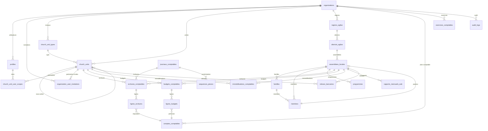

# 📘 BACKEND_REFERENCE.md — Référence Complète du Backend EAB

> [!CAUTION]
> **⚠️ LECTURE ET MISE À JOUR OBLIGATOIRES**
> Ce fichier est la **source de vérité unique** pour le backend Supabase du projet EAB.
> **Toute modification du backend** (tables, colonnes, RLS, fonctions, triggers, index, storage)
> **DOIT être reflétée ici AVANT de commiter.**
> Ne JAMAIS se fier uniquement aux fichiers de migration — ce document reflète l'état RÉEL.

- **Projet** : EAB (Église–Administration–Budget)
- **Backend** : Supabase (PostgreSQL)
- **Derniere mise a jour** : 2026-06-14
- **Fichiers de migration** : `supabase/migrations/00001` -> `00025`

---

## Table des matières

1. [Types / Enums](#1-types--enums)
2. [Tables — Structure ecclésiastique](#2-tables--structure-ecclésiastique)
3. [Tables — Comptabilité (SYCEBNL)](#3-tables--comptabilité-sycebnl)
4. [Tables — Améliorations (exercices, audit, séquences)](#4-tables--améliorations)
5. [Clés étrangères — Résumé](#5-clés-étrangères--résumé)
6. [Contraintes CHECK et UNIQUE](#6-contraintes-check-et-unique)
7. [Politiques RLS](#7-politiques-rls)
8. [Fonctions PostgreSQL](#8-fonctions-postgresql)
9. [Triggers](#9-triggers)
10. [Index](#10-index)
11. [Vues](#11-vues)
12. [Storage Buckets](#12-storage-buckets)
13. [Extensions](#13-extensions)
14. [Diagramme de dépendances](#14-diagramme-de-dépendances)
15. [Procedure de reconstruction et de deploiement](#15-procedure-de-reconstruction-et-de-deploiement)
16. [Journal des modifications](#16-journal-des-modifications)

---

## 1. Types / Enums

| Nom | Valeurs | Source |
| ----- | --------- | -------- |
| `gender` | `male`, `female` | 00001 |
| `statut_matrimonial` | `celibataire`, `marie`, `veuf`, `veuve`, `divorce`, `separe` | 00001 |
| `statut_fidele` | `actif`, `inactif`, `parti`, `decede`, `transfere` | 00001 |
| `role_fidele` | `membre`, `pasteur`, `ancien`, `diacre`, `diaconesse`, `evangeliste`, `autre_officier` | 00001 |
| `vulnerabilite_fidele` | `orphelin`, `veuf`, `veuve`, `handicape`, `troisieme_age`, `autre` | 00001 |
| `type_programme` | `culte`, `evangelisation_masse`, `evangelisation_porte_a_porte`, `baptemes`, `mains_association`, `sainte_cene`, `reunion_priere`, `mariage`, `discipline`, `visite`, `ecole_du_dimanche`, `autre` | 00001 |
| `type_visite` | `fidele`, `autorite`, `partenaire`, `autre_assemblee`, `autre` | 00001 |
| `role_utilisateur` | `admin_national`, `responsable_region`, `surintendant_district`, `tresorier_assemblee` | 00001 |
| `nature_compte` | `actif`, `passif`, `charge`, `produit`, `hors_activite_ordinaire`, `engagement`, `autre` | 00002 |
| `type_journal_comptable` | `caisse`, `banque`, `operations_diverses` | 00002 |
| `type_tiers` | `membre`, `fournisseur`, `bailleur`, `employe`, `partenaire`, `autre` | 00002 |
| `type_centre_analytique` | `assemblee_locale`, `projet`, `activite`, `departement`, `autre` | 00002 |
| `mode_paiement` | `especes`, `cheque`, `virement_bancaire`, `mobile_money`, `microfinance`, `autre` | 00002 |
| `type_immobilisation` | `terrain`, `batiment`, `mobilier`, `materiel_informatique`, `materiel_sono`, `vehicule`, `autre` | 00002 |
| `statut_ecriture` | `brouillon`, `validee`, `cloturee` | 00002 |
| `action_audit` | `INSERT`, `UPDATE`, `DELETE`, `SOFT_DELETE`, `LOGIN`, `LOGOUT`, `VALIDATION`, `CLOTURE` | 00007 |
| `statut_exercice` | `brouillon`, `ouvert`, `cloture` | 00008 |
| `fiscal_dossier_status` | `draft`, `in_progress`, `ready`, `locked`, `submitted` | 00011 |

---

## 2. Tables — Structure ecclésiastique

### 2.1 `organizations`

> Multi-tenancy. Chaque église/organisation a son espace isolé.

| Colonne | Type | Nullable | Défaut | Description |
| --------- | ------ | ---------- | -------- | ------------- |
| `id` | UUID | NON | `uuid_generate_v4()` | PK |
| `name` | TEXT | NON | — | Nom de l'organisation |
| `code` | TEXT | OUI | — | Code unique (UNIQUE) |
| `description` | TEXT | OUI | — | Description |
| `logo_url` | TEXT | OUI | — | URL du logo |
| `sigle` | TEXT | OUI | — | Sigle affiche dans l'interface |
| `couleur_primaire` | TEXT | OUI | — | Couleur principale de l'organisation |
| `couleur_secondaire` | TEXT | OUI | — | Couleur secondaire de l'organisation |
| `adresse` | TEXT | OUI | — | Adresse de contact |
| `telephone` | TEXT | OUI | — | Telephone de contact |
| `email` | TEXT | OUI | — | Email de contact |
| `site_web` | TEXT | OUI | — | Site web |
| `devise` | TEXT | NON | `'FCFA'` | Devise par defaut |
| `parametres` | JSONB | NON | `'{}'::jsonb` | Parametres libres de l'organisation |
| `created_at` | TIMESTAMPTZ | NON | `NOW()` | Date de création |
| `updated_at` | TIMESTAMPTZ | NON | `NOW()` | Dernière modification |

**RLS** : ✅ activé — **UNIQUE** : `code`

---

### 2.2 `profiles`

> Profil utilisateur avec rôle et périmètre d'accès. Lié à `auth.users`.

| Colonne | Type | Nullable | Défaut | Description |
| --------- | ------ | ---------- | -------- | ------------- |
| `id` | UUID | NON | — | PK, FK → `auth.users(id)` ON DELETE CASCADE |
| `organization_id` | UUID | OUI | — | FK → `organizations(id)` ON DELETE SET NULL |
| `full_name` | TEXT | NON | — | Nom complet |
| `role` | `role_utilisateur` | NON | `'tresorier_assemblee'` | Rôle utilisateur |
| `id_region` | UUID | OUI | — | FK → `regions_eglise(id)` ON DELETE SET NULL |
| `id_district` | UUID | OUI | — | FK → `districts_eglise(id)` ON DELETE SET NULL |
| `id_assemblee_locale` | UUID | OUI | — | FK → `assemblees_locales(id)` ON DELETE SET NULL |
| `primary_church_unit_id` | UUID | OUI | — | FK → `church_units(id)` ON DELETE SET NULL |
| `avatar_url` | TEXT | OUI | — | URL de l'avatar |
| `created_at` | TIMESTAMPTZ | NON | `NOW()` | — |
| `updated_at` | TIMESTAMPTZ | NON | `NOW()` | — |

**RLS** : ✅ activé

---

### 2.3 `regions_eglise`

> Régions ecclésiastiques au niveau national.

| Colonne | Type | Nullable | Défaut | Description |
| --------- | ------ | ---------- | -------- | ------------- |
| `id` | UUID | NON | `uuid_generate_v4()` | PK |
| `organization_id` | UUID | NON | — | FK → `organizations(id)` ON DELETE CASCADE |
| `nom` | TEXT | NON | — | Nom de la région |
| `code` | TEXT | OUI | — | Code région |
| `description` | TEXT | OUI | — | — |
| `created_at` | TIMESTAMPTZ | NON | `NOW()` | — |
| `updated_at` | TIMESTAMPTZ | NON | `NOW()` | — |

**RLS** : ✅ — **UNIQUE** : `(organization_id, code)`

---

### 2.4 `districts_eglise`

> Districts au sein d'une région.

| Colonne | Type | Nullable | Défaut | Description |
| --------- | ------ | ---------- | -------- | ------------- |
| `id` | UUID | NON | `uuid_generate_v4()` | PK |
| `organization_id` | UUID | NON | — | FK → `organizations(id)` ON DELETE CASCADE |
| `id_region` | UUID | NON | — | FK → `regions_eglise(id)` ON DELETE CASCADE |
| `nom` | TEXT | NON | — | Nom du district |
| `code` | TEXT | OUI | — | Code district |
| `description` | TEXT | OUI | — | — |
| `created_at` | TIMESTAMPTZ | NON | `NOW()` | — |
| `updated_at` | TIMESTAMPTZ | NON | `NOW()` | — |

**RLS** : ✅ — **UNIQUE** : `(organization_id, code)`

---

### 2.5 `assemblees_locales`

> Assemblées locales (églises locales).

| Colonne | Type | Nullable | Défaut | Description |
| --------- | ------ | ---------- | -------- | ------------- |
| `id` | UUID | NON | `uuid_generate_v4()` | PK |
| `organization_id` | UUID | NON | — | FK → `organizations(id)` ON DELETE CASCADE |
| `id_district` | UUID | NON | — | FK → `districts_eglise(id)` ON DELETE CASCADE |
| `nom` | TEXT | NON | — | Nom de l'assemblée |
| `code` | TEXT | OUI | — | Code assemblée |
| `ville` | TEXT | OUI | — | Ville |
| `quartier` | TEXT | OUI | — | Quartier |
| `adresse_postale` | TEXT | OUI | — | Adresse postale |
| `telephone` | TEXT | OUI | — | Téléphone |
| `email` | TEXT | OUI | — | Email |
| `id_fidele_pasteur_responsable` | UUID | OUI | — | FK → `membres(id)` ON DELETE SET NULL |
| `created_at` | TIMESTAMPTZ | NON | `NOW()` | — |
| `updated_at` | TIMESTAMPTZ | NON | `NOW()` | — |

**RLS** : ✅ — **UNIQUE** : `(organization_id, code)`

---

### 2.6 `church_unit_types`

> Niveaux de hierarchie configurables par organisation : organisation, region, district, eglise locale, departement, etc.

| Colonne | Type | Nullable | Defaut | Description |
| --------- | ------ | ---------- | -------- | ------------- |
| `id` | UUID | NON | `uuid_generate_v4()` | PK |
| `organization_id` | UUID | NON | — | FK → `organizations(id)` ON DELETE CASCADE |
| `code` | TEXT | NON | — | Code technique du niveau |
| `label` | TEXT | NON | — | Libelle visible |
| `level_order` | INTEGER | NON | `0` | Ordre hierarchique |
| `is_local` | BOOLEAN | NON | `FALSE` | Indique une eglise locale |
| `is_financial_scope` | BOOLEAN | NON | `FALSE` | Peut servir de perimetre comptable |
| `can_have_members` | BOOLEAN | NON | `FALSE` | Peut contenir des fideles |
| `created_at` | TIMESTAMPTZ | NON | `NOW()` | — |
| `updated_at` | TIMESTAMPTZ | NON | `NOW()` | — |

**RLS** : ✅ — **UNIQUE** : `(organization_id, code)`

---

### 2.7 `church_units`

> Noeuds generiques de structure. Permet une eglise unique ou une hierarchie multi-niveaux. Les donnees EAB historiques sont recopiees ici comme demo.

| Colonne | Type | Nullable | Defaut | Description |
| --------- | ------ | ---------- | -------- | ------------- |
| `id` | UUID | NON | `uuid_generate_v4()` | PK |
| `organization_id` | UUID | NON | — | FK → `organizations(id)` ON DELETE CASCADE |
| `type_id` | UUID | NON | — | FK → `church_unit_types(id)` ON DELETE RESTRICT |
| `parent_id` | UUID | OUI | — | FK recursive → `church_units(id)` ON DELETE CASCADE |
| `nom` | TEXT | NON | — | Nom de l'unite |
| `code` | TEXT | OUI | — | Code de l'unite |
| `description` | TEXT | OUI | — | Description |
| `ville` | TEXT | OUI | — | Ville |
| `quartier` | TEXT | OUI | — | Quartier |
| `adresse` | TEXT | OUI | — | Adresse |
| `telephone` | TEXT | OUI | — | Telephone |
| `email` | TEXT | OUI | — | Email |
| `active` | BOOLEAN | NON | `TRUE` | Unite active |
| `legacy_region_id` | UUID | OUI | — | Lien vers `regions_eglise(id)` pour migration progressive |
| `legacy_district_id` | UUID | OUI | — | Lien vers `districts_eglise(id)` pour migration progressive |
| `legacy_assemblee_id` | UUID | OUI | — | Lien vers `assemblees_locales(id)` pour migration progressive |
| `metadata` | JSONB | NON | `'{}'::jsonb` | Donnees libres |
| `created_at` | TIMESTAMPTZ | NON | `NOW()` | — |
| `updated_at` | TIMESTAMPTZ | NON | `NOW()` | — |

**RLS** : ✅ — **CHECK** : `parent_id IS NULL OR parent_id <> id`

---

### 2.8 `church_unit_user_scopes`

> Roles utilisateurs rattaches a un perimetre flexible.

| Colonne | Type | Nullable | Defaut | Description |
| --------- | ------ | ---------- | -------- | ------------- |
| `id` | UUID | NON | `uuid_generate_v4()` | PK |
| `organization_id` | UUID | NON | — | FK → `organizations(id)` ON DELETE CASCADE |
| `user_id` | UUID | NON | — | FK → `profiles(id)` ON DELETE CASCADE |
| `unit_id` | UUID | NON | — | FK → `church_units(id)` ON DELETE CASCADE |
| `role` | `role_utilisateur` | NON | — | Role sur ce perimetre |
| `can_manage_children` | BOOLEAN | NON | `FALSE` | Peut gerer les sous-unites |
| `created_at` | TIMESTAMPTZ | NON | `NOW()` | — |

**RLS** : ✅ — **UNIQUE** : `(user_id, unit_id, role)`

---

### 2.9 `organization_user_invitations`

> Invitations de sous-comptes rattachees a une organisation et, optionnellement, a un perimetre `church_units`.

| Colonne | Type | Nullable | Defaut | Description |
| --------- | ------ | ---------- | -------- | ------------- |
| `id` | UUID | NON | `uuid_generate_v4()` | PK |
| `organization_id` | UUID | NON | — | FK → `organizations(id)` ON DELETE CASCADE |
| `email` | TEXT | NON | — | Email invite, normalise en minuscules |
| `role` | `role_utilisateur` | NON | `'tresorier_assemblee'` | Role a appliquer au profil |
| `primary_church_unit_id` | UUID | OUI | — | FK → `church_units(id)` ON DELETE SET NULL |
| `can_manage_children` | BOOLEAN | NON | `FALSE` | Peut gerer les sous-unites du perimetre |
| `invited_by` | UUID | OUI | — | FK → `profiles(id)` ON DELETE SET NULL |
| `accepted_by` | UUID | OUI | — | FK → `profiles(id)` ON DELETE SET NULL |
| `accepted_at` / `revoked_at` | TIMESTAMPTZ | OUI | — | Cycle de vie de l'invitation |
| `expires_at` | TIMESTAMPTZ | NON | `NOW() + 14 days` | Expiration |
| `created_at` / `updated_at` | TIMESTAMPTZ | NON | `NOW()` | — |

**RLS** : ✅ — **UNIQUE partiel** : `(organization_id, email)` si invitation active.

---

### 2.10 `familles`

> Migration `00019` : ajout de `church_unit_id UUID REFERENCES church_units(id) ON DELETE SET NULL`.
> Ce champ est synchronise avec `id_assemblee_locale` quand l'unite flexible pointe vers une assemblee legacy.

> Familles de fidèles pour le suivi familial.

| Colonne | Type | Nullable | Défaut | Description |
| --------- | ------ | ---------- | -------- | ------------- |
| `id` | UUID | NON | `uuid_generate_v4()` | PK |
| `organization_id` | UUID | NON | — | FK → `organizations(id)` ON DELETE CASCADE |
| `id_assemblee_locale` | UUID | OUI | — | FK → `assemblees_locales(id)` ON DELETE SET NULL |
| `nom` | TEXT | NON | — | Nom de famille |
| `id_epoux` | UUID | OUI | — | FK → `membres(id)` ON DELETE SET NULL |
| `id_epouse` | UUID | OUI | — | FK → `membres(id)` ON DELETE SET NULL |
| `deleted_at` | TIMESTAMPTZ | OUI | — | Soft delete (00007) |
| `created_at` | TIMESTAMPTZ | NON | `NOW()` | — |
| `updated_at` | TIMESTAMPTZ | NON | `NOW()` | — |

**RLS** : ✅

---

### 2.11 `membres`

> Migration `00019` : ajout de `church_unit_id UUID REFERENCES church_units(id) ON DELETE SET NULL`.
> Le trigger `sync_member_church_unit_scope()` garde la compatibilite avec `id_assemblee_locale` pendant la migration progressive.

> Membres/fidèles de l'église avec toutes leurs informations.

| Colonne | Type | Nullable | Défaut | Description |
| --------- | ------ | ---------- | -------- | ------------- |
| `id` | UUID | NON | `uuid_generate_v4()` | PK |
| `organization_id` | UUID | NON | — | FK → `organizations(id)` ON DELETE CASCADE |
| `id_assemblee_locale` | UUID | OUI | — | FK → `assemblees_locales(id)` ON DELETE SET NULL |
| `id_famille` | UUID | OUI | — | FK → `familles(id)` ON DELETE SET NULL |
| `full_name` | TEXT | NON | — | Nom complet |
| `gender` | `gender` | NON | — | Genre |
| `date_naissance` | DATE | OUI | — | Date de naissance |
| `phone` | TEXT | OUI | — | Téléphone |
| `email` | TEXT | OUI | — | Email |
| `address` | TEXT | OUI | — | Adresse |
| `statut_matrimonial` | `statut_matrimonial` | OUI | — | Statut matrimonial |
| `date_conversion` | DATE | OUI | — | Date de conversion |
| `date_bapteme` | DATE | OUI | — | Date de baptême |
| `date_main_association` | DATE | OUI | — | Date main d'association |
| `statut` | `statut_fidele` | NON | `'actif'` | Statut du fidèle |
| `role` | `role_fidele` | NON | `'membre'` | Rôle dans l'église |
| `date_entree` | DATE | OUI | — | Date d'entrée |
| `date_sortie` | DATE | OUI | — | Date de sortie |
| `motif_sortie` | TEXT | OUI | — | Motif de sortie |
| `date_deces` | DATE | OUI | — | Date de décès |
| `vulnerabilites` | JSONB | OUI | `'[]'` | Liste des vulnérabilités |
| `photo_url` | TEXT | OUI | — | URL de la photo |
| `deleted_at` | TIMESTAMPTZ | OUI | — | Soft delete (00007) |
| `created_at` | TIMESTAMPTZ | NON | `NOW()` | — |
| `updated_at` | TIMESTAMPTZ | NON | `NOW()` | — |

**RLS** : ✅

---

### 2.12 `programmes`

> Migration `00020` : ajout de `church_unit_id UUID REFERENCES church_units(id) ON DELETE SET NULL`.
> Le trigger `sync_program_church_unit_scope()` garde la compatibilite avec `id_assemblee_locale` pendant la migration progressive.

> Activités et programmes de l'église (cultes, évangélisations, etc.).

| Colonne | Type | Nullable | Défaut | Description |
| --------- | ------ | ---------- | -------- | ------------- |
| `id` | UUID | NON | `uuid_generate_v4()` | PK |
| `organization_id` | UUID | NON | — | FK → `organizations(id)` ON DELETE CASCADE |
| `id_assemblee_locale` | UUID | OUI | — | FK → `assemblees_locales(id)` ON DELETE SET NULL |
| `type` | `type_programme` | NON | — | Type de programme |
| `date` | DATE | NON | — | Date du programme |
| `location` | TEXT | NON | — | Lieu |
| `description` | TEXT | OUI | — | Description |
| `observations` | TEXT | OUI | — | Observations |
| `participant_ids` | JSONB | OUI | `'[]'` | IDs des participants |
| `type_visite` | `type_visite` | OUI | — | Type de visite |
| `compte_rendu_visite` | TEXT | OUI | — | Compte rendu |
| `nombre_hommes` | INTEGER | OUI | `0` | Nb hommes présents |
| `nombre_femmes` | INTEGER | OUI | `0` | Nb femmes présentes |
| `nombre_garcons` | INTEGER | OUI | `0` | Nb garçons présents |
| `nombre_filles` | INTEGER | OUI | `0` | Nb filles présentes |
| `conversions_hommes` | INTEGER | OUI | `0` | Conversions hommes |
| `conversions_femmes` | INTEGER | OUI | `0` | Conversions femmes |
| `conversions_garcons` | INTEGER | OUI | `0` | Conversions garçons |
| `conversions_filles` | INTEGER | OUI | `0` | Conversions filles |
| `nombre_classes_ecole_dimanche` | INTEGER | OUI | `0` | Nb classes école dimanche |
| `nombre_moniteurs_hommes` | INTEGER | OUI | `0` | Nb moniteurs hommes |
| `nombre_monitrices_femmes` | INTEGER | OUI | `0` | Nb monitrices femmes |
| `derniere_lecon_ecole_dimanche` | TEXT | OUI | — | Dernière leçon |
| `deleted_at` | TIMESTAMPTZ | OUI | — | Soft delete (00007) |
| `created_at` | TIMESTAMPTZ | NON | `NOW()` | — |
| `updated_at` | TIMESTAMPTZ | NON | `NOW()` | — |

**RLS** : ✅

---

## 3. Tables — Comptabilité (SYCEBNL)

### 3.1 `comptes_comptables`

> Plan comptable conforme SYCEBNL.

| Colonne | Type | Nullable | Défaut | Description |
| --------- | ------ | ---------- | -------- | ------------- |
| `id` | UUID | NON | `uuid_generate_v4()` | PK |
| `organization_id` | UUID | NON | — | FK → `organizations(id)` CASCADE |
| `numero` | TEXT | NON | — | Numéro du compte (ex: "5121") |
| `intitule` | TEXT | NON | — | Libellé du compte |
| `nature` | `nature_compte` | NON | — | Nature comptable |
| `niveau` | INTEGER | OUI | `1` | 1=classe, 2=compte, 3=sous-compte |
| `id_compte_parent` | UUID | OUI | — | FK → `comptes_comptables(id)` SET NULL |
| `actif` | BOOLEAN | NON | `TRUE` | Compte actif |
| `created_at` / `updated_at` | TIMESTAMPTZ | NON | `NOW()` | — |

**RLS** : ✅ — **UNIQUE** : `(organization_id, numero)`

---

### 3.2 `journaux_comptables`

> Journaux comptables (caisse, banque, OD).

| Colonne | Type | Nullable | Défaut | Description |
| --------- | ------ | ---------- | -------- | ------------- |
| `id` | UUID | NON | `uuid_generate_v4()` | PK |
| `organization_id` | UUID | NON | — | FK → `organizations(id)` CASCADE |
| `code` | TEXT | NON | — | Code journal (ex: "CAI", "BAN") |
| `intitule` | TEXT | NON | — | Libellé |
| `type` | `type_journal_comptable` | NON | — | Type de journal |
| `actif` | BOOLEAN | NON | `TRUE` | Journal actif |
| `created_at` / `updated_at` | TIMESTAMPTZ | NON | `NOW()` | — |

**RLS** : ✅ — **UNIQUE** : `(organization_id, code)`

---

### 3.3 `centres_analytiques`

> Centres analytiques pour la comptabilité analytique.

| Colonne | Type | Nullable | Défaut | Description |
| --------- | ------ | ---------- | -------- | ------------- |
| `id` | UUID | NON | `uuid_generate_v4()` | PK |
| `organization_id` | UUID | NON | — | FK → `organizations(id)` CASCADE |
| `id_assemblee_locale` | UUID | OUI | — | FK → `assemblees_locales(id)` SET NULL |
| `church_unit_id` | UUID | OUI | — | FK -> `church_units(id)` SET NULL |
| `code` | TEXT | NON | — | Code centre |
| `nom` | TEXT | NON | — | Nom |
| `type` | `type_centre_analytique` | NON | — | Type |
| `description` | TEXT | OUI | — | — |
| `actif` | BOOLEAN | NON | `TRUE` | Centre actif |
| `created_at` / `updated_at` | TIMESTAMPTZ | NON | `NOW()` | — |

**RLS** : ✅ — **UNIQUE** : `(organization_id, code)`

---

### 3.4 `tiers`

> Fournisseurs, bailleurs, partenaires et autres tiers.

| Colonne | Type | Nullable | Défaut | Description |
| --------- | ------ | ---------- | -------- | ------------- |
| `id` | UUID | NON | `uuid_generate_v4()` | PK |
| `organization_id` | UUID | NON | — | FK → `organizations(id)` CASCADE |
| `id_assemblee_locale` | UUID | OUI | — | FK → `assemblees_locales(id)` SET NULL |
| `church_unit_id` | UUID | OUI | — | FK -> `church_units(id)` SET NULL |
| `id_fidele_lie` | UUID | OUI | — | FK → `membres(id)` SET NULL |
| `nom` | TEXT | NON | — | Nom du tiers |
| `type` | `type_tiers` | NON | — | Type de tiers |
| `telephone` / `email` / `adresse` | TEXT | OUI | — | Contact |
| `deleted_at` | TIMESTAMPTZ | OUI | — | Soft delete (00007) |
| `created_at` / `updated_at` | TIMESTAMPTZ | NON | `NOW()` | — |

**RLS** : ✅

---

### 3.5 `ecritures_comptables`

> En-têtes des écritures comptables.

| Colonne | Type | Nullable | Défaut | Description |
| --------- | ------ | ---------- | -------- | ------------- |
| `id` | UUID | NON | `uuid_generate_v4()` | PK |
| `organization_id` | UUID | NON | — | FK → `organizations(id)` CASCADE |
| `id_assemblee_locale` | UUID | OUI | — | FK → `assemblees_locales(id)` SET NULL |
| `church_unit_id` | UUID | OUI | — | FK -> `church_units(id)` SET NULL |
| `id_journal` | UUID | NON | — | FK → `journaux_comptables(id)` **RESTRICT** |
| `id_centre_analytique_principal` | UUID | OUI | — | FK → `centres_analytiques(id)` SET NULL |
| `date` | DATE | NON | — | Date de l'écriture |
| `reference_piece` | TEXT | OUI | — | Réf. pièce justificative |
| `libelle` | TEXT | NON | — | Libellé |
| `statut` | `statut_ecriture` | NON | `'brouillon'` | Statut |
| `piece_justificative_url` | TEXT | OUI | — | URL vers Storage |
| `created_by` | UUID | OUI | — | FK → `profiles(id)` SET NULL |
| `validated_by` | UUID | OUI | — | FK → `profiles(id)` SET NULL |
| `validated_at` | TIMESTAMPTZ | OUI | — | Date validation |
| `deleted_at` | TIMESTAMPTZ | OUI | — | Soft delete (00007) |
| `created_at` / `updated_at` | TIMESTAMPTZ | NON | `NOW()` | — |

**RLS** : ✅

---

### 3.6 `lignes_ecritures`

> Lignes débit/crédit des écritures comptables.

| Colonne | Type | Nullable | Défaut | Description |
| --------- | ------ | ---------- | -------- | ------------- |
| `id` | UUID | NON | `uuid_generate_v4()` | PK |
| `id_ecriture` | UUID | NON | — | FK → `ecritures_comptables(id)` CASCADE |
| `id_compte_comptable` | UUID | NON | — | FK → `comptes_comptables(id)` **RESTRICT** |
| `id_centre_analytique` | UUID | OUI | — | FK → `centres_analytiques(id)` SET NULL |
| `id_tiers` | UUID | OUI | — | FK → `tiers(id)` SET NULL |
| `libelle` | TEXT | OUI | — | Libellé de la ligne |
| `debit` | DECIMAL(15,2) | OUI | `0` | Montant débit |
| `credit` | DECIMAL(15,2) | OUI | `0` | Montant crédit |
| `mode_paiement` | `mode_paiement` | OUI | — | Mode de paiement |
| `created_at` / `updated_at` | TIMESTAMPTZ | NON | `NOW()` | — |

**RLS** : ✅ — **CHECK** : `(debit>0 AND credit=0) OR (debit=0 AND credit>0) OR (debit=0 AND credit=0)`

---

### 3.7 `budgets_comptables`

> Budgets par exercice et périmètre.

| Colonne | Type | Nullable | Défaut | Description |
| --------- | ------ | ---------- | -------- | ------------- |
| `id` | UUID | NON | `uuid_generate_v4()` | PK |
| `organization_id` | UUID | NON | — | FK → `organizations(id)` CASCADE |
| `id_assemblee_locale` | UUID | OUI | — | FK → `assemblees_locales(id)` SET NULL |
| `church_unit_id` | UUID | OUI | — | FK -> `church_units(id)` SET NULL |
| `id_centre_analytique` | UUID | OUI | — | FK → `centres_analytiques(id)` SET NULL |
| `id_tiers_bailleur` | UUID | OUI | — | FK → `tiers(id)` SET NULL |
| `exercice` | INTEGER | NON | — | Année budgétaire |
| `libelle` | TEXT | OUI | — | Libellé |
| `est_verrouille` | BOOLEAN | NON | `FALSE` | Budget verrouillé |
| `deleted_at` | TIMESTAMPTZ | OUI | — | Soft delete (00007) |
| `created_at` / `updated_at` | TIMESTAMPTZ | NON | `NOW()` | — |

**RLS** : ✅ — **UNIQUE** : `(organization_id, exercice, id_assemblee_locale, id_centre_analytique)` + `(organization_id, exercice, church_unit_id, id_centre_analytique)` si `church_unit_id IS NOT NULL`

---

### 3.8 `lignes_budgets`

> Détail des lignes budgétaires par compte.

| Colonne | Type | Nullable | Défaut | Description |
| --------- | ------ | ---------- | -------- | ------------- |
| `id` | UUID | NON | `uuid_generate_v4()` | PK |
| `id_budget` | UUID | NON | — | FK → `budgets_comptables(id)` CASCADE |
| `id_compte_comptable` | UUID | NON | — | FK → `comptes_comptables(id)` **RESTRICT** |
| `montant_prevu` | DECIMAL(15,2) | NON | `0` | Montant prévu |
| `montant_revu` | DECIMAL(15,2) | OUI | — | Montant révisé |
| `created_at` / `updated_at` | TIMESTAMPTZ | NON | `NOW()` | — |

**RLS** : ✅ — **UNIQUE** : `(id_budget, id_compte_comptable)`

---

### 3.9 `immobilisations_comptables`

> Actifs immobilisés avec suivi des amortissements.

| Colonne | Type | Nullable | Défaut | Description |
| --------- | ------ | ---------- | -------- | ------------- |
| `id` | UUID | NON | `uuid_generate_v4()` | PK |
| `organization_id` | UUID | NON | — | FK CASCADE |
| `id_assemblee_locale` | UUID | OUI | — | FK SET NULL |
| `church_unit_id` | UUID | OUI | — | FK -> `church_units(id)` SET NULL |
| `id_centre_analytique` | UUID | OUI | — | FK SET NULL |
| `libelle` | TEXT | NON | — | Libellé |
| `type` | `type_immobilisation` | NON | — | Type |
| `date_acquisition` | DATE | NON | — | Date d'acquisition |
| `valeur_acquisition` | DECIMAL(15,2) | NON | — | Valeur d'acquisition |
| `valeur_residuelle` | DECIMAL(15,2) | OUI | — | Valeur résiduelle |
| `duree_utilite_en_annees` | INTEGER | NON | — | Durée d'utilité |
| `id_compte_immobilisation` | UUID | OUI | — | FK → `comptes_comptables` **RESTRICT** |
| `id_compte_amortissement` | UUID | OUI | — | FK → `comptes_comptables` SET NULL |
| `id_compte_dotation` | UUID | OUI | — | FK → `comptes_comptables` SET NULL |
| `est_sortie` | BOOLEAN | NON | `FALSE` | Bien sorti |
| `date_sortie` | DATE | OUI | — | Date de sortie |
| `valeur_cession` | DECIMAL(15,2) | OUI | — | Valeur de cession |
| `deleted_at` | TIMESTAMPTZ | OUI | — | Soft delete (00007) |
| `created_at` / `updated_at` | TIMESTAMPTZ | NON | `NOW()` | — |

**RLS** : ✅

---

### 3.10 `rapports_mensuels_eab`

> Rapports mensuels consolides par unite/perimetre d'eglise.

| Colonne | Type | Nullable | Défaut | Description |
| --------- | ------ | ---------- | -------- | ------------- |
| `id` | UUID | NON | `uuid_generate_v4()` | PK |
| `organization_id` | UUID | NON | — | FK CASCADE |
| `id_assemblee_locale` | UUID | OUI | — | FK CASCADE legacy |
| `church_unit_id` | UUID | OUI | — | FK -> `church_units(id)` SET NULL |
| `annee` | INTEGER | NON | — | Année |
| `mois` | INTEGER | NON | — | Mois (CHECK 1-12) |
| `stats_membres` | JSONB | NON | `'{}'` | Stats membres |
| `stats_activites` | JSONB | NON | `'{}'` | Stats activités |
| `stats_finances` | JSONB | NON | `'{}'` | Stats finances |
| `resume_activites` | TEXT | OUI | — | Résumé |
| `projets_realisations` | TEXT | OUI | — | Projets réalisés |
| `projets_mois_suivant` | TEXT | OUI | — | Projets à venir |
| `observations` | TEXT | OUI | — | Observations |
| `created_at` / `updated_at` | TIMESTAMPTZ | NON | `NOW()` | — |

> Migration `00021` : ajout de `church_unit_id UUID REFERENCES church_units(id) ON DELETE SET NULL`.
> `id_assemblee_locale` devient nullable pour permettre des rapports sur une eglise unique, une region, un district ou tout autre niveau configure.

**RLS** : ✅ — **UNIQUE** : `(organization_id, id_assemblee_locale, annee, mois)` + `(organization_id, church_unit_id, annee, mois)` si `church_unit_id IS NOT NULL` — **CHECK** : `mois >= 1 AND mois <= 12`

---

### 3.11 `releves_bancaires`

> Relevés bancaires pour rapprochement.

| Colonne | Type | Nullable | Défaut | Description |
| --------- | ------ | ---------- | -------- | ------------- |
| `id` | UUID | NON | `uuid_generate_v4()` | PK |
| `organization_id` | UUID | NON | — | FK CASCADE |
| `id_assemblee_locale` | UUID | OUI | — | FK SET NULL |
| `church_unit_id` | UUID | OUI | — | FK -> `church_units(id)` SET NULL |
| `id_journal_banque` | UUID | OUI | — | FK → `journaux_comptables(id)` **RESTRICT** |
| `date_releve` | DATE | NON | — | Date du relevé |
| `solde_initial` | DECIMAL(15,2) | NON | `0` | Solde initial |
| `solde_final` | DECIMAL(15,2) | NON | `0` | Solde final |
| `fichier_url` | TEXT | OUI | — | URL du fichier |
| `created_at` / `updated_at` | TIMESTAMPTZ | NON | `NOW()` | — |

> Migration `00022` : ajout de `church_unit_id UUID REFERENCES church_units(id) ON DELETE SET NULL`
> sur `centres_analytiques`, `tiers`, `ecritures_comptables`, `budgets_comptables`,
> `immobilisations_comptables` et `releves_bancaires`.
> Les anciennes colonnes `id_assemblee_locale` restent en place pendant la transition.

**RLS** : ✅

---

## 4. Tables — Améliorations

### 4.1 `exercices_comptables`

> Exercices comptables pour la gestion des périodes comptables.

| Colonne | Type | Nullable | Défaut | Description |
| --------- | ------ | ---------- | -------- | ------------- |
| `id` | UUID | NON | `uuid_generate_v4()` | PK |
| `organization_id` | UUID | NON | — | FK → `organizations(id)` CASCADE |
| `annee` | INTEGER | NON | — | Année de l'exercice |
| `date_debut` | DATE | NON | — | Début exercice |
| `date_fin` | DATE | NON | — | Fin exercice |
| `libelle` | TEXT | OUI | — | Libellé |
| `statut` | `statut_exercice` | NON | `'brouillon'` | Statut (brouillon/ouvert/cloture) |
| `est_ouvert` | BOOLEAN | NON | `TRUE` | Exercice ouvert (legacy) |
| `est_cloture` | BOOLEAN | NON | `FALSE` | Exercice clôturé (legacy) |
| `cloture_par` | UUID | OUI | — | FK → `profiles(id)` SET NULL |
| `cloture_at` | TIMESTAMPTZ | OUI | — | Date de clôture |
| `opening_entry_id` | UUID | OUI | — | FK → `ecritures_comptables(id)` SET NULL |
| `closing_entry_id` | UUID | OUI | — | FK → `ecritures_comptables(id)` SET NULL |
| `deleted_at` | TIMESTAMPTZ | OUI | — | Soft delete |
| `created_at` / `updated_at` | TIMESTAMPTZ | NON | `NOW()` | — |

**RLS** : ✅ — **UNIQUE** : `(organization_id, annee)` — **CHECK** : `date_debut <= date_fin` — **Index partiel** : 1 exercice ouvert max par org

---

### 4.2 `sequences_pieces`

> Numérotation automatique des pièces comptables par journal et exercice.

| Colonne | Type | Nullable | Défaut | Description |
| --------- | ------ | ---------- | -------- | ------------- |
| `id` | UUID | NON | `uuid_generate_v4()` | PK |
| `organization_id` | UUID | NON | — | FK → `organizations(id)` CASCADE |
| `id_journal` | UUID | NON | — | FK → `journaux_comptables(id)` CASCADE |
| `exercice` | INTEGER | NON | — | Exercice lié |
| `dernier_numero` | INTEGER | NON | `0` | Dernier numéro utilisé |
| `prefixe` | TEXT | OUI | — | Préfixe (ex: "CAI-2025-") |
| `created_at` / `updated_at` | TIMESTAMPTZ | NON | `NOW()` | — |

**RLS** : ✅ — **UNIQUE** : `(organization_id, id_journal, exercice)`

---

### 4.3 `audit_logs`

> Journal d'audit pour tracer toutes les actions importantes.

| Colonne | Type | Nullable | Défaut | Description |
| --------- | ------ | ---------- | -------- | ------------- |
| `id` | UUID | NON | `uuid_generate_v4()` | PK |
| `organization_id` | UUID | OUI | — | FK → `organizations(id)` SET NULL |
| `user_id` | UUID | OUI | — | FK → `auth.users(id)` SET NULL |
| `user_email` | TEXT | OUI | — | Email capturé |
| `user_role` | TEXT | OUI | — | Rôle capturé |
| `action` | `action_audit` | NON | — | Type d'action |
| `table_name` | TEXT | OUI | — | Table concernée |
| `record_id` | UUID | OUI | — | ID de l'enregistrement |
| `old_data` | JSONB | OUI | — | Données avant |
| `new_data` | JSONB | OUI | — | Données après |
| `changes` | JSONB | OUI | — | Résumé des changements |
| `ip_address` | INET | OUI | — | Adresse IP |
| `user_agent` | TEXT | OUI | — | User agent |
| `created_at` | TIMESTAMPTZ | NON | `NOW()` | — |

**RLS** : ✅ (admins uniquement en lecture)

---

## 4bis. Tables — Dossier Fiscal SYSCEBNL (00011)

### 4bis.1 `fiscal_templates`

> Templates fiscaux versionnés (globaux, read-only pour utilisateurs).

| Colonne | Type | Nullable | Défaut | Description |
| --------- | ------ | ---------- | -------- | ------------- |
| `id` | UUID | NON | `uuid_generate_v4()` | PK |
| `code` | TEXT | NON | — | Code unique (ex: `SYSCEBNL_2026`) |
| `label` | TEXT | NON | — | Libellé |
| `version` | INTEGER | NON | `1` | Version du template |
| `is_active` | BOOLEAN | NON | `TRUE` | Template actif |
| `created_at` | TIMESTAMPTZ | NON | `NOW()` | — |

**RLS** : ✅ — **UNIQUE** : `code` — **Policy** : SELECT pour `authenticated`

---

### 4bis.2 `fiscal_template_pages`

> Pages ordonnées d'un template fiscal (COVER, BILAN_ACTIF, etc.).

| Colonne | Type | Nullable | Défaut | Description |
| --------- | ------ | ---------- | -------- | ------------- |
| `id` | UUID | NON | `uuid_generate_v4()` | PK |
| `template_id` | UUID | NON | — | FK → `fiscal_templates(id)` CASCADE |
| `code` | TEXT | NON | — | Code page (ex: BILAN_ACTIF) |
| `title` | TEXT | NON | — | Titre affiché |
| `page_order` | INTEGER | NON | — | Ordre d'affichage/impression |
| `layout` | JSONB | NON | `'{}'` | Colonnes, widths, styles |
| `rules` | JSONB | NON | `'{}'` | Validations page-level |
| `created_at` | TIMESTAMPTZ | NON | `NOW()` | — |

**RLS** : ✅ — **UNIQUE** : `(template_id, code)`, `(template_id, page_order)`

---

### 4bis.3 `fiscal_template_fields`

> Champs typés de chaque page template.

| Colonne | Type | Nullable | Défaut | Description |
| --------- | ------ | ---------- | -------- | ------------- |
| `id` | UUID | NON | `uuid_generate_v4()` | PK |
| `page_id` | UUID | NON | — | FK → `fiscal_template_pages(id)` CASCADE |
| `field_key` | TEXT | NON | — | Clé (ex: `bilan.actif.total`) |
| `label` | TEXT | NON | — | Label affiché |
| `field_type` | TEXT | NON | — | Type : money/text/date/select/bool/percent/integer |
| `field_order` | INTEGER | NON | `0` | Ordre dans la page |
| `section` | TEXT | OUI | — | Sous-section de regroupement |
| `required` | BOOLEAN | NON | `FALSE` | Champ obligatoire |
| `default_value` | JSONB | OUI | — | Valeur par défaut |
| `compute` | JSONB | OUI | — | Formule ou mapping compta |
| `ui` | JSONB | NON | `'{}'` | Placeholder, hint, mask |
| `created_at` | TIMESTAMPTZ | NON | `NOW()` | — |

**RLS** : ✅ — **UNIQUE** : `(page_id, field_key)` — **CHECK** : `field_type IN ('money','text','date','select','bool','percent','integer')`

---

### 4bis.4 `fiscal_account_mapping`

> Règles de mapping comptes comptables → champs fiscaux pour pré-remplissage.

| Colonne | Type | Nullable | Défaut | Description |
| --------- | ------ | ---------- | -------- | ------------- |
| `id` | UUID | NON | `uuid_generate_v4()` | PK |
| `template_id` | UUID | NON | — | FK → `fiscal_templates(id)` CASCADE |
| `field_key` | TEXT | NON | — | Clé du champ cible |
| `rule_type` | TEXT | NON | — | Type : sum_prefixes/sum_accounts/balance_class/custom_sql |
| `params` | JSONB | NON | `'{}'` | Paramètres de la règle |
| `created_at` | TIMESTAMPTZ | NON | `NOW()` | — |

**RLS** : ✅ — **UNIQUE** : `(template_id, field_key)` — **CHECK** : `rule_type IN ('sum_prefixes','sum_accounts','balance_class','custom_sql')`

---

### 4bis.5 `fiscal_dossiers`

> Dossiers fiscaux par organisation. Cycle : draft → in_progress → ready → locked → submitted.

| Colonne | Type | Nullable | Défaut | Description |
| --------- | ------ | ---------- | -------- | ------------- |
| `id` | UUID | NON | `uuid_generate_v4()` | PK |
| `organization_id` | UUID | NON | — | FK → `organizations(id)` CASCADE |
| `template_id` | UUID | NON | — | FK → `fiscal_templates(id)` |
| `exercice_id` | UUID | OUI | — | FK → `exercices_comptables(id)` |
| `import_id` | UUID | OUI | — | FK → `imported_trial_balances(id)` SET NULL |
| `status` | `fiscal_dossier_status` | NON | `'draft'` | Statut du dossier |
| `label` | TEXT | OUI | — | Libellé |
| `notes` | TEXT | OUI | — | Notes |
| `created_by` | UUID | OUI | — | FK → `auth.users(id)` |
| `locked_by` | UUID | OUI | — | FK → `auth.users(id)` |
| `locked_at` | TIMESTAMPTZ | OUI | — | Date de verrouillage |
| `created_at` / `updated_at` | TIMESTAMPTZ | NON | `NOW()` | — |

**RLS** : ✅ — isolation par `organization_id`. UPDATE bloqué si `status IN ('locked','submitted')`. DELETE seulement si `status = 'draft'`.

---

### 4bis.6 `fiscal_dossier_values`

> Valeurs des champs du dossier fiscal (manuelles, calculées ou importées).

| Colonne | Type | Nullable | Défaut | Description |
| --------- | ------ | ---------- | -------- | ------------- |
| `id` | UUID | NON | `uuid_generate_v4()` | PK |
| `dossier_id` | UUID | NON | — | FK → `fiscal_dossiers(id)` CASCADE |
| `organization_id` | UUID | NON | — | FK → `organizations(id)` CASCADE |
| `field_key` | TEXT | NON | — | Clé du champ |
| `value` | JSONB | OUI | — | Valeur stockée |
| `source` | TEXT | NON | `'manual'` | Source : manual/computed/imported |
| `updated_by` | UUID | OUI | — | FK → `auth.users(id)` |
| `updated_at` | TIMESTAMPTZ | NON | `NOW()` | — |

**RLS** : ✅ — **UNIQUE** : `(dossier_id, field_key)` — **CHECK** : `source IN ('manual','computed','imported')`

---

### 4bis.7 `imported_trial_balances`

> En-têtes de balances CSV importées (mode "sans historique").

| Colonne | Type | Nullable | Défaut | Description |
| --------- | ------ | ---------- | -------- | ------------- |
| `id` | UUID | NON | `uuid_generate_v4()` | PK |
| `organization_id` | UUID | NON | — | FK → `organizations(id)` CASCADE |
| `exercice_label` | TEXT | OUI | — | Libellé exercice |
| `filename` | TEXT | OUI | — | Nom du fichier importé |
| `total_debit` | DECIMAL(15,2) | NON | `0` | Total débits |
| `total_credit` | DECIMAL(15,2) | NON | `0` | Total crédits |
| `line_count` | INTEGER | NON | `0` | Nombre de lignes |
| `created_by` | UUID | OUI | — | FK → `auth.users(id)` |
| `created_at` | TIMESTAMPTZ | NON | `NOW()` | — |

**RLS** : ✅ — isolation par `organization_id`

---

### 4bis.8 `imported_trial_balance_lines`

> Lignes individuelles d'une balance importée.

| Colonne | Type | Nullable | Défaut | Description |
| --------- | ------ | ---------- | -------- | ------------- |
| `id` | UUID | NON | `uuid_generate_v4()` | PK |
| `import_id` | UUID | NON | — | FK → `imported_trial_balances(id)` CASCADE |
| `organization_id` | UUID | NON | — | FK → `organizations(id)` CASCADE |
| `account_number` | TEXT | NON | — | Numéro de compte |
| `account_label` | TEXT | OUI | — | Libellé du compte |
| `debit` | DECIMAL(15,2) | NON | `0` | Montant débit |
| `credit` | DECIMAL(15,2) | NON | `0` | Montant crédit |
| `solde` | DECIMAL(15,2) | OUI | — | Solde calculé |
| `created_at` | TIMESTAMPTZ | NON | `NOW()` | — |

**RLS** : ✅ — isolation par `organization_id`

---

## 5. Clés étrangères — Résumé

Toutes les tables ont `id UUID PRIMARY KEY DEFAULT uuid_generate_v4()`, sauf `profiles` (`id UUID PK REFERENCES auth.users(id)`).

| Source | Colonne | → Cible | ON DELETE |
| -------- | --------- | --------- | ----------- |
| `profiles` | `id` | `auth.users(id)` | CASCADE |
| `profiles` | `organization_id` | `organizations(id)` | SET NULL |
| `profiles` | `id_region` | `regions_eglise(id)` | SET NULL |
| `profiles` | `id_district` | `districts_eglise(id)` | SET NULL |
| `profiles` | `id_assemblee_locale` | `assemblees_locales(id)` | SET NULL |
| `profiles` | `primary_church_unit_id` | `church_units(id)` | SET NULL |
| `church_unit_types` | `organization_id` | `organizations(id)` | CASCADE |
| `church_units` | `organization_id` | `organizations(id)` | CASCADE |
| `church_units` | `type_id` | `church_unit_types(id)` | RESTRICT |
| `church_units` | `parent_id` | `church_units(id)` | CASCADE |
| `church_unit_user_scopes` | `organization_id` | `organizations(id)` | CASCADE |
| `church_unit_user_scopes` | `user_id` | `profiles(id)` | CASCADE |
| `church_unit_user_scopes` | `unit_id` | `church_units(id)` | CASCADE |
| `districts_eglise` | `id_region` | `regions_eglise(id)` | CASCADE |
| `assemblees_locales` | `id_district` | `districts_eglise(id)` | CASCADE |
| `assemblees_locales` | `id_fidele_pasteur_responsable` | `membres(id)` | SET NULL |
| `familles` | `id_epoux` / `id_epouse` | `membres(id)` | SET NULL |
| `membres` | `id_famille` | `familles(id)` | SET NULL |
| `ecritures_comptables` | `id_journal` | `journaux_comptables(id)` | **RESTRICT** |
| `lignes_ecritures` | `id_ecriture` | `ecritures_comptables(id)` | CASCADE |
| `lignes_ecritures` | `id_compte_comptable` | `comptes_comptables(id)` | **RESTRICT** |
| `lignes_budgets` | `id_budget` | `budgets_comptables(id)` | CASCADE |
| `lignes_budgets` | `id_compte_comptable` | `comptes_comptables(id)` | **RESTRICT** |
| `immobilisations_comptables` | `id_compte_immobilisation` | `comptes_comptables(id)` | **RESTRICT** |
| `sequences_pieces` | `id_journal` | `journaux_comptables(id)` | CASCADE |
| `audit_logs` | `user_id` | `auth.users(id)` | SET NULL |

> **Note** : Toutes les tables (sauf `lignes_*`, `audit_logs`, `sequences_pieces`) ont une FK `organization_id → organizations(id)` ON DELETE CASCADE.

---

## 6. Contraintes CHECK et UNIQUE

| Table | Type | Expression |
| ------- | ------ | ------------ |
| `organizations` | UNIQUE | `code` |
| `church_unit_types` | UNIQUE | `(organization_id, code)` |
| `church_units` | CHECK | `parent_id IS NULL OR parent_id <> id` |
| `church_units` | UNIQUE INDEX | `(organization_id, type_id, code)` si `code IS NOT NULL` |
| `church_unit_user_scopes` | UNIQUE | `(user_id, unit_id, role)` |
| `organization_user_invitations` | UNIQUE INDEX | `(organization_id, email)` si invitation active |
| `organization_user_invitations` | CHECK | `email = lower(trim(email))` et contient `@` |
| `regions_eglise` | UNIQUE | `(organization_id, code)` |
| `districts_eglise` | UNIQUE | `(organization_id, code)` |
| `assemblees_locales` | UNIQUE | `(organization_id, code)` |
| `comptes_comptables` | UNIQUE | `(organization_id, numero)` |
| `journaux_comptables` | UNIQUE | `(organization_id, code)` |
| `centres_analytiques` | UNIQUE | `(organization_id, code)` |
| `lignes_ecritures` | CHECK | `(debit>0 AND credit=0) OR (debit=0 AND credit>0) OR (debit=0 AND credit=0)` |
| `budgets_comptables` | UNIQUE | `(organization_id, exercice, id_assemblee_locale, id_centre_analytique)` |
| `budgets_comptables` | UNIQUE INDEX | `(organization_id, exercice, church_unit_id, id_centre_analytique)` si `church_unit_id IS NOT NULL` |
| `lignes_budgets` | UNIQUE | `(id_budget, id_compte_comptable)` |
| `rapports_mensuels_eab` | CHECK | `mois >= 1 AND mois <= 12` |
| `rapports_mensuels_eab` | UNIQUE | `(organization_id, id_assemblee_locale, annee, mois)` |
| `rapports_mensuels_eab` | UNIQUE INDEX | `(organization_id, church_unit_id, annee, mois)` si `church_unit_id IS NOT NULL` |
| `exercices_comptables` | UNIQUE | `(organization_id, annee)` |
| `sequences_pieces` | UNIQUE | `(organization_id, id_journal, exercice)` |

---

## 7. Politiques RLS

> RLS est active sur toutes les tables metier multi-tenant, y compris les tables de hierarchie flexible ajoutees en `00018`. Toutes les fonctions helper sont `SECURITY DEFINER STABLE`.

### Fonctions helper RLS

> Migration `00019` ajoute `user_has_church_unit_access(UUID)` pour verifier les perimetres `church_units`,
> en tenant compte de `profiles.primary_church_unit_id`, de `church_unit_user_scopes`
> et des descendants via `get_church_unit_descendants(UUID)`.

| Fonction | Retour | Description |
| ---------- | -------- | ------------- |
| `get_user_organization_id()` | UUID | `organization_id` du profil courant |
| `get_user_role()` | `role_utilisateur` | Rôle du profil courant |
| `get_user_region_id()` | UUID | `id_region` du profil courant |
| `get_user_district_id()` | UUID | `id_district` du profil courant |
| `get_user_assemblee_id()` | UUID | `id_assemblee_locale` du profil courant |
| `user_has_region_access(UUID)` | BOOLEAN | Vérifie accès à une région |
| `user_has_district_access(UUID)` | BOOLEAN | Vérifie accès à un district |
| `user_has_assemblee_access(UUID)` | BOOLEAN | Vérifie accès à une assemblée |

### Récapitulatif par table

| Table | SELECT | Mutations | Logique |
| ------- | -------- | ----------- | --------- |
| `organizations` | Propre org | Admin national | Isolation org |
| `profiles` | Même org | Propre profil / Admin | Multi-niveau |
| `church_unit_types` | Même org | Admin national | Configuration niveaux |
| `church_units` | Même org | Admin national | Hierarchie flexible |
| `church_unit_user_scopes` | Même org | Admin national | Perimetres utilisateurs |
| `organization_user_invitations` | Admin national propre org | Admin national propre org | Sous-comptes |
| `regions_eglise` | Même org | Admin / Resp. région (propre) | Hiérarchique |
| `districts_eglise` | Même org | Admin / Resp. région | Hiérarchique |
| `assemblees_locales` | Même org | Admin / Resp. / Surint. / Trés. | Hiérarchique |
| `membres` | Org + `user_has_church_unit_access` / assemblee legacy | Idem | Acces hybride unite/assemblee |
| `familles` | Org + `user_has_church_unit_access` / assemblee legacy | Idem | Acces hybride unite/assemblee |
| `programmes` | Org + `user_has_church_unit_access` / assemblee legacy | Idem | Acces hybride unite/assemblee |
| `comptes_comptables` | Même org | Admin seulement | Org simple |
| `journaux_comptables` | Même org | Admin seulement | Org simple |
| `centres_analytiques` | Même org | Admin seulement | Org simple + `church_unit_id` |
| `tiers` | Org + `user_has_church_unit_access` / assemblee legacy (+NULL) | Idem | Acces hybride unite/assemblee |
| `ecritures_comptables` | Org + `user_has_church_unit_access` / assemblee legacy | Idem | Acces hybride unite/assemblee |
| `lignes_ecritures` | Via parent `ecritures_comptables` | Idem | Herite hybride |
| `budgets_comptables` | Org + `user_has_church_unit_access` / assemblee legacy | Idem | Acces hybride unite/assemblee |
| `lignes_budgets` | Via parent `budgets_comptables` | Idem | Herite hybride |
| `immobilisations_comptables` | Org + `user_has_church_unit_access` / assemblee legacy | Idem | Acces hybride unite/assemblee |
| `rapports_mensuels_eab` | Org + `user_has_church_unit_access` / assemblee legacy | Idem | Acces hybride unite/assemblee |
| `releves_bancaires` | Org + `user_has_church_unit_access` / assemblee legacy | Idem | Acces hybride unite/assemblee |
| `exercices_comptables` | Même org | Admin seulement | Org simple |
| `sequences_pieces` | Même org | Même org (système) | Org simple |
| `audit_logs` | Admin national seulement | — | Lecture seule |

---

## 8. Fonctions PostgreSQL

| Fonction | Langage | Sécurité | Description |
| ---------- | --------- | ---------- | ------------- |
| `update_updated_at_column()` | plpgsql | — | Met `updated_at = NOW()` avant UPDATE |
| `handle_new_user()` | plpgsql | DEFINER | Crée le profil a l'inscription ; applique une invitation active si l'email correspond |
| `normalize_user_role(TEXT)` | plpgsql | — | Normalise les roles camelCase/snake_case en `role_utilisateur` |
| `invite_user_to_org(UUID, TEXT, TEXT, UUID, BOOLEAN)` | plpgsql | DEFINER | Cree ou met a jour une invitation de sous-compte et rattache l'utilisateur si le compte existe deja |
| `create_organization_onboarding(TEXT, TEXT, TEXT, TEXT, TEXT, TEXT, TEXT, TEXT, JSONB, JSONB, JSONB)` | plpgsql | DEFINER | Cree une organisation autonome, sa structure minimale et rattache l'utilisateur connecte comme admin national |
| `verify_ecriture_equilibree()` | plpgsql | — | Vérifie débit = crédit (écritures validées) |
| `prevent_modification_validated_ecriture()` | plpgsql | — | Bloque modification écritures validées/clôturées |
| `validate_ecriture(UUID)` | plpgsql | DEFINER | Valide une écriture après vérification équilibre |
| `calculate_solde_compte(UUID, DATE, DATE)` | plpgsql | DEFINER STABLE | Calcule solde selon nature du compte |
| `generate_rapport_mensuel(UUID, INT, INT)` | plpgsql | DEFINER | Génère rapport mensuel (membres, activités, finances) |
| `get_assemblee_hierarchy(UUID)` | plpgsql | DEFINER STABLE | Retourne assemblée + district + région |
| `get_next_piece_number(UUID, UUID, INT)` | plpgsql | DEFINER | Numérotation auto pièces (ex: "CAI-2025-000001") |
| `soft_delete()` | plpgsql | — | Marque `deleted_at = NOW()` |
| `log_audit_action(...)` | plpgsql | DEFINER | Enregistre action dans `audit_logs` avec diff |
| `audit_membres()` | plpgsql | DEFINER | Trigger audit sur `membres` |
| `audit_ecritures()` | plpgsql | DEFINER | Trigger audit sur `ecritures_comptables` |
| `calculate_amortissement(UUID, DATE)` | plpgsql | DEFINER STABLE | Calcul amortissement linéaire |
| `cloturer_exercice(UUID)` | plpgsql | DEFINER | Clôture exercice : vérifie brouillons, génère écriture résultat (6/7→131) + à-nouveaux (1-5), passe statut cloturee (admin) |
| `open_exercice(UUID)` | plpgsql | DEFINER | Ouvre exercice brouillon→ouvert (admin, unicité index) |
| `get_exercice_ouvert(UUID)` | plpgsql | DEFINER STABLE | Retourne exercice ouvert ou NULL |
| `can_post_in_exercice(UUID, DATE)` | plpgsql | DEFINER STABLE | Vérifie si date dans plage exercice ouvert |
| `report_balance_generale(UUID, DATE, DATE)` | plpgsql | DEFINER STABLE | Balance générale : débits, crédits, soldes par compte |
| `report_compte_resultat(UUID, DATE, DATE)` | plpgsql | DEFINER STABLE | Compte de résultat : produits (cl.7) - charges (cl.6) |
| `report_bilan(UUID, DATE)` | plpgsql | DEFINER STABLE | Bilan simplifié SYCEBNL : actif (cl.2-5) / passif (cl.1,4) |
| `report_grand_livre(UUID, UUID, DATE, DATE)` | plpgsql | DEFINER STABLE | Grand livre : mouvements par compte avec solde cumulé |
| `global_search(UUID, TEXT, INTEGER)` | plpgsql | DEFINER STABLE | Recherche globale : membres (trigrammes), programmes, écritures |
| `get_church_unit_descendants(UUID)` | SQL | STABLE | Retourne recursivement une unite d'eglise et toutes ses sous-unites |
| `sync_accounting_church_unit_scope()` | plpgsql | DEFINER | Synchronise `church_unit_id` et `id_assemblee_locale` sur les tables comptables pendant la transition |
| `prefill_fiscal_dossier(UUID)` | plpgsql | DEFINER | Pré-remplit les champs du dossier fiscal depuis les écritures comptables via `fiscal_account_mapping` (sum_prefixes, balance_class, sum_accounts) |
| `prefill_fiscal_dossier_from_import(UUID, UUID)` | plpgsql | DEFINER | Pré-remplit depuis une balance CSV importée (`imported_trial_balance_lines`) |
| `validate_fiscal_dossier(UUID)` | plpgsql | DEFINER | Valide le dossier : champs requis, actif=passif, résultat=produits-charges, cohérence bilan/résultat. Passe statut `ready` si OK. |
| `lock_fiscal_dossier(UUID)` | plpgsql | DEFINER | Verrouille le dossier si validation OK. Rôles autorisés : admin_national, responsable_region. Passe statut `locked`. |

---

## 9. Triggers

Migration `00019` ajoute :

- `sync_member_church_unit_scope_trigger` sur `membres`
- `sync_family_church_unit_scope_trigger` sur `familles`

Ces triggers renseignent `organization_id` si besoin et synchronisent `church_unit_id`
avec `id_assemblee_locale` lorsque l'unite flexible conserve un lien legacy.

Migration `00020` ajoute :

- `sync_program_church_unit_scope_trigger` sur `programmes`

Ce trigger synchronise `church_unit_id` avec `id_assemblee_locale` pour les programmes.

Migration `00021` ajoute :

- `sync_monthly_report_church_unit_scope_trigger` sur `rapports_mensuels_eab`

Ce trigger synchronise `church_unit_id` avec `id_assemblee_locale` pour les rapports mensuels.

Migration `00022` ajoute :

- `sync_centre_church_unit_scope_trigger` sur `centres_analytiques`
- `sync_tiers_church_unit_scope_trigger` sur `tiers`
- `sync_ecriture_church_unit_scope_trigger` sur `ecritures_comptables`
- `sync_budget_church_unit_scope_trigger` sur `budgets_comptables`
- `sync_immobilisation_church_unit_scope_trigger` sur `immobilisations_comptables`
- `sync_releve_church_unit_scope_trigger` sur `releves_bancaires`

Ces triggers synchronisent `church_unit_id` avec `id_assemblee_locale` pour les objets comptables operationnels.

Migration `00023` remplace `handle_new_user()` pour appliquer les invitations de sous-comptes :

- si l'email d'inscription correspond a une invitation active, le profil recoit `organization_id`, `role`, `primary_church_unit_id` et le perimetre `church_unit_user_scopes` ;
- sinon, le comportement historique cree un profil `tresorier_assemblee` sans organisation.

### Triggers `updated_at` (BEFORE UPDATE)

Appliquent `update_updated_at_column()` sur : `organizations`, `profiles`, `regions_eglise`, `districts_eglise`, `assemblees_locales`, `familles`, `membres`, `programmes`, `comptes_comptables`, `journaux_comptables`, `centres_analytiques`, `tiers`, `ecritures_comptables`, `lignes_ecritures`, `budgets_comptables`, `lignes_budgets`, `immobilisations_comptables`, `rapports_mensuels_eab`, `releves_bancaires`, `exercices_comptables`, `organization_user_invitations` (21 tables).

### Triggers métier

| Trigger | Table | Événement | Fonction |
| --------- | ------- | ----------- | ---------- |
| `on_auth_user_created` | `auth.users` | AFTER INSERT | `handle_new_user()` |
| `check_ecriture_equilibree` | `lignes_ecritures` | AFTER INSERT/UPDATE/DELETE | `verify_ecriture_equilibree()` |
| `protect_validated_ecritures` | `ecritures_comptables` | BEFORE UPDATE/DELETE | `prevent_modification_validated_ecriture()` |
| `audit_membres_trigger` | `membres` | AFTER INSERT/UPDATE/DELETE | `audit_membres()` |
| `audit_ecritures_trigger` | `ecritures_comptables` | AFTER INSERT/UPDATE/DELETE | `audit_ecritures()` |

---

## 10. Index

> **Total : ~100 index**, dont les index metier existants, la recherche trigram et les index de hierarchie flexible `00018`.

<details>
<summary>Cliquer pour voir la liste complète des index</summary>

### Structure ecclésiastique

| Index | Table | Colonnes |
| ------- | ------- | ---------- |
| `idx_organizations_code` | `organizations` | `code` |
| `idx_profiles_organization` | `profiles` | `organization_id` |
| `idx_profiles_role` | `profiles` | `role` |
| `idx_profiles_region` | `profiles` | `id_region` |
| `idx_profiles_district` | `profiles` | `id_district` |
| `idx_profiles_assemblee` | `profiles` | `id_assemblee_locale` |
| `idx_church_units_code_per_type` | `church_units` | `(organization_id, type_id, code)` WHERE `code IS NOT NULL` |
| `idx_church_units_organization` | `church_units` | `organization_id` |
| `idx_church_units_parent` | `church_units` | `parent_id` |
| `idx_church_units_legacy_region` | `church_units` | `legacy_region_id` WHERE NOT NULL |
| `idx_church_units_legacy_district` | `church_units` | `legacy_district_id` WHERE NOT NULL |
| `idx_church_units_legacy_assemblee` | `church_units` | `legacy_assemblee_id` WHERE NOT NULL |
| `idx_org_user_invitations_*` | `organization_user_invitations` | `organization_id`, `email`, `primary_church_unit_id`, unique actif `(organization_id, email)` |
| `idx_regions_organization` | `regions_eglise` | `organization_id` |
| `idx_regions_code` | `regions_eglise` | `(organization_id, code)` |
| `idx_districts_organization` | `districts_eglise` | `organization_id` |
| `idx_districts_region` | `districts_eglise` | `id_region` |
| `idx_districts_code` | `districts_eglise` | `(organization_id, code)` |
| `idx_assemblees_organization` | `assemblees_locales` | `organization_id` |
| `idx_assemblees_district` | `assemblees_locales` | `id_district` |
| `idx_assemblees_code` | `assemblees_locales` | `(organization_id, code)` |
| `idx_assemblees_pasteur` | `assemblees_locales` | `id_fidele_pasteur_responsable` |
| `idx_familles_organization` | `familles` | `organization_id` |
| `idx_familles_assemblee` | `familles` | `id_assemblee_locale` |
| `idx_familles_deleted` | `familles` | `deleted_at` |
| `idx_membres_organization` | `membres` | `organization_id` |
| `idx_membres_assemblee` | `membres` | `id_assemblee_locale` |
| `idx_membres_famille` | `membres` | `id_famille` |
| `idx_membres_statut` | `membres` | `statut` |
| `idx_membres_role` | `membres` | `role` |
| `idx_membres_full_name` | `membres` | `full_name` |
| `idx_membres_phone` | `membres` | `phone` |
| `idx_membres_email` | `membres` | `email` |
| `idx_membres_full_name_trgm` | `membres` | `full_name` (GIN trigram) |
| `idx_membres_deleted` | `membres` | `deleted_at` |
| `idx_programmes_*` | `programmes` | `organization_id`, `id_assemblee_locale`, `type`, `date`, composite, `deleted_at` |

### Comptabilité

| Index | Table | Colonnes |
| ------- | ------- | ---------- |
| `idx_comptes_*` | `comptes_comptables` | `organization_id`, composite, `nature`, `id_compte_parent`, `actif` |
| `idx_journaux_*` | `journaux_comptables` | `organization_id`, composite, `type` |
| `idx_centres_*` | `centres_analytiques` | `organization_id`, `id_assemblee_locale`, `church_unit_id`, composite, `type` |
| `idx_tiers_*` | `tiers` | `organization_id`, `id_assemblee_locale`, `church_unit_id`, `type`, `id_fidele_lie`, `deleted_at` |
| `idx_ecritures_*` | `ecritures_comptables` | `organization_id`, `id_assemblee_locale`, `church_unit_id`, `id_journal`, `date`, `statut`, composite, `created_by`, `deleted_at` |
| `idx_lignes_*` | `lignes_ecritures` | `id_ecriture`, `id_compte_comptable`, `id_centre_analytique`, `id_tiers` |
| `idx_budgets_*` | `budgets_comptables` | `organization_id`, `id_assemblee_locale`, `church_unit_id`, `exercice`, `id_centre_analytique`, `deleted_at` |
| `idx_lignes_budgets_*` | `lignes_budgets` | `id_budget`, `id_compte_comptable` |
| `idx_immobilisations_*` | `immobilisations_comptables` | `organization_id`, `id_assemblee_locale`, `church_unit_id`, `type`, `date_acquisition`, `est_sortie`, `deleted_at` |
| `idx_rapports_*` | `rapports_mensuels_eab` | `organization_id`, `id_assemblee_locale`, `church_unit_id`, `(annee, mois)`, composite |
| `idx_releves_*` | `releves_bancaires` | `organization_id`, `id_assemblee_locale`, `church_unit_id`, `date_releve`, `id_journal_banque` |

### Améliorations (00007)

| Index | Table | Colonnes |
| ------- | ------- | ---------- |
| `idx_exercices_organization` | `exercices_comptables` | `organization_id` |
| `idx_exercices_annee` | `exercices_comptables` | `annee` |
| `idx_exercices_dates` | `exercices_comptables` | `(date_debut, date_fin)` |
| `idx_exercices_statut` | `exercices_comptables` | `statut` |
| `ux_exercice_ouvert_par_org` | `exercices_comptables` | `organization_id` WHERE statut='ouvert' (UNIQUE partiel) |
| `idx_sequences_organization` | `sequences_pieces` | `organization_id` |
| `idx_sequences_journal` | `sequences_pieces` | `id_journal` |
| `idx_audit_organization` | `audit_logs` | `organization_id` |
| `idx_audit_user` | `audit_logs` | `user_id` |
| `idx_audit_table` | `audit_logs` | `table_name` |
| `idx_audit_record` | `audit_logs` | `record_id` |
| `idx_audit_action` | `audit_logs` | `action` |
| `idx_audit_created` | `audit_logs` | `created_at` |

</details>

---

## 11. Vues

| Vue | Description |
| ----- | ------------- |
| `membres_actifs` | `SELECT * FROM membres WHERE deleted_at IS NULL` |
| `ecritures_actives` | `SELECT * FROM ecritures_comptables WHERE deleted_at IS NULL` |
| `vue_soldes_comptes` | Solde de chaque compte actif (D-C ou C-D selon nature) |
| `vue_tableau_bord_financier` | Résumé mensuel par assemblée : produits, charges, résultat |

---

## 12. Storage Buckets

| Bucket | Visibilité | Usage |
| -------- | ------------ | ------- |
| `member-photos` | Privé | Photos de profil des membres |
| `documents` | Privé | Pièces justificatives, rapports |
| `organization-assets` | Public | Logos, images de l'organisation |

### Politiques Storage (`storage.objects`)

| Politique | Bucket | Opération | Condition |
| ----------- | -------- | ----------- | ----------- |
| Users can upload/view/update/delete member photos | `member-photos` | INSERT/SELECT/UPDATE/DELETE | Dossier = org ID |
| Users can upload/view/update/delete documents | `documents` | INSERT/SELECT/UPDATE/DELETE | Dossier = org ID |
| Anyone can view organization assets | `organization-assets` | SELECT | Aucune |
| Admins can upload/update/delete organization assets | `organization-assets` | INSERT/UPDATE/DELETE | Admin + dossier = org ID |

---

## 13. Extensions

| Extension | Description |
| ----------- | ------------- |
| `uuid-ossp` | Génération de UUID v4 |
| `pgcrypto` | Generation UUID via `gen_random_uuid()` pour l'onboarding et les tests Supabase |
| `pg_trgm` | Recherche floue par trigrammes (sur `membres.full_name`) |

---

## 14. Diagramme de dépendances



---

## 15. Procedure de reconstruction et de deploiement

Cette section sert de procedure courte pour recreer le backend d'une eglise
sur un nouveau projet Supabase, puis brancher le meme frontend dessus.

### Modes supportes

| Mode | Usage | Donnees EAB |
| ---- | ----- | ----------- |
| Multi-tenant partage | Plusieurs eglises dans une meme base Supabase | Optionnelles comme compte demo |
| Base dediee par eglise | Une base Supabase autonome par eglise cliente | Ne pas importer le seed demo |

### Ordre SQL obligatoire

Executer les migrations dans cet ordre exact depuis Supabase SQL Editor ou via
la CLI Supabase :

```text
supabase/migrations/00001_initial_schema.sql
supabase/migrations/00002_accounting_schema.sql
supabase/migrations/00003_rls_policies.sql
supabase/migrations/00004_functions_triggers.sql
supabase/migrations/00005_indexes.sql
supabase/migrations/00006_storage_buckets.sql
supabase/migrations/00007_improvements.sql
supabase/migrations/00008_exercices_v2.sql
supabase/migrations/00008_fix_handle_new_user.sql
supabase/migrations/00009_patch_post_revue.sql
supabase/migrations/00010_dashboard_finance.sql
supabase/migrations/00011_fiscal_tables.sql
supabase/migrations/00012_fiscal_rls.sql
supabase/migrations/00013_fiscal_rpcs.sql
supabase/migrations/00014_fiscal_import_balance.sql
supabase/migrations/00015_seed_syscebnl_template_v1.sql
supabase/migrations/00016_fix_user_id_rpcs.sql
supabase/migrations/00017_organization_branding.sql
supabase/migrations/00018_flexible_church_units.sql
supabase/migrations/00019_members_church_units.sql
supabase/migrations/00020_programs_church_units.sql
supabase/migrations/00021_monthly_reports_church_units.sql
supabase/migrations/00022_accounting_church_units.sql
supabase/migrations/00023_user_invitations.sql
supabase/migrations/00024_fix_user_invitation_legacy_scope.sql
supabase/migrations/00025_organization_onboarding.sql
```

### Storage a creer dans Supabase

La migration `00006_storage_buckets.sql` cree les politiques RLS, mais les
buckets doivent exister dans Supabase Storage :

| Bucket | Visibilite | Obligatoire | Usage |
| ------ | ---------- | ----------- | ----- |
| `member-photos` | Prive | Oui | Photos des fideles |
| `documents` | Prive | Oui | Pieces justificatives et rapports |
| `organization-assets` | Public | Oui | Logos et ressources publiques des eglises |

### Seed demo ou vraie installation

| Cas | Action |
| --- | ------ |
| Demonstration EAB | Executer `supabase/seed.sql` apres les migrations |
| Nouvelle eglise cliente | Ne pas executer `supabase/seed.sql`; creer le premier compte puis utiliser l'onboarding de l'app |
| Base partagee avec EAB demo | Garder le seed EAB comme organisation demo; les nouvelles eglises sont creees via `create_organization_onboarding()` |

### Verification apres installation

Executer ces scripts dans Supabase SQL Editor. Si Supabase affiche un
avertissement RLS ou operations destructives, utiliser `Run without RLS` :

| Script | Resultat attendu |
| ------ | ---------------- |
| `supabase/tests/test_user_invitations.sql` | Toutes les lignes avec `ok = true` |
| `supabase/tests/test_organization_onboarding.sql` | 6 lignes avec `ok = true` |

### Branchement du frontend

1. Creer ou choisir le projet Supabase cible.
2. Appliquer toutes les migrations et creer les buckets Storage.
3. Configurer Auth Email, SMTP personnalise et Rate Limits dans Supabase.
4. Copier `Project URL` et `anon public key` depuis Supabase > Settings > API.
5. Mettre ces valeurs dans `lib/core/config/supabase_config.dart`.
6. Construire le frontend avec `flutter build web --no-wasm-dry-run --pwa-strategy=none -O1`.
7. Creer le premier utilisateur depuis l'app, puis creer l'eglise via l'ecran d'onboarding.

### Auth et limite email

Le service email integre de Supabase est limite et peut retourner
`email rate limit exceeded`. Pour une installation d'eglise en production,
configurer un SMTP dedie dans Supabase Auth, puis ajuster
`Authentication > Rate Limits` selon le volume d'inscriptions et de confirmations.

### Invariants a conserver

- Toute table metier doit rester rattachee a `organizations.id`.
- Les nouveaux perimetres doivent passer par `church_units` et `church_unit_id`.
- Les sous-comptes doivent passer par `organization_user_invitations` et `invite_user_to_org()`.
- La creation d'une nouvelle eglise autonome doit passer par `create_organization_onboarding()`.
- Les logos importes doivent etre stockes dans `organization-assets/{organization_id}/branding/`.

---

## 16. Journal des modifications

| Date | Auteur | Description |
| ------ | -------- | ------------- |
| 2026-06-14 | Agent IA | **Reference backend** : Ajout de la procedure de reconstruction/deploiement pour dupliquer le backend sur une nouvelle base Supabase, avec ordre complet des migrations `00001` a `00025`, buckets Storage, tests de verification et branchement frontend. |
| 2026-06-14 | Agent IA | **Correction 00025** : Remplacement de `uuid_generate_v4()` par `gen_random_uuid()` dans l'onboarding progressif afin que le RPC fonctionne dans le contexte Supabase avec `search_path` restreint. |
| 2026-06-14 | Agent IA | **Migration 00025** : Ajout de l'onboarding progressif `create_organization_onboarding()` pour creer une organisation autonome, initialiser sa hierarchie flexible minimale et rattacher le premier administrateur sans imposer logo, couleurs, contact ou niveaux detailles. |
| 2026-06-14 | Agent IA | **Migration 00024** : Correction de `invite_user_to_org()` et `handle_new_user()` pour qualifier explicitement les colonnes legacy de `church_units` et eviter l'ambiguite PL/pgSQL lors des invitations de sous-comptes. |
| 2026-06-13 | Agent IA | **Migration 00023** : Ajout des invitations de sous-comptes (`organization_user_invitations`), RPC `invite_user_to_org`, normalisation des roles et adaptation de `handle_new_user()` pour rattacher automatiquement un nouvel inscrit a son organisation, son role et son perimetre `church_units`. |
| 2026-06-13 | Agent IA | **Migration 00022** : Rattachement progressif de la comptabilite operationnelle a `church_units` via `church_unit_id` (`centres_analytiques`, `tiers`, `ecritures_comptables`, `budgets_comptables`, `immobilisations_comptables`, `releves_bancaires`). Backfill depuis les assemblees legacy, triggers de synchronisation, index et politiques RLS hybrides pour les objets comptables rattaches a un perimetre. |
| 2026-06-13 | Agent IA | **Migration 00021** : Rattachement progressif de `rapports_mensuels_eab` a `church_units` via `church_unit_id`. `id_assemblee_locale` devient nullable pour les rapports sur niveaux non locaux, backfill depuis les assemblees legacy, trigger de synchronisation, index unique par unite/periode et politiques RLS hybrides. |
| 2026-06-13 | Agent IA | **Migration 00020** : Rattachement progressif de `programmes` a `church_units` via `church_unit_id`. Backfill depuis les assemblees legacy, trigger de synchronisation `id_assemblee_locale` <-> `church_unit_id`, index et politiques RLS hybrides basees sur `user_has_church_unit_access(UUID)`. |
| 2026-06-13 | Agent IA | **Migration 00019** : Rattachement progressif de `membres` et `familles` a `church_units` via `church_unit_id`. Backfill depuis les assemblees legacy, triggers de synchronisation `id_assemblee_locale` <-> `church_unit_id`, fonction RLS `user_has_church_unit_access(UUID)`, index et politiques RLS hybrides pendant la transition. |
| 2026-06-13 | Agent IA | **Migration 00018** : Ajout de la hierarchie flexible multi-eglises (`church_unit_types`, `church_units`, `church_unit_user_scopes`). Backfill des regions, districts et assemblees EAB existants comme donnees de demonstration. Ajout de `profiles.primary_church_unit_id`, fonction recursive `get_church_unit_descendants(UUID)`, index et politiques RLS. |
| 2026-06-13 | Agent IA | **Migration 00017** : Branding organisation personnalisable (`sigle`, couleurs, contact, devise, `parametres`) et conservation de `logo_url`. L'application utilise une marque neutre par defaut et l'identite de l'organisation active. |
| 2026-03-02 | Agent IA | **PR4** : `FiscalPdfService` — Génération PDF multi-pages dossier fiscal (COVER avec badge/watermark, IDENTITY, BILAN_ACTIF, BILAN_PASSIF, RESULTAT). Rendu dynamique depuis template fields + valeurs. Header/footer cohérents avec pagination. Intégration dans wizard (bouton PDF). |
| 2026-03-02 | Agent IA | **Migration 00015** : Seed template SYSCEBNL V1. 1 template (`SYSCEBNL_2026`), 5 pages (COVER, IDENTITY, BILAN_ACTIF, BILAN_PASSIF, RESULTAT), 30 champs typés avec sections et ordres, 11 mappings comptes→champs (sum_prefixes + balance_class). Tests SQL : `test_fiscal_rls.sql` (RLS/policies/RPCs/seed check) + `test_e2e_fiscal_dossier.sql` (cycle complet). |
| 2026-03-02 | Agent IA | **Migration 00013** : 4 RPCs dossier fiscal — `prefill_fiscal_dossier` (pré-remplissage depuis écritures via mappings sum_prefixes/balance_class/sum_accounts), `prefill_fiscal_dossier_from_import` (depuis balance CSV), `validate_fiscal_dossier` (contrôles actif=passif + résultat + champs requis), `lock_fiscal_dossier` (verrouillage avec validation + contrôle rôle admin/resp_region). Toutes SECURITY DEFINER + vérification org. |
| 2026-03-02 | Agent IA | **Migrations 00011+00012** : Module Dossier Fiscal SYSCEBNL. 8 nouvelles tables (`fiscal_templates`, `fiscal_template_pages`, `fiscal_template_fields`, `fiscal_account_mapping`, `fiscal_dossiers`, `fiscal_dossier_values`, `imported_trial_balances`, `imported_trial_balance_lines`). Enum `fiscal_dossier_status` (draft/in_progress/ready/locked/submitted). 17 index. 2 triggers `updated_at`. RLS activé sur 8 tables. 14 policies (templates=lecture auth, dossiers/values=isolation org avec protection status, import=isolation org). |
| 2026-03-02 | Agent IA | **Session frontend/UX uniquement** — aucun changement backend. Côté frontend : fix zone mismatch Sentry (`main.dart` : bindings+Supabase dans `appRunner`), fix auth réactive (`app.dart` : `StatefulWidget` + `onAuthStateChange`, TOKEN_REFRESH ignoré), auto-init `profilUtilisateurCourant` dans `ProfilsUtilisateursNotifier.build()`, refonte `EabTable` (row #, zebra stripes, fixedWidth/flex), `ResponsiveFormRow`+`ResponsiveLayout`, `error_handler` enrichi (onRetry, icônes/couleurs par type, +20 patterns d'erreur RPC). |
| 2026-02-28 | Agent IA | **Migration 00008** : `statut_exercice` enum, colonnes `statut`/`opening_entry_id`/`closing_entry_id`/`deleted_at` sur `exercices_comptables`, CHECK `date_debut<=date_fin`, index unique partiel 1 ouvert/org, RPCs `open_exercice`, `get_exercice_ouvert`, `can_post_in_exercice`. `cloturer_exercice` enrichi : génère écriture résultat (classes 6/7→131) + à-nouveaux (classes 1-5). |
| 2026-02-23 | Agent IA | **Fix affichage tableau de bord** : correction des mappings JSON dans `SupabaseDataService` — `ProfilUtilisateur` (fullName→nom, role snake→camel), `Member` (dateNaissance→birthDate, statutMatrimonial→maritalStatus FR→EN, dateBapteme→baptismDate), `Program` (type/typeVisite snake→camel). Ajout helpers `_snakeValueToCamel()` et `_mapStatutMatrimonialToEnglish()`. Remplacement de `accountingEntriesProvider` (retournait `[]`) par `ecrituresComptablesProvider` dans le dashboard. **Convention** : `_snakeToCamel()` convertit les clés JSON uniquement ; les valeurs enum et les champs renommés doivent être mappés manuellement dans chaque méthode `get*()`. |
| 2026-02-23 | Agent IA | Correction du trigger `handle_new_user()` : ajout politique RLS INSERT `Service role can insert profiles` (WITH CHECK true) sur `profiles`, recréation de la fonction avec `SET search_path = public` et `OWNER TO postgres` pour bypass RLS. Création organisation `EAB-001`. Promotion `georgesbusiness54@gmail.com` en `admin_national`. Désactivation confirmation email dans Auth. |
| 2026-02-22 | Système | Création initiale à partir des migrations 00001-00007 |

---

> [!IMPORTANT]
> **Processus de mise à jour obligatoire** :
>
> 1. Avant toute modification backend → **lire ce fichier**
> 2. Après toute modification backend → **mettre à jour ce fichier** + ajouter une entrée au journal
> 3. En cas de doute → exécuter les scripts d'introspection (`docs/scripts_introspection.md`)
