# 📘 BACKEND_REFERENCE.md — Référence Complète du Backend EAB

> [!CAUTION]
> **⚠️ LECTURE ET MISE À JOUR OBLIGATOIRES**
> Ce fichier est la **source de vérité unique** pour le backend Supabase du projet EAB.
> **Toute modification du backend** (tables, colonnes, RLS, fonctions, triggers, index, storage)
> **DOIT être reflétée ici AVANT de commiter.**
> Ne JAMAIS se fier uniquement aux fichiers de migration — ce document reflète l'état RÉEL.

- **Projet** : EAB (Église Apostolique du Bénin)
- **Backend** : Supabase (PostgreSQL)
- **Derniere mise a jour** : 2026-06-17
- **Fichiers de migration** : `supabase/migrations/00001` -> `00037`

---

## Table des matières

1. [Types / Enums](#1-types--enums)
2. [Tables — Structure ecclésiastique](#2-tables--structure-ecclésiastique)
3. [Tables — Comptabilité (SYCEBNL)](#3-tables--comptabilité-sycebnl)
4. [Tables — Améliorations (exercices, audit, séquences)](#4-tables--améliorations)
5. [Clés étrangères — Résumé](#5-clés-étrangères--résumé)
6. [Contraintes CHECK et UNIQUE](#6-contraintes-check-et-unique)
7. [Politiques RLS](#7-politiques-rls)
8. [Fonctions PostgreSQL](#8-fonctions-postgresql)
9. [Triggers](#9-triggers)
10. [Index](#10-index)
11. [Vues](#11-vues)
12. [Storage Buckets](#12-storage-buckets)
13. [Extensions](#13-extensions)
14. [Diagramme de dépendances](#14-diagramme-de-dépendances)
15. [Procedure de reconstruction et de deploiement](#15-procedure-de-reconstruction-et-de-deploiement)
16. [Journal des modifications](#16-journal-des-modifications)

---

## 1. Types / Enums

| Nom | Valeurs | Source |
| ----- | --------- | -------- |
| `gender` | `male`, `female` | 00001 |
| `statut_matrimonial` | `celibataire`, `marie`, `veuf`, `veuve`, `divorce`, `separe` | 00001 |
| `statut_fidele` | `actif`, `inactif`, `parti`, `decede`, `transfere` | 00001 |
| `role_fidele` | `membre`, `pasteur`, `ancien`, `diacre`, `diaconesse`, `evangeliste`, `autre_officier` | 00001 |
| `vulnerabilite_fidele` | `orphelin`, `veuf`, `veuve`, `handicape`, `troisieme_age`, `autre` | 00001 |
| `type_programme` | `culte`, `evangelisation_masse`, `evangelisation_porte_a_porte`, `baptemes`, `mains_association`, `sainte_cene`, `reunion_priere`, `mariage`, `discipline`, `visite`, `ecole_du_dimanche`, `autre` | 00001 |
| `type_visite` | `fidele`, `autorite`, `partenaire`, `autre_assemblee`, `autre` | 00001 |
| `role_utilisateur` | `admin_national`, `responsable_region`, `surintendant_district`, `tresorier_assemblee` | 00001 |
| `nature_compte` | `actif`, `passif`, `charge`, `produit`, `hors_activite_ordinaire`, `engagement`, `autre` | 00002 |
| `type_journal_comptable` | `caisse`, `banque`, `operations_diverses` | 00002 |
| `type_tiers` | `membre`, `fournisseur`, `bailleur`, `employe`, `partenaire`, `autre` | 00002 |
| `type_centre_analytique` | `assemblee_locale`, `projet`, `activite`, `departement`, `autre` | 00002 |
| `mode_paiement` | `especes`, `cheque`, `virement_bancaire`, `mobile_money`, `microfinance`, `autre` | 00002 |
| `type_immobilisation` | `terrain`, `batiment`, `mobilier`, `materiel_informatique`, `materiel_sono`, `vehicule`, `autre` | 00002 |
| `statut_ecriture` | `brouillon`, `validee`, `cloturee` | 00002 |
| `action_audit` | `INSERT`, `UPDATE`, `DELETE`, `SOFT_DELETE`, `LOGIN`, `LOGOUT`, `VALIDATION`, `CLOTURE` | 00007 |
| `statut_exercice` | `brouillon`, `ouvert`, `cloture` | 00008 |
| `fiscal_dossier_status` | `draft`, `in_progress`, `ready`, `locked`, `submitted` | 00012 |

---

## 2. Tables — Structure ecclésiastique

### 2.1 `organizations`

> Multi-tenancy. Chaque église/organisation a son espace isolé.

| Colonne | Type | Nullable | Défaut | Description |
| --------- | ------ | ---------- | -------- | ------------- |
| `id` | UUID | NON | `uuid_generate_v4()` | PK |
| `name` | TEXT | NON | — | Nom de l'organisation |
| `code` | TEXT | OUI | — | Code unique (UNIQUE) |
| `description` | TEXT | OUI | — | Description |
| `logo_url` | TEXT | OUI | — | URL du logo |
| `sigle` | TEXT | OUI | — | Sigle affiche dans l'interface |
| `couleur_primaire` | TEXT | OUI | — | Couleur principale de l'organisation |
| `couleur_secondaire` | TEXT | OUI | — | Couleur secondaire de l'organisation |
| `adresse` | TEXT | OUI | — | Adresse de contact |
| `telephone` | TEXT | OUI | — | Telephone de contact |
| `email` | TEXT | OUI | — | Email de contact |
| `site_web` | TEXT | OUI | — | Site web |
| `devise` | TEXT | NON | `'FCFA'` | Devise par defaut |
| `parametres` | JSONB | NON | `'{}'::jsonb` | Parametres libres de l'organisation |
| `created_at` | TIMESTAMPTZ | NON | `NOW()` | Date de création |
| `updated_at` | TIMESTAMPTZ | NON | `NOW()` | Dernière modification |

**RLS** : ✅ activé — **UNIQUE** : `code`

---

### 2.2 `profiles`

> Profil utilisateur avec rôle et périmètre d'accès. Lié à `auth.users`.

| Colonne | Type | Nullable | Défaut | Description |
| --------- | ------ | ---------- | -------- | ------------- |
| `id` | UUID | NON | — | PK, FK → `auth.users(id)` ON DELETE CASCADE |
| `organization_id` | UUID | OUI | — | FK → `organizations(id)` ON DELETE SET NULL |
| `full_name` | TEXT | NON | — | Nom complet |
| `role` | `role_utilisateur` | NON | `'tresorier_assemblee'` | Rôle utilisateur |
| `id_region` | UUID | OUI | — | FK → `regions_eglise(id)` ON DELETE SET NULL |
| `id_district` | UUID | OUI | — | FK → `districts_eglise(id)` ON DELETE SET NULL |
| `id_assemblee_locale` | UUID | OUI | — | FK → `assemblees_locales(id)` ON DELETE SET NULL |
| `primary_church_unit_id` | UUID | OUI | — | FK → `church_units(id)` ON DELETE SET NULL |
| `avatar_url` | TEXT | OUI | — | URL de l'avatar |
| `created_at` | TIMESTAMPTZ | NON | `NOW()` | — |
| `updated_at` | TIMESTAMPTZ | NON | `NOW()` | — |

**RLS** : ✅ activé

---

### 2.3 `regions_eglise`

> Régions ecclésiastiques au niveau national.

| Colonne | Type | Nullable | Défaut | Description |
| --------- | ------ | ---------- | -------- | ------------- |
| `id` | UUID | NON | `uuid_generate_v4()` | PK |
| `organization_id` | UUID | NON | — | FK → `organizations(id)` ON DELETE CASCADE |
| `nom` | TEXT | NON | — | Nom de la région |
| `code` | TEXT | OUI | — | Code région |
| `description` | TEXT | OUI | — | — |
| `created_at` | TIMESTAMPTZ | NON | `NOW()` | — |
| `updated_at` | TIMESTAMPTZ | NON | `NOW()` | — |

**RLS** : ✅ — **UNIQUE** : `(organization_id, code)`

---

### 2.4 `districts_eglise`

> Districts au sein d'une région.

| Colonne | Type | Nullable | Défaut | Description |
| --------- | ------ | ---------- | -------- | ------------- |
| `id` | UUID | NON | `uuid_generate_v4()` | PK |
| `organization_id` | UUID | NON | — | FK → `organizations(id)` ON DELETE CASCADE |
| `id_region` | UUID | NON | — | FK → `regions_eglise(id)` ON DELETE CASCADE |
| `nom` | TEXT | NON | — | Nom du district |
| `code` | TEXT | OUI | — | Code district |
| `description` | TEXT | OUI | — | — |
| `created_at` | TIMESTAMPTZ | NON | `NOW()` | — |
| `updated_at` | TIMESTAMPTZ | NON | `NOW()` | — |

**RLS** : ✅ — **UNIQUE** : `(organization_id, code)`

---

### 2.5 `assemblees_locales`

> Assemblées locales (églises locales).

| Colonne | Type | Nullable | Défaut | Description |
| --------- | ------ | ---------- | -------- | ------------- |
| `id` | UUID | NON | `uuid_generate_v4()` | PK |
| `organization_id` | UUID | NON | — | FK → `organizations(id)` ON DELETE CASCADE |
| `id_district` | UUID | NON | — | FK → `districts_eglise(id)` ON DELETE CASCADE |
| `nom` | TEXT | NON | — | Nom de l'assemblée |
| `code` | TEXT | OUI | — | Code assemblée |
| `ville` | TEXT | OUI | — | Ville |
| `quartier` | TEXT | OUI | — | Quartier |
| `adresse_postale` | TEXT | OUI | — | Adresse postale |
| `telephone` | TEXT | OUI | — | Téléphone |
| `email` | TEXT | OUI | — | Email |
| `id_fidele_pasteur_responsable` | UUID | OUI | — | FK → `membres(id)` ON DELETE SET NULL |
| `created_at` | TIMESTAMPTZ | NON | `NOW()` | — |
| `updated_at` | TIMESTAMPTZ | NON | `NOW()` | — |

**RLS** : ✅ — **UNIQUE** : `(organization_id, code)`

---

### 2.6 `church_unit_types`

> Niveaux de hierarchie configurables par organisation : organisation, region, district, eglise locale, departement, etc.

| Colonne | Type | Nullable | Defaut | Description |
| --------- | ------ | ---------- | -------- | ------------- |
| `id` | UUID | NON | `uuid_generate_v4()` | PK |
| `organization_id` | UUID | NON | — | FK → `organizations(id)` ON DELETE CASCADE |
| `code` | TEXT | NON | — | Code technique du niveau |
| `label` | TEXT | NON | — | Libelle visible |
| `level_order` | INTEGER | NON | `0` | Ordre hierarchique |
| `is_local` | BOOLEAN | NON | `FALSE` | Indique une eglise locale |
| `is_financial_scope` | BOOLEAN | NON | `FALSE` | Peut servir de perimetre comptable |
| `can_have_members` | BOOLEAN | NON | `FALSE` | Peut contenir des fideles |
| `can_have_cash_accounts` | BOOLEAN | NON | `FALSE` | Peut posseder une ou plusieurs caisses |
| `can_have_bank_accounts` | BOOLEAN | NON | `FALSE` | Peut posseder un ou plusieurs comptes bancaires |
| `can_have_mobile_money_accounts` | BOOLEAN | NON | `FALSE` | Peut posseder un ou plusieurs portefeuilles Mobile Money |
| `can_create_programs` | BOOLEAN | NON | `TRUE` | Peut creer des programmes ou activites |
| `can_launch_contributions` | BOOLEAN | NON | `TRUE` | Peut lancer cotisations, campagnes ou promesses |
| `can_validate_finances` | BOOLEAN | NON | `FALSE` | Peut valider ou reviser des mouvements financiers |
| `can_consolidate_finances` | BOOLEAN | NON | `FALSE` | Peut consolider les finances des niveaux inferieurs |
| `can_notify_descendants` | BOOLEAN | NON | `FALSE` | Peut notifier les niveaux inferieurs |
| `can_view_descendants` | BOOLEAN | NON | `TRUE` | Peut inclure les descendants dans son perimetre de consultation |
| `created_at` | TIMESTAMPTZ | NON | `NOW()` | — |
| `updated_at` | TIMESTAMPTZ | NON | `NOW()` | — |

**RLS** : ✅ — **UNIQUE** : `(organization_id, code)`

---

### 2.7 `church_units`

> Noeuds generiques de structure. Permet une eglise unique ou une hierarchie multi-niveaux. Les donnees EAB historiques sont recopiees ici comme demo.

| Colonne | Type | Nullable | Defaut | Description |
| --------- | ------ | ---------- | -------- | ------------- |
| `id` | UUID | NON | `uuid_generate_v4()` | PK |
| `organization_id` | UUID | NON | — | FK → `organizations(id)` ON DELETE CASCADE |
| `type_id` | UUID | NON | — | FK → `church_unit_types(id)` ON DELETE RESTRICT |
| `parent_id` | UUID | OUI | — | FK recursive → `church_units(id)` ON DELETE CASCADE |
| `nom` | TEXT | NON | — | Nom de l'unite |
| `code` | TEXT | OUI | — | Code de l'unite |
| `description` | TEXT | OUI | — | Description |
| `ville` | TEXT | OUI | — | Ville |
| `quartier` | TEXT | OUI | — | Quartier |
| `adresse` | TEXT | OUI | — | Adresse |
| `telephone` | TEXT | OUI | — | Telephone |
| `email` | TEXT | OUI | — | Email |
| `active` | BOOLEAN | NON | `TRUE` | Unite active |
| `legacy_region_id` | UUID | OUI | — | Lien vers `regions_eglise(id)` pour migration progressive |
| `legacy_district_id` | UUID | OUI | — | Lien vers `districts_eglise(id)` pour migration progressive |
| `legacy_assemblee_id` | UUID | OUI | — | Lien vers `assemblees_locales(id)` pour migration progressive |
| `metadata` | JSONB | NON | `'{}'::jsonb` | Donnees libres |
| `created_at` | TIMESTAMPTZ | NON | `NOW()` | — |
| `updated_at` | TIMESTAMPTZ | NON | `NOW()` | — |

**RLS** : ✅ — **CHECK** : `parent_id IS NULL OR parent_id <> id`

---

### 2.8 `church_unit_user_scopes`

> Roles utilisateurs rattaches a un perimetre flexible.

| Colonne | Type | Nullable | Defaut | Description |
| --------- | ------ | ---------- | -------- | ------------- |
| `id` | UUID | NON | `uuid_generate_v4()` | PK |
| `organization_id` | UUID | NON | — | FK → `organizations(id)` ON DELETE CASCADE |
| `user_id` | UUID | NON | — | FK → `profiles(id)` ON DELETE CASCADE |
| `unit_id` | UUID | NON | — | FK → `church_units(id)` ON DELETE CASCADE |
| `role` | `role_utilisateur` | NON | — | Role sur ce perimetre |
| `can_manage_children` | BOOLEAN | NON | `FALSE` | Peut gerer les sous-unites |
| `created_at` | TIMESTAMPTZ | NON | `NOW()` | — |

**RLS** : ✅ — **UNIQUE** : `(user_id, unit_id, role)`

---

### 2.9 `church_unit_financial_accounts`

> Comptes financiers attaches aux unites configurables : caisse, banque et Mobile Money. Cette table permet a chaque niveau autorise de posseder ses propres moyens financiers sans figer la structure autour de EAB.

| Colonne | Type | Nullable | Defaut | Description |
| --------- | ------ | ---------- | -------- | ------------- |
| `id` | UUID | NON | `gen_random_uuid()` | PK |
| `organization_id` | UUID | NON | — | FK -> `organizations(id)` ON DELETE CASCADE |
| `church_unit_id` | UUID | NON | — | FK -> `church_units(id)` ON DELETE CASCADE |
| `type` | TEXT | NON | — | `cash`, `bank` ou `mobile_money` |
| `label` | TEXT | NON | — | Libelle visible du compte |
| `provider` | TEXT | OUI | — | Banque, Moov, MTN, Celtiis, etc. |
| `account_number` | TEXT | OUI | — | Numero bancaire ou reference externe |
| `phone_number` | TEXT | OUI | — | Numero associe au wallet Mobile Money |
| `currency` | TEXT | NON | `'FCFA'` | Devise du compte |
| `opening_balance` | DECIMAL(15,2) | NON | `0` | Solde initial de parametrage uniquement |
| `journal_id` | UUID | OUI | — | FK -> `journaux_comptables(id)` ON DELETE SET NULL |
| `comptable_account_id` | UUID | OUI | — | FK -> `comptes_comptables(id)` ON DELETE SET NULL |
| `active` | BOOLEAN | NON | `TRUE` | Compte actif |
| `metadata` | JSONB | NON | `'{}'::jsonb` | Donnees libres |
| `created_at` | TIMESTAMPTZ | NON | `NOW()` | — |
| `updated_at` | TIMESTAMPTZ | NON | `NOW()` | — |

**RLS** : ✅ — **CHECK** : `type IN ('cash','bank','mobile_money')` — **UNIQUE partiel** : `(organization_id, church_unit_id, lower(label))` si `active = TRUE`.

> Le trigger `enforce_church_unit_financial_account_capability()` refuse la creation d'un compte financier si le type du niveau (`church_unit_types`) n'autorise pas ce moyen. Les soldes vivants doivent etre calcules depuis les mouvements valides ; `opening_balance` sert seulement a initialiser le compte.

---

### 2.10 `church_permission_domains`

> Domaines fonctionnels controlables entre niveaux : fideles, programmes, rapports, mouvements financiers, comptabilite, notifications, exports, parametres, etc.

| Colonne | Type | Nullable | Defaut | Description |
| --------- | ------ | ---------- | -------- | ------------- |
| `id` | UUID | NON | `gen_random_uuid()` | PK |
| `organization_id` | UUID | NON | — | FK -> `organizations(id)` ON DELETE CASCADE |
| `code` | TEXT | NON | — | Code technique stable (`members`, `programs`, `financial_movements`, etc.) |
| `label` | TEXT | NON | — | Libelle visible dans les parametres |
| `description` | TEXT | OUI | — | Explication courte du domaine |
| `sort_order` | INTEGER | NON | `0` | Ordre d'affichage |
| `active` | BOOLEAN | NON | `TRUE` | Domaine utilisable |
| `system_default` | BOOLEAN | NON | `FALSE` | Domaine cree par le systeme |
| `metadata` | JSONB | NON | `'{}'::jsonb` | Donnees libres |
| `created_at` / `updated_at` | TIMESTAMPTZ | NON | `NOW()` | Cycle de vie |

**RLS** : active — **UNIQUE** : `(organization_id, code)`.

---

### 2.11 `church_permission_actions`

> Actions controlables sur un domaine : voir la synthese, voir le detail, creer, modifier, valider, rejeter, exporter, consolider, notifier, configurer.

| Colonne | Type | Nullable | Defaut | Description |
| --------- | ------ | ---------- | -------- | ------------- |
| `id` | UUID | NON | `gen_random_uuid()` | PK |
| `organization_id` | UUID | NON | — | FK -> `organizations(id)` ON DELETE CASCADE |
| `code` | TEXT | NON | — | Code technique stable (`view_details`, `validate`, `export`, etc.) |
| `label` | TEXT | NON | — | Libelle visible dans les parametres |
| `description` | TEXT | OUI | — | Explication courte de l'action |
| `sort_order` | INTEGER | NON | `0` | Ordre d'affichage |
| `active` | BOOLEAN | NON | `TRUE` | Action utilisable |
| `system_default` | BOOLEAN | NON | `FALSE` | Action creee par le systeme |
| `metadata` | JSONB | NON | `'{}'::jsonb` | Donnees libres |
| `created_at` / `updated_at` | TIMESTAMPTZ | NON | `NOW()` | Cycle de vie |

**RLS** : active — **UNIQUE** : `(organization_id, code)`.

---

### 2.12 `church_hierarchy_permission_rules`

> Matrice par defaut entre un type de niveau superieur et un type de niveau inferieur. Exemple : un niveau national peut voir les syntheses financieres des districts, mais la validation peut etre limitee.

| Colonne | Type | Nullable | Defaut | Description |
| --------- | ------ | ---------- | -------- | ------------- |
| `id` | UUID | NON | `gen_random_uuid()` | PK |
| `organization_id` | UUID | NON | — | FK -> `organizations(id)` ON DELETE CASCADE |
| `ancestor_type_id` | UUID | NON | — | Type de niveau superieur |
| `descendant_type_id` | UUID | NON | — | Type de niveau inferieur |
| `domain_id` | UUID | NON | — | Domaine controle |
| `action_id` | UUID | NON | — | Action controlee |
| `allowed` | BOOLEAN | NON | `FALSE` | Autorisation par defaut |
| `requires_descendant_acceptance` | BOOLEAN | NON | `FALSE` | L'autorisation exige une acceptation du niveau inferieur |
| `inherited` | BOOLEAN | NON | `TRUE` | S'applique aux unites de ces types sauf exception |
| `configured_by` | UUID | OUI | — | Profil ayant configure la regle |
| `metadata` | JSONB | NON | `'{}'::jsonb` | Donnees libres |
| `created_at` / `updated_at` | TIMESTAMPTZ | NON | `NOW()` | Cycle de vie |

**RLS** : active — **UNIQUE** : `(organization_id, ancestor_type_id, descendant_type_id, domain_id, action_id)`.

---

### 2.13 `church_unit_permission_overrides`

> Exceptions concretes entre deux unites reelles de la hierarchie. Elles permettent de dire, par exemple, qu'une region precise peut voir un detail donne pour une assemblee precise, avec acceptation optionnelle de l'assemblee.

| Colonne | Type | Nullable | Defaut | Description |
| --------- | ------ | ---------- | -------- | ------------- |
| `id` | UUID | NON | `gen_random_uuid()` | PK |
| `organization_id` | UUID | NON | — | FK -> `organizations(id)` ON DELETE CASCADE |
| `ancestor_unit_id` | UUID | NON | — | Unite superieure |
| `descendant_unit_id` | UUID | NON | — | Unite inferieure |
| `domain_id` | UUID | NON | — | Domaine controle |
| `action_id` | UUID | NON | — | Action controlee |
| `allowed` | BOOLEAN | NON | `FALSE` | Autorisation explicite |
| `requires_descendant_acceptance` | BOOLEAN | NON | `FALSE` | Exige acceptation du niveau inferieur |
| `acceptance_status` | TEXT | NON | `'not_required'` | `not_required`, `pending`, `accepted`, `rejected`, `revoked` |
| `configured_by` | UUID | OUI | — | Profil ayant demande l'exception |
| `accepted_by` / `accepted_at` | UUID / TIMESTAMPTZ | OUI | — | Acceptation du niveau inferieur |
| `reason` | TEXT | OUI | — | Motif lisible |
| `metadata` | JSONB | NON | `'{}'::jsonb` | Donnees libres |
| `created_at` / `updated_at` | TIMESTAMPTZ | NON | `NOW()` | Cycle de vie |

**RLS** : active — **UNIQUE** : `(organization_id, ancestor_unit_id, descendant_unit_id, domain_id, action_id)`.

---

### 2.14 `organization_user_invitations`

> Invitations de sous-comptes rattachees a une organisation et, optionnellement, a un perimetre `church_units`.

| Colonne | Type | Nullable | Defaut | Description |
| --------- | ------ | ---------- | -------- | ------------- |
| `id` | UUID | NON | `uuid_generate_v4()` | PK |
| `organization_id` | UUID | NON | — | FK → `organizations(id)` ON DELETE CASCADE |
| `email` | TEXT | NON | — | Email invite, normalise en minuscules |
| `role` | `role_utilisateur` | NON | `'tresorier_assemblee'` | Role a appliquer au profil |
| `primary_church_unit_id` | UUID | OUI | — | FK → `church_units(id)` ON DELETE SET NULL |
| `can_manage_children` | BOOLEAN | NON | `FALSE` | Peut gerer les sous-unites du perimetre |
| `invited_by` | UUID | OUI | — | FK → `profiles(id)` ON DELETE SET NULL |
| `accepted_by` | UUID | OUI | — | FK → `profiles(id)` ON DELETE SET NULL |
| `accepted_at` / `revoked_at` | TIMESTAMPTZ | OUI | — | Cycle de vie de l'invitation |
| `expires_at` | TIMESTAMPTZ | NON | `NOW() + 14 days` | Expiration |
| `created_at` / `updated_at` | TIMESTAMPTZ | NON | `NOW()` | — |

**RLS** : ✅ — **UNIQUE partiel** : `(organization_id, email)` si invitation active.

---

### 2.15 `familles`

> Migration `00020` : ajout de `church_unit_id UUID REFERENCES church_units(id) ON DELETE SET NULL`.
> Ce champ est synchronise avec `id_assemblee_locale` quand l'unite flexible pointe vers une assemblee legacy.

> Familles de fidèles pour le suivi familial.

| Colonne | Type | Nullable | Défaut | Description |
| --------- | ------ | ---------- | -------- | ------------- |
| `id` | UUID | NON | `uuid_generate_v4()` | PK |
| `organization_id` | UUID | NON | — | FK → `organizations(id)` ON DELETE CASCADE |
| `id_assemblee_locale` | UUID | OUI | — | FK → `assemblees_locales(id)` ON DELETE SET NULL |
| `nom` | TEXT | NON | — | Nom de famille |
| `id_epoux` | UUID | OUI | — | FK → `membres(id)` ON DELETE SET NULL |
| `id_epouse` | UUID | OUI | — | FK → `membres(id)` ON DELETE SET NULL |
| `deleted_at` | TIMESTAMPTZ | OUI | — | Soft delete (00007) |
| `created_at` | TIMESTAMPTZ | NON | `NOW()` | — |
| `updated_at` | TIMESTAMPTZ | NON | `NOW()` | — |

**RLS** : ✅

---

### 2.16 `membres`

> Migration `00020` : ajout de `church_unit_id UUID REFERENCES church_units(id) ON DELETE SET NULL`.
> Le trigger `sync_member_church_unit_scope()` garde la compatibilite avec `id_assemblee_locale` pendant la migration progressive.

> Membres/fidèles de l'église avec toutes leurs informations.

| Colonne | Type | Nullable | Défaut | Description |
| --------- | ------ | ---------- | -------- | ------------- |
| `id` | UUID | NON | `uuid_generate_v4()` | PK |
| `organization_id` | UUID | NON | — | FK → `organizations(id)` ON DELETE CASCADE |
| `id_assemblee_locale` | UUID | OUI | — | FK → `assemblees_locales(id)` ON DELETE SET NULL |
| `id_famille` | UUID | OUI | — | FK → `familles(id)` ON DELETE SET NULL |
| `full_name` | TEXT | NON | — | Nom complet |
| `gender` | `gender` | NON | — | Genre |
| `date_naissance` | DATE | OUI | — | Date de naissance |
| `phone` | TEXT | OUI | — | Téléphone |
| `email` | TEXT | OUI | — | Email |
| `address` | TEXT | OUI | — | Adresse |
| `statut_matrimonial` | `statut_matrimonial` | OUI | — | Statut matrimonial |
| `date_conversion` | DATE | OUI | — | Date de conversion |
| `date_bapteme` | DATE | OUI | — | Date de baptême |
| `date_main_association` | DATE | OUI | — | Date main d'association |
| `statut` | `statut_fidele` | NON | `'actif'` | Statut du fidèle |
| `role` | `role_fidele` | NON | `'membre'` | Rôle dans l'église |
| `date_entree` | DATE | OUI | — | Date d'entrée |
| `date_sortie` | DATE | OUI | — | Date de sortie |
| `motif_sortie` | TEXT | OUI | — | Motif de sortie |
| `date_deces` | DATE | OUI | — | Date de décès |
| `vulnerabilites` | JSONB | OUI | `'[]'` | Liste des vulnérabilités |
| `photo_url` | TEXT | OUI | — | URL de la photo |
| `deleted_at` | TIMESTAMPTZ | OUI | — | Soft delete (00007) |
| `created_at` | TIMESTAMPTZ | NON | `NOW()` | — |
| `updated_at` | TIMESTAMPTZ | NON | `NOW()` | — |

**RLS** : ✅

---

### 2.17 `programmes`

> Migration `00021` : ajout de `church_unit_id UUID REFERENCES church_units(id) ON DELETE SET NULL`.
> Le trigger `sync_program_church_unit_scope()` garde la compatibilite avec `id_assemblee_locale` pendant la migration progressive.

> Activités et programmes de l'église (cultes, évangélisations, etc.).

| Colonne | Type | Nullable | Défaut | Description |
| --------- | ------ | ---------- | -------- | ------------- |
| `id` | UUID | NON | `uuid_generate_v4()` | PK |
| `organization_id` | UUID | NON | — | FK → `organizations(id)` ON DELETE CASCADE |
| `id_assemblee_locale` | UUID | OUI | — | FK → `assemblees_locales(id)` ON DELETE SET NULL |
| `type` | `type_programme` | NON | — | Type de programme |
| `date` | DATE | NON | — | Date du programme |
| `location` | TEXT | NON | — | Lieu |
| `description` | TEXT | OUI | — | Description |
| `observations` | TEXT | OUI | — | Observations |
| `participant_ids` | JSONB | OUI | `'[]'` | IDs des participants |
| `type_visite` | `type_visite` | OUI | — | Type de visite |
| `compte_rendu_visite` | TEXT | OUI | — | Compte rendu |
| `nombre_hommes` | INTEGER | OUI | `0` | Nb hommes présents |
| `nombre_femmes` | INTEGER | OUI | `0` | Nb femmes présentes |
| `nombre_garcons` | INTEGER | OUI | `0` | Nb garçons présents |
| `nombre_filles` | INTEGER | OUI | `0` | Nb filles présentes |
| `conversions_hommes` | INTEGER | OUI | `0` | Conversions hommes |
| `conversions_femmes` | INTEGER | OUI | `0` | Conversions femmes |
| `conversions_garcons` | INTEGER | OUI | `0` | Conversions garçons |
| `conversions_filles` | INTEGER | OUI | `0` | Conversions filles |
| `nombre_classes_ecole_dimanche` | INTEGER | OUI | `0` | Nb classes école dimanche |
| `nombre_moniteurs_hommes` | INTEGER | OUI | `0` | Nb moniteurs hommes |
| `nombre_monitrices_femmes` | INTEGER | OUI | `0` | Nb monitrices femmes |
| `derniere_lecon_ecole_dimanche` | TEXT | OUI | — | Dernière leçon |
| `deleted_at` | TIMESTAMPTZ | OUI | — | Soft delete (00007) |
| `created_at` | TIMESTAMPTZ | NON | `NOW()` | — |
| `updated_at` | TIMESTAMPTZ | NON | `NOW()` | — |

**RLS** : ✅

---

## 3. Tables — Comptabilité (SYCEBNL)

### 3.1 `comptes_comptables`

> Plan comptable conforme SYCEBNL.

| Colonne | Type | Nullable | Défaut | Description |
| --------- | ------ | ---------- | -------- | ------------- |
| `id` | UUID | NON | `uuid_generate_v4()` | PK |
| `organization_id` | UUID | NON | — | FK → `organizations(id)` CASCADE |
| `numero` | TEXT | NON | — | Numéro du compte (ex: "5121") |
| `intitule` | TEXT | NON | — | Libellé du compte |
| `nature` | `nature_compte` | NON | — | Nature comptable |
| `niveau` | INTEGER | OUI | `1` | 1=classe, 2=compte, 3=sous-compte |
| `id_compte_parent` | UUID | OUI | — | FK → `comptes_comptables(id)` SET NULL |
| `actif` | BOOLEAN | NON | `TRUE` | Compte actif |
| `created_at` / `updated_at` | TIMESTAMPTZ | NON | `NOW()` | — |

**RLS** : ✅ — **UNIQUE** : `(organization_id, numero)`

---

### 3.2 `journaux_comptables`

> Journaux comptables (caisse, banque, OD).

| Colonne | Type | Nullable | Défaut | Description |
| --------- | ------ | ---------- | -------- | ------------- |
| `id` | UUID | NON | `uuid_generate_v4()` | PK |
| `organization_id` | UUID | NON | — | FK → `organizations(id)` CASCADE |
| `code` | TEXT | NON | — | Code journal (ex: "CAI", "BAN") |
| `intitule` | TEXT | NON | — | Libellé |
| `type` | `type_journal_comptable` | NON | — | Type de journal |
| `actif` | BOOLEAN | NON | `TRUE` | Journal actif |
| `created_at` / `updated_at` | TIMESTAMPTZ | NON | `NOW()` | — |

**RLS** : ✅ — **UNIQUE** : `(organization_id, code)`

---

### 3.3 `centres_analytiques`

> Centres analytiques pour la comptabilité analytique.

| Colonne | Type | Nullable | Défaut | Description |
| --------- | ------ | ---------- | -------- | ------------- |
| `id` | UUID | NON | `uuid_generate_v4()` | PK |
| `organization_id` | UUID | NON | — | FK → `organizations(id)` CASCADE |
| `id_assemblee_locale` | UUID | OUI | — | FK → `assemblees_locales(id)` SET NULL |
| `church_unit_id` | UUID | OUI | — | FK -> `church_units(id)` SET NULL |
| `code` | TEXT | NON | — | Code centre |
| `nom` | TEXT | NON | — | Nom |
| `type` | `type_centre_analytique` | NON | — | Type |
| `description` | TEXT | OUI | — | — |
| `actif` | BOOLEAN | NON | `TRUE` | Centre actif |
| `created_at` / `updated_at` | TIMESTAMPTZ | NON | `NOW()` | — |

**RLS** : ✅ — **UNIQUE** : `(organization_id, code)`

---

### 3.4 `tiers`

> Fournisseurs, bailleurs, partenaires et autres tiers.

| Colonne | Type | Nullable | Défaut | Description |
| --------- | ------ | ---------- | -------- | ------------- |
| `id` | UUID | NON | `uuid_generate_v4()` | PK |
| `organization_id` | UUID | NON | — | FK → `organizations(id)` CASCADE |
| `id_assemblee_locale` | UUID | OUI | — | FK → `assemblees_locales(id)` SET NULL |
| `church_unit_id` | UUID | OUI | — | FK -> `church_units(id)` SET NULL |
| `id_fidele_lie` | UUID | OUI | — | FK → `membres(id)` SET NULL |
| `nom` | TEXT | NON | — | Nom du tiers |
| `type` | `type_tiers` | NON | — | Type de tiers |
| `telephone` / `email` / `adresse` | TEXT | OUI | — | Contact |
| `deleted_at` | TIMESTAMPTZ | OUI | — | Soft delete (00007) |
| `created_at` / `updated_at` | TIMESTAMPTZ | NON | `NOW()` | — |

**RLS** : ✅

---

### 3.5 `ecritures_comptables`

> En-têtes des écritures comptables.

| Colonne | Type | Nullable | Défaut | Description |
| --------- | ------ | ---------- | -------- | ------------- |
| `id` | UUID | NON | `uuid_generate_v4()` | PK |
| `organization_id` | UUID | NON | — | FK → `organizations(id)` CASCADE |
| `id_assemblee_locale` | UUID | OUI | — | FK → `assemblees_locales(id)` SET NULL |
| `church_unit_id` | UUID | OUI | — | FK -> `church_units(id)` SET NULL |
| `id_journal` | UUID | NON | — | FK → `journaux_comptables(id)` **RESTRICT** |
| `id_centre_analytique_principal` | UUID | OUI | — | FK → `centres_analytiques(id)` SET NULL |
| `date` | DATE | NON | — | Date de l'écriture |
| `reference_piece` | TEXT | OUI | — | Réf. pièce justificative |
| `libelle` | TEXT | NON | — | Libellé |
| `statut` | `statut_ecriture` | NON | `'brouillon'` | Statut |
| `piece_justificative_url` | TEXT | OUI | — | URL vers Storage |
| `created_by` | UUID | OUI | — | FK → `profiles(id)` SET NULL |
| `validated_by` | UUID | OUI | — | FK → `profiles(id)` SET NULL |
| `validated_at` | TIMESTAMPTZ | OUI | — | Date validation |
| `deleted_at` | TIMESTAMPTZ | OUI | — | Soft delete (00007) |
| `created_at` / `updated_at` | TIMESTAMPTZ | NON | `NOW()` | — |

**RLS** : ✅

---

### 3.6 `lignes_ecritures`

> Lignes débit/crédit des écritures comptables.

| Colonne | Type | Nullable | Défaut | Description |
| --------- | ------ | ---------- | -------- | ------------- |
| `id` | UUID | NON | `uuid_generate_v4()` | PK |
| `id_ecriture` | UUID | NON | — | FK → `ecritures_comptables(id)` CASCADE |
| `id_compte_comptable` | UUID | NON | — | FK → `comptes_comptables(id)` **RESTRICT** |
| `id_centre_analytique` | UUID | OUI | — | FK → `centres_analytiques(id)` SET NULL |
| `id_tiers` | UUID | OUI | — | FK → `tiers(id)` SET NULL |
| `libelle` | TEXT | OUI | — | Libellé de la ligne |
| `debit` | DECIMAL(15,2) | OUI | `0` | Montant débit |
| `credit` | DECIMAL(15,2) | OUI | `0` | Montant crédit |
| `mode_paiement` | `mode_paiement` | OUI | — | Mode de paiement |
| `created_at` / `updated_at` | TIMESTAMPTZ | NON | `NOW()` | — |

**RLS** : ✅ — **CHECK** : `(debit>0 AND credit=0) OR (debit=0 AND credit>0) OR (debit=0 AND credit=0)`

---

### 3.7 `budgets_comptables`

> Budgets par exercice et périmètre.

| Colonne | Type | Nullable | Défaut | Description |
| --------- | ------ | ---------- | -------- | ------------- |
| `id` | UUID | NON | `uuid_generate_v4()` | PK |
| `organization_id` | UUID | NON | — | FK → `organizations(id)` CASCADE |
| `id_assemblee_locale` | UUID | OUI | — | FK → `assemblees_locales(id)` SET NULL |
| `church_unit_id` | UUID | OUI | — | FK -> `church_units(id)` SET NULL |
| `id_centre_analytique` | UUID | OUI | — | FK → `centres_analytiques(id)` SET NULL |
| `id_tiers_bailleur` | UUID | OUI | — | FK → `tiers(id)` SET NULL |
| `exercice` | INTEGER | NON | — | Année budgétaire |
| `libelle` | TEXT | OUI | — | Libellé |
| `est_verrouille` | BOOLEAN | NON | `FALSE` | Budget verrouillé |
| `deleted_at` | TIMESTAMPTZ | OUI | — | Soft delete (00007) |
| `created_at` / `updated_at` | TIMESTAMPTZ | NON | `NOW()` | — |

**RLS** : ✅ — **UNIQUE** : `(organization_id, exercice, id_assemblee_locale, id_centre_analytique)` + `(organization_id, exercice, church_unit_id, id_centre_analytique)` si `church_unit_id IS NOT NULL`

---

### 3.8 `lignes_budgets`

> Détail des lignes budgétaires par compte.

| Colonne | Type | Nullable | Défaut | Description |
| --------- | ------ | ---------- | -------- | ------------- |
| `id` | UUID | NON | `uuid_generate_v4()` | PK |
| `id_budget` | UUID | NON | — | FK → `budgets_comptables(id)` CASCADE |
| `id_compte_comptable` | UUID | NON | — | FK → `comptes_comptables(id)` **RESTRICT** |
| `montant_prevu` | DECIMAL(15,2) | NON | `0` | Montant prévu |
| `montant_revu` | DECIMAL(15,2) | OUI | — | Montant révisé |
| `created_at` / `updated_at` | TIMESTAMPTZ | NON | `NOW()` | — |

**RLS** : ✅ — **UNIQUE** : `(id_budget, id_compte_comptable)`

---

### 3.9 `immobilisations_comptables`

> Actifs immobilisés avec suivi des amortissements.

| Colonne | Type | Nullable | Défaut | Description |
| --------- | ------ | ---------- | -------- | ------------- |
| `id` | UUID | NON | `uuid_generate_v4()` | PK |
| `organization_id` | UUID | NON | — | FK CASCADE |
| `id_assemblee_locale` | UUID | OUI | — | FK SET NULL |
| `church_unit_id` | UUID | OUI | — | FK -> `church_units(id)` SET NULL |
| `id_centre_analytique` | UUID | OUI | — | FK SET NULL |
| `libelle` | TEXT | NON | — | Libellé |
| `type` | `type_immobilisation` | NON | — | Type |
| `date_acquisition` | DATE | NON | — | Date d'acquisition |
| `valeur_acquisition` | DECIMAL(15,2) | NON | — | Valeur d'acquisition |
| `valeur_residuelle` | DECIMAL(15,2) | OUI | — | Valeur résiduelle |
| `duree_utilite_en_annees` | INTEGER | NON | — | Durée d'utilité |
| `id_compte_immobilisation` | UUID | OUI | — | FK → `comptes_comptables` **RESTRICT** |
| `id_compte_amortissement` | UUID | OUI | — | FK → `comptes_comptables` SET NULL |
| `id_compte_dotation` | UUID | OUI | — | FK → `comptes_comptables` SET NULL |
| `est_sortie` | BOOLEAN | NON | `FALSE` | Bien sorti |
| `date_sortie` | DATE | OUI | — | Date de sortie |
| `valeur_cession` | DECIMAL(15,2) | OUI | — | Valeur de cession |
| `deleted_at` | TIMESTAMPTZ | OUI | — | Soft delete (00007) |
| `created_at` / `updated_at` | TIMESTAMPTZ | NON | `NOW()` | — |

**RLS** : ✅

---

### 3.10 `rapports_mensuels_eab`

> Rapports mensuels consolides par unite/perimetre d'eglise.

| Colonne | Type | Nullable | Défaut | Description |
| --------- | ------ | ---------- | -------- | ------------- |
| `id` | UUID | NON | `uuid_generate_v4()` | PK |
| `organization_id` | UUID | NON | — | FK CASCADE |
| `id_assemblee_locale` | UUID | OUI | — | FK CASCADE legacy |
| `church_unit_id` | UUID | OUI | — | FK -> `church_units(id)` SET NULL |
| `annee` | INTEGER | NON | — | Année |
| `mois` | INTEGER | NON | — | Mois (CHECK 1-12) |
| `stats_membres` | JSONB | NON | `'{}'` | Stats membres |
| `stats_activites` | JSONB | NON | `'{}'` | Stats activités |
| `stats_finances` | JSONB | NON | `'{}'` | Stats finances |
| `resume_activites` | TEXT | OUI | — | Résumé |
| `projets_realisations` | TEXT | OUI | — | Projets réalisés |
| `projets_mois_suivant` | TEXT | OUI | — | Projets à venir |
| `observations` | TEXT | OUI | — | Observations |
| `created_at` / `updated_at` | TIMESTAMPTZ | NON | `NOW()` | — |

> Migration `00022` : ajout de `church_unit_id UUID REFERENCES church_units(id) ON DELETE SET NULL`.
> `id_assemblee_locale` devient nullable pour permettre des rapports sur une eglise unique, une region, un district ou tout autre niveau configure.

**RLS** : ✅ — **UNIQUE** : `(organization_id, id_assemblee_locale, annee, mois)` + `(organization_id, church_unit_id, annee, mois)` si `church_unit_id IS NOT NULL` — **CHECK** : `mois >= 1 AND mois <= 12`

---

### 3.11 `releves_bancaires`

> Relevés bancaires pour rapprochement.

| Colonne | Type | Nullable | Défaut | Description |
| --------- | ------ | ---------- | -------- | ------------- |
| `id` | UUID | NON | `uuid_generate_v4()` | PK |
| `organization_id` | UUID | NON | — | FK CASCADE |
| `id_assemblee_locale` | UUID | OUI | — | FK SET NULL |
| `church_unit_id` | UUID | OUI | — | FK -> `church_units(id)` SET NULL |
| `id_journal_banque` | UUID | OUI | — | FK → `journaux_comptables(id)` **RESTRICT** |
| `date_releve` | DATE | NON | — | Date du relevé |
| `solde_initial` | DECIMAL(15,2) | NON | `0` | Solde initial |
| `solde_final` | DECIMAL(15,2) | NON | `0` | Solde final |
| `fichier_url` | TEXT | OUI | — | URL du fichier |
| `created_at` / `updated_at` | TIMESTAMPTZ | NON | `NOW()` | — |

> Migration `00023` : ajout de `church_unit_id UUID REFERENCES church_units(id) ON DELETE SET NULL`
> sur `centres_analytiques`, `tiers`, `ecritures_comptables`, `budgets_comptables`,
> `immobilisations_comptables` et `releves_bancaires`.
> Les anciennes colonnes `id_assemblee_locale` restent en place pendant la transition.

**RLS** : ✅

---

### 3.12 `campagnes_financieres`

> Couche operationnelle pour cotisations, promesses, offrandes speciales, projets ou activites financees. Ne genere pas automatiquement d'ecriture comptable SYSCEBNL.

| Colonne | Type | Nullable | Defaut | Description |
| --------- | ------ | ---------- | -------- | ------------- |
| `id` | UUID | NON | `gen_random_uuid()` | PK |
| `organization_id` | UUID | NON | — | FK -> `organizations(id)` CASCADE |
| `church_unit_id` | UUID | NON | — | FK -> `church_units(id)` CASCADE |
| `programme_id` | UUID | OUI | — | FK -> `programmes(id)` SET NULL |
| `titre` | TEXT | NON | — | Titre de la campagne |
| `type` | TEXT | NON | `'cotisation'` | `cotisation`, `promesse_don`, `offrande_speciale`, `projet`, `activite`, `autre` |
| `description` | TEXT | OUI | — | Details |
| `objectif_montant` | DECIMAL(15,2) | OUI | — | Objectif financier |
| `date_debut` / `date_fin` | DATE | NON/OUI | `CURRENT_DATE` | Periode de la campagne |
| `periodicite` | TEXT | OUI | — | Ponctuelle, hebdomadaire, mensuelle, trimestrielle, etc. |
| `statut` | TEXT | NON | `'brouillon'` | `brouillon`, `active`, `cloturee`, `annulee` |
| `allow_partial_payments` | BOOLEAN | NON | `TRUE` | Paiements partiels autorises |
| `created_by` / `closed_by` | UUID | OUI | — | FK -> `profiles(id)` SET NULL |
| `closed_at` | TIMESTAMPTZ | OUI | — | Date de cloture |
| `metadata` | JSONB | NON | `'{}'` | Donnees libres |
| `created_at` / `updated_at` | TIMESTAMPTZ | NON | `NOW()` | — |

**RLS** : ✅ — acces par `organization_id` + `user_has_church_unit_access(church_unit_id)` — **CHECK** : type, statut, dates, montant objectif positif.

---

### 3.13 `promesses_financieres`

> Promesses de don ou engagements financiers rattaches a une campagne.

| Colonne | Type | Nullable | Defaut | Description |
| --------- | ------ | ---------- | -------- | ------------- |
| `id` | UUID | NON | `gen_random_uuid()` | PK |
| `organization_id` | UUID | NON | — | FK -> `organizations(id)` CASCADE |
| `campagne_id` | UUID | NON | — | FK -> `campagnes_financieres(id)` CASCADE |
| `church_unit_id` | UUID | NON | — | FK -> `church_units(id)` CASCADE |
| `membre_id` | UUID | OUI | — | FK -> `membres(id)` SET NULL |
| `tiers_id` | UUID | OUI | — | FK -> `tiers(id)` SET NULL |
| `contributeur_nom` | TEXT | OUI | — | Nom libre si non membre/tiers |
| `montant_promis` | DECIMAL(15,2) | NON | — | Montant promis |
| `date_promesse` / `date_echeance` | DATE | NON/OUI | `CURRENT_DATE` | Dates de promesse/echeance |
| `statut` | TEXT | NON | `'ouverte'` | `ouverte`, `partielle`, `reglee`, `annulee` |
| `notes` | TEXT | OUI | — | Notes |
| `created_by` | UUID | OUI | — | FK -> `profiles(id)` SET NULL |
| `metadata` | JSONB | NON | `'{}'` | Donnees libres |
| `created_at` / `updated_at` | TIMESTAMPTZ | NON | `NOW()` | — |

**RLS** : ✅ — **CHECK** : montant positif, statut, contributeur obligatoire, echeance >= promesse.

---

### 3.14 `mouvements_financiers`

> Encaissements, decaissements ou ajustements operationnels sur une caisse, banque ou Mobile Money configure. Le lien vers `ecritures_comptables` reste optionnel et arrive apres validation/classement comptable.

| Colonne | Type | Nullable | Defaut | Description |
| --------- | ------ | ---------- | -------- | ------------- |
| `id` | UUID | NON | `gen_random_uuid()` | PK |
| `organization_id` | UUID | NON | — | FK -> `organizations(id)` CASCADE |
| `church_unit_id` | UUID | NON | — | FK -> `church_units(id)` CASCADE |
| `financial_account_id` | UUID | NON | — | FK -> `church_unit_financial_accounts(id)` RESTRICT |
| `campagne_id` | UUID | OUI | — | FK -> `campagnes_financieres(id)` SET NULL |
| `programme_id` | UUID | OUI | — | FK -> `programmes(id)` SET NULL |
| `promesse_id` | UUID | OUI | — | FK -> `promesses_financieres(id)` SET NULL |
| `membre_id` | UUID | OUI | — | FK -> `membres(id)` SET NULL |
| `tiers_id` | UUID | OUI | — | FK -> `tiers(id)` SET NULL |
| `contributeur_nom` | TEXT | OUI | — | Nom libre |
| `type` | TEXT | NON | `'encaissement'` | `encaissement`, `decaissement`, `ajustement` |
| `montant` | DECIMAL(15,2) | NON | — | Montant positif |
| `date_mouvement` | DATE | NON | `CURRENT_DATE` | Date operationnelle |
| `libelle` | TEXT | NON | — | Libelle utilisateur |
| `mode_paiement` | `mode_paiement` | OUI | — | Mode de paiement |
| `reference_externe` | TEXT | OUI | — | Reference cheque, MoMo, banque, etc. |
| `piece_justificative_url` | TEXT | OUI | — | Piece stockee dans Storage |
| `statut` | TEXT | NON | `'brouillon'` | `brouillon`, `soumis`, `valide`, `rejete`, `annule` |
| `rejet_motif` | TEXT | OUI | — | Obligatoire si rejet |
| `submitted_by` / `validated_by` | UUID | OUI | — | FK -> `profiles(id)` SET NULL |
| `submitted_at` / `validated_at` | TIMESTAMPTZ | OUI | — | Dates workflow |
| `ecriture_id` | UUID | OUI | — | FK -> `ecritures_comptables(id)` SET NULL |
| `metadata` | JSONB | NON | `'{}'` | Donnees libres |
| `created_at` / `updated_at` | TIMESTAMPTZ | NON | `NOW()` | — |

**RLS** : ✅ — **CHECK** : montant positif, type, statut, libelle, motif de rejet.

---

## 4. Tables — Améliorations

### 4.1 `exercices_comptables`

> Exercices comptables pour la gestion des périodes comptables.

| Colonne | Type | Nullable | Défaut | Description |
| --------- | ------ | ---------- | -------- | ------------- |
| `id` | UUID | NON | `uuid_generate_v4()` | PK |
| `organization_id` | UUID | NON | — | FK → `organizations(id)` CASCADE |
| `annee` | INTEGER | NON | — | Année de l'exercice |
| `date_debut` | DATE | NON | — | Début exercice |
| `date_fin` | DATE | NON | — | Fin exercice |
| `libelle` | TEXT | OUI | — | Libellé |
| `statut` | `statut_exercice` | NON | `'brouillon'` | Statut (brouillon/ouvert/cloture) |
| `est_ouvert` | BOOLEAN | NON | `TRUE` | Exercice ouvert (legacy) |
| `est_cloture` | BOOLEAN | NON | `FALSE` | Exercice clôturé (legacy) |
| `cloture_par` | UUID | OUI | — | FK → `profiles(id)` SET NULL |
| `cloture_at` | TIMESTAMPTZ | OUI | — | Date de clôture |
| `opening_entry_id` | UUID | OUI | — | FK → `ecritures_comptables(id)` SET NULL |
| `closing_entry_id` | UUID | OUI | — | FK → `ecritures_comptables(id)` SET NULL |
| `deleted_at` | TIMESTAMPTZ | OUI | — | Soft delete |
| `created_at` / `updated_at` | TIMESTAMPTZ | NON | `NOW()` | — |

**RLS** : ✅ — **UNIQUE** : `(organization_id, annee)` — **CHECK** : `date_debut <= date_fin` — **Index partiel** : 1 exercice ouvert max par org

---

### 4.2 `sequences_pieces`

> Numérotation automatique des pièces comptables par journal et exercice.

| Colonne | Type | Nullable | Défaut | Description |
| --------- | ------ | ---------- | -------- | ------------- |
| `id` | UUID | NON | `uuid_generate_v4()` | PK |
| `organization_id` | UUID | NON | — | FK → `organizations(id)` CASCADE |
| `id_journal` | UUID | NON | — | FK → `journaux_comptables(id)` CASCADE |
| `exercice` | INTEGER | NON | — | Exercice lié |
| `dernier_numero` | INTEGER | NON | `0` | Dernier numéro utilisé |
| `prefixe` | TEXT | OUI | — | Préfixe (ex: "CAI-2025-") |
| `created_at` / `updated_at` | TIMESTAMPTZ | NON | `NOW()` | — |

**RLS** : ✅ — **UNIQUE** : `(organization_id, id_journal, exercice)`

---

### 4.3 `audit_logs`

> Journal d'audit pour tracer toutes les actions importantes.

| Colonne | Type | Nullable | Défaut | Description |
| --------- | ------ | ---------- | -------- | ------------- |
| `id` | UUID | NON | `uuid_generate_v4()` | PK |
| `organization_id` | UUID | OUI | — | FK → `organizations(id)` SET NULL |
| `user_id` | UUID | OUI | — | FK → `auth.users(id)` SET NULL |
| `user_email` | TEXT | OUI | — | Email capturé |
| `user_role` | TEXT | OUI | — | Rôle capturé |
| `action` | `action_audit` | NON | — | Type d'action |
| `table_name` | TEXT | OUI | — | Table concernée |
| `record_id` | UUID | OUI | — | ID de l'enregistrement |
| `old_data` | JSONB | OUI | — | Données avant |
| `new_data` | JSONB | OUI | — | Données après |
| `changes` | JSONB | OUI | — | Résumé des changements |
| `ip_address` | INET | OUI | — | Adresse IP |
| `user_agent` | TEXT | OUI | — | User agent |
| `created_at` | TIMESTAMPTZ | NON | `NOW()` | — |

**RLS** : ✅ (admins uniquement en lecture)

---

## 4bis. Tables — Dossier Fiscal SYSCEBNL (00012)

### 4bis.1 `fiscal_templates`

> Templates fiscaux versionnés (globaux, read-only pour utilisateurs).

| Colonne | Type | Nullable | Défaut | Description |
| --------- | ------ | ---------- | -------- | ------------- |
| `id` | UUID | NON | `uuid_generate_v4()` | PK |
| `code` | TEXT | NON | — | Code unique (ex: `SYSCEBNL_2026`) |
| `label` | TEXT | NON | — | Libellé |
| `version` | INTEGER | NON | `1` | Version du template |
| `is_active` | BOOLEAN | NON | `TRUE` | Template actif |
| `created_at` | TIMESTAMPTZ | NON | `NOW()` | — |

**RLS** : ✅ — **UNIQUE** : `code` — **Policy** : SELECT pour `authenticated`

---

### 4bis.2 `fiscal_template_pages`

> Pages ordonnées d'un template fiscal (COVER, BILAN_ACTIF, etc.).

| Colonne | Type | Nullable | Défaut | Description |
| --------- | ------ | ---------- | -------- | ------------- |
| `id` | UUID | NON | `uuid_generate_v4()` | PK |
| `template_id` | UUID | NON | — | FK → `fiscal_templates(id)` CASCADE |
| `code` | TEXT | NON | — | Code page (ex: BILAN_ACTIF) |
| `title` | TEXT | NON | — | Titre affiché |
| `page_order` | INTEGER | NON | — | Ordre d'affichage/impression |
| `layout` | JSONB | NON | `'{}'` | Colonnes, widths, styles |
| `rules` | JSONB | NON | `'{}'` | Validations page-level |
| `created_at` | TIMESTAMPTZ | NON | `NOW()` | — |

**RLS** : ✅ — **UNIQUE** : `(template_id, code)`, `(template_id, page_order)`

---

### 4bis.3 `fiscal_template_fields`

> Champs typés de chaque page template.

| Colonne | Type | Nullable | Défaut | Description |
| --------- | ------ | ---------- | -------- | ------------- |
| `id` | UUID | NON | `uuid_generate_v4()` | PK |
| `page_id` | UUID | NON | — | FK → `fiscal_template_pages(id)` CASCADE |
| `field_key` | TEXT | NON | — | Clé (ex: `bilan.actif.total`) |
| `label` | TEXT | NON | — | Label affiché |
| `field_type` | TEXT | NON | — | Type : money/text/date/select/bool/percent/integer |
| `field_order` | INTEGER | NON | `0` | Ordre dans la page |
| `section` | TEXT | OUI | — | Sous-section de regroupement |
| `required` | BOOLEAN | NON | `FALSE` | Champ obligatoire |
| `default_value` | JSONB | OUI | — | Valeur par défaut |
| `compute` | JSONB | OUI | — | Formule ou mapping compta |
| `ui` | JSONB | NON | `'{}'` | Placeholder, hint, mask |
| `created_at` | TIMESTAMPTZ | NON | `NOW()` | — |

**RLS** : ✅ — **UNIQUE** : `(page_id, field_key)` — **CHECK** : `field_type IN ('money','text','date','select','bool','percent','integer')`

---

### 4bis.4 `fiscal_account_mapping`

> Règles de mapping comptes comptables → champs fiscaux pour pré-remplissage.

| Colonne | Type | Nullable | Défaut | Description |
| --------- | ------ | ---------- | -------- | ------------- |
| `id` | UUID | NON | `uuid_generate_v4()` | PK |
| `template_id` | UUID | NON | — | FK → `fiscal_templates(id)` CASCADE |
| `field_key` | TEXT | NON | — | Clé du champ cible |
| `rule_type` | TEXT | NON | — | Type : sum_prefixes/sum_accounts/balance_class/custom_sql |
| `params` | JSONB | NON | `'{}'` | Paramètres de la règle |
| `created_at` | TIMESTAMPTZ | NON | `NOW()` | — |

**RLS** : ✅ — **UNIQUE** : `(template_id, field_key)` — **CHECK** : `rule_type IN ('sum_prefixes','sum_accounts','balance_class','custom_sql')`

---

### 4bis.5 `fiscal_dossiers`

> Dossiers fiscaux par organisation. Cycle : draft → in_progress → ready → locked → submitted.

| Colonne | Type | Nullable | Défaut | Description |
| --------- | ------ | ---------- | -------- | ------------- |
| `id` | UUID | NON | `uuid_generate_v4()` | PK |
| `organization_id` | UUID | NON | — | FK → `organizations(id)` CASCADE |
| `church_unit_id` | UUID | OUI | — | FK → `church_units(id)` SET NULL, perimetre flexible du dossier |
| `template_id` | UUID | NON | — | FK → `fiscal_templates(id)` |
| `exercice_id` | UUID | OUI | — | FK → `exercices_comptables(id)` |
| `import_id` | UUID | OUI | — | FK → `imported_trial_balances(id)` SET NULL |
| `status` | `fiscal_dossier_status` | NON | `'draft'` | Statut du dossier |
| `label` | TEXT | OUI | — | Libellé |
| `notes` | TEXT | OUI | — | Notes |
| `created_by` | UUID | OUI | — | FK → `auth.users(id)` |
| `locked_by` | UUID | OUI | — | FK → `auth.users(id)` |
| `locked_at` | TIMESTAMPTZ | OUI | — | Date de verrouillage |
| `created_at` / `updated_at` | TIMESTAMPTZ | NON | `NOW()` | — |

**RLS** : ✅ — depuis `00035`, acces par matrice hierarchique `financial_statements` sur `church_unit_id`. UPDATE bloque si `status IN ('locked','submitted')`. DELETE seulement si `status = 'draft'`.

Depuis `00037`, les champs fiscaux `exercice.date_debut` et `exercice.date_fin`
sont synchronises automatiquement depuis `exercices_comptables` lors de la
creation ou du changement d'exercice d'un dossier fiscal. Les dossiers existants
sont backfilles et les inversions annuelles evidentes `31/12 -> 01/01` sont
corrigees pour eviter un export Excel fiscal avec periode invalide.

---

### 4bis.6 `fiscal_dossier_values`

> Valeurs des champs du dossier fiscal (manuelles, calculées ou importées).

| Colonne | Type | Nullable | Défaut | Description |
| --------- | ------ | ---------- | -------- | ------------- |
| `id` | UUID | NON | `uuid_generate_v4()` | PK |
| `dossier_id` | UUID | NON | — | FK → `fiscal_dossiers(id)` CASCADE |
| `organization_id` | UUID | NON | — | FK → `organizations(id)` CASCADE |
| `field_key` | TEXT | NON | — | Clé du champ |
| `value` | JSONB | OUI | — | Valeur stockée |
| `source` | TEXT | NON | `'manual'` | Source : manual/computed/imported |
| `updated_by` | UUID | OUI | — | FK → `auth.users(id)` |
| `updated_at` | TIMESTAMPTZ | NON | `NOW()` | — |

**RLS** : ✅ — **UNIQUE** : `(dossier_id, field_key)` — **CHECK** : `source IN ('manual','computed','imported')`

Les valeurs techniques `exercice.date_debut` et `exercice.date_fin` peuvent etre
gerees par le backend avec `source = 'computed'`. Une valeur manuelle existante
reste prioritaire, sauf correction limite d'une inversion annuelle evidente
appliquee par la migration `00037`.

---

### 4bis.7 `imported_trial_balances`

> En-têtes de balances CSV importées (mode "sans historique").

| Colonne | Type | Nullable | Défaut | Description |
| --------- | ------ | ---------- | -------- | ------------- |
| `id` | UUID | NON | `uuid_generate_v4()` | PK |
| `organization_id` | UUID | NON | — | FK → `organizations(id)` CASCADE |
| `church_unit_id` | UUID | OUI | — | FK → `church_units(id)` SET NULL, perimetre flexible de la balance importee |
| `exercice_label` | TEXT | OUI | — | Libellé exercice |
| `filename` | TEXT | OUI | — | Nom du fichier importé |
| `total_debit` | DECIMAL(15,2) | NON | `0` | Total débits |
| `total_credit` | DECIMAL(15,2) | NON | `0` | Total crédits |
| `line_count` | INTEGER | NON | `0` | Nombre de lignes |
| `created_by` | UUID | OUI | — | FK → `auth.users(id)` |
| `created_at` | TIMESTAMPTZ | NON | `NOW()` | — |

**RLS** : ✅ — depuis `00035`, acces par matrice hierarchique `financial_statements` sur le perimetre de la balance importee.

---

### 4bis.8 `imported_trial_balance_lines`

> Lignes individuelles d'une balance importée.

| Colonne | Type | Nullable | Défaut | Description |
| --------- | ------ | ---------- | -------- | ------------- |
| `id` | UUID | NON | `uuid_generate_v4()` | PK |
| `import_id` | UUID | NON | — | FK → `imported_trial_balances(id)` CASCADE |
| `organization_id` | UUID | NON | — | FK → `organizations(id)` CASCADE |
| `account_number` | TEXT | NON | — | Numéro de compte |
| `account_label` | TEXT | OUI | — | Libellé du compte |
| `debit` | DECIMAL(15,2) | NON | `0` | Montant débit |
| `credit` | DECIMAL(15,2) | NON | `0` | Montant crédit |
| `solde` | DECIMAL(15,2) | OUI | — | Solde calculé |
| `created_at` | TIMESTAMPTZ | NON | `NOW()` | — |

**RLS** : ✅ — isolation par `organization_id`

---

## 5. Clés étrangères — Résumé

Toutes les tables ont `id UUID PRIMARY KEY DEFAULT uuid_generate_v4()`, sauf `profiles` (`id UUID PK REFERENCES auth.users(id)`).

| Source | Colonne | → Cible | ON DELETE |
| -------- | --------- | --------- | ----------- |
| `profiles` | `id` | `auth.users(id)` | CASCADE |
| `profiles` | `organization_id` | `organizations(id)` | SET NULL |
| `profiles` | `id_region` | `regions_eglise(id)` | SET NULL |
| `profiles` | `id_district` | `districts_eglise(id)` | SET NULL |
| `profiles` | `id_assemblee_locale` | `assemblees_locales(id)` | SET NULL |
| `profiles` | `primary_church_unit_id` | `church_units(id)` | SET NULL |
| `church_unit_types` | `organization_id` | `organizations(id)` | CASCADE |
| `church_units` | `organization_id` | `organizations(id)` | CASCADE |
| `church_units` | `type_id` | `church_unit_types(id)` | RESTRICT |
| `church_units` | `parent_id` | `church_units(id)` | CASCADE |
| `church_unit_user_scopes` | `organization_id` | `organizations(id)` | CASCADE |
| `church_unit_user_scopes` | `user_id` | `profiles(id)` | CASCADE |
| `church_unit_user_scopes` | `unit_id` | `church_units(id)` | CASCADE |
| `church_unit_financial_accounts` | `organization_id` | `organizations(id)` | CASCADE |
| `church_unit_financial_accounts` | `church_unit_id` | `church_units(id)` | CASCADE |
| `church_unit_financial_accounts` | `journal_id` | `journaux_comptables(id)` | SET NULL |
| `church_unit_financial_accounts` | `comptable_account_id` | `comptes_comptables(id)` | SET NULL |
| `church_permission_domains` | `organization_id` | `organizations(id)` | CASCADE |
| `church_permission_actions` | `organization_id` | `organizations(id)` | CASCADE |
| `church_hierarchy_permission_rules` | `organization_id` | `organizations(id)` | CASCADE |
| `church_hierarchy_permission_rules` | `ancestor_type_id` | `church_unit_types(id)` | CASCADE |
| `church_hierarchy_permission_rules` | `descendant_type_id` | `church_unit_types(id)` | CASCADE |
| `church_hierarchy_permission_rules` | `domain_id` | `church_permission_domains(id)` | CASCADE |
| `church_hierarchy_permission_rules` | `action_id` | `church_permission_actions(id)` | CASCADE |
| `church_hierarchy_permission_rules` | `configured_by` | `profiles(id)` | SET NULL |
| `church_unit_permission_overrides` | `organization_id` | `organizations(id)` | CASCADE |
| `church_unit_permission_overrides` | `ancestor_unit_id` | `church_units(id)` | CASCADE |
| `church_unit_permission_overrides` | `descendant_unit_id` | `church_units(id)` | CASCADE |
| `church_unit_permission_overrides` | `domain_id` | `church_permission_domains(id)` | CASCADE |
| `church_unit_permission_overrides` | `action_id` | `church_permission_actions(id)` | CASCADE |
| `church_unit_permission_overrides` | `configured_by` / `accepted_by` | `profiles(id)` | SET NULL |
| `campagnes_financieres` | `organization_id` | `organizations(id)` | CASCADE |
| `campagnes_financieres` | `church_unit_id` | `church_units(id)` | CASCADE |
| `campagnes_financieres` | `programme_id` | `programmes(id)` | SET NULL |
| `promesses_financieres` | `organization_id` | `organizations(id)` | CASCADE |
| `promesses_financieres` | `campagne_id` | `campagnes_financieres(id)` | CASCADE |
| `promesses_financieres` | `church_unit_id` | `church_units(id)` | CASCADE |
| `promesses_financieres` | `membre_id` | `membres(id)` | SET NULL |
| `promesses_financieres` | `tiers_id` | `tiers(id)` | SET NULL |
| `mouvements_financiers` | `organization_id` | `organizations(id)` | CASCADE |
| `mouvements_financiers` | `church_unit_id` | `church_units(id)` | CASCADE |
| `mouvements_financiers` | `financial_account_id` | `church_unit_financial_accounts(id)` | RESTRICT |
| `mouvements_financiers` | `campagne_id` | `campagnes_financieres(id)` | SET NULL |
| `mouvements_financiers` | `programme_id` | `programmes(id)` | SET NULL |
| `mouvements_financiers` | `promesse_id` | `promesses_financieres(id)` | SET NULL |
| `mouvements_financiers` | `membre_id` | `membres(id)` | SET NULL |
| `mouvements_financiers` | `tiers_id` | `tiers(id)` | SET NULL |
| `mouvements_financiers` | `ecriture_id` | `ecritures_comptables(id)` | SET NULL |
| `districts_eglise` | `id_region` | `regions_eglise(id)` | CASCADE |
| `assemblees_locales` | `id_district` | `districts_eglise(id)` | CASCADE |
| `assemblees_locales` | `id_fidele_pasteur_responsable` | `membres(id)` | SET NULL |
| `familles` | `id_epoux` / `id_epouse` | `membres(id)` | SET NULL |
| `membres` | `id_famille` | `familles(id)` | SET NULL |
| `ecritures_comptables` | `id_journal` | `journaux_comptables(id)` | **RESTRICT** |
| `lignes_ecritures` | `id_ecriture` | `ecritures_comptables(id)` | CASCADE |
| `lignes_ecritures` | `id_compte_comptable` | `comptes_comptables(id)` | **RESTRICT** |
| `lignes_budgets` | `id_budget` | `budgets_comptables(id)` | CASCADE |
| `lignes_budgets` | `id_compte_comptable` | `comptes_comptables(id)` | **RESTRICT** |
| `immobilisations_comptables` | `id_compte_immobilisation` | `comptes_comptables(id)` | **RESTRICT** |
| `sequences_pieces` | `id_journal` | `journaux_comptables(id)` | CASCADE |
| `audit_logs` | `user_id` | `auth.users(id)` | SET NULL |

> **Note** : Toutes les tables (sauf `lignes_*`, `audit_logs`, `sequences_pieces`) ont une FK `organization_id → organizations(id)` ON DELETE CASCADE.

---

## 6. Contraintes CHECK et UNIQUE

| Table | Type | Expression |
| ------- | ------ | ------------ |
| `organizations` | UNIQUE | `code` |
| `church_unit_types` | UNIQUE | `(organization_id, code)` |
| `church_units` | CHECK | `parent_id IS NULL OR parent_id <> id` |
| `church_units` | UNIQUE INDEX | `(organization_id, type_id, code)` si `code IS NOT NULL` |
| `church_unit_user_scopes` | UNIQUE | `(user_id, unit_id, role)` |
| `church_unit_financial_accounts` | CHECK | `type IN ('cash','bank','mobile_money')` |
| `church_unit_financial_accounts` | CHECK | `length(trim(label)) > 0` et `length(trim(currency)) > 0` |
| `church_unit_financial_accounts` | UNIQUE INDEX | `(organization_id, church_unit_id, lower(label))` si `active = TRUE` |
| `church_permission_domains` | UNIQUE | `(organization_id, code)` |
| `church_permission_domains` | CHECK | `code` en snake_case et `label` non vide |
| `church_permission_actions` | UNIQUE | `(organization_id, code)` |
| `church_permission_actions` | CHECK | `code` en snake_case et `label` non vide |
| `church_hierarchy_permission_rules` | UNIQUE | `(organization_id, ancestor_type_id, descendant_type_id, domain_id, action_id)` |
| `church_hierarchy_permission_rules` | CHECK | `ancestor_type_id <> descendant_type_id` et niveau superieur -> inferieur via trigger |
| `church_unit_permission_overrides` | UNIQUE | `(organization_id, ancestor_unit_id, descendant_unit_id, domain_id, action_id)` |
| `church_unit_permission_overrides` | CHECK | `ancestor_unit_id <> descendant_unit_id`, statut d'acceptation valide et ascendance verifiee par trigger |
| `campagnes_financieres` | CHECK | type, statut, titre non vide, dates coherentes, objectif positif |
| `promesses_financieres` | CHECK | montant positif, statut, contributeur obligatoire, echeance coherente |
| `mouvements_financiers` | CHECK | montant positif, type, statut, libelle non vide, motif obligatoire si rejet |
| `organization_user_invitations` | UNIQUE INDEX | `(organization_id, email)` si invitation active |
| `organization_user_invitations` | CHECK | `email = lower(trim(email))` et contient `@` |
| `regions_eglise` | UNIQUE | `(organization_id, code)` |
| `districts_eglise` | UNIQUE | `(organization_id, code)` |
| `assemblees_locales` | UNIQUE | `(organization_id, code)` |
| `comptes_comptables` | UNIQUE | `(organization_id, numero)` |
| `journaux_comptables` | UNIQUE | `(organization_id, code)` |
| `centres_analytiques` | UNIQUE | `(organization_id, code)` |
| `lignes_ecritures` | CHECK | `(debit>0 AND credit=0) OR (debit=0 AND credit>0) OR (debit=0 AND credit=0)` |
| `budgets_comptables` | UNIQUE | `(organization_id, exercice, id_assemblee_locale, id_centre_analytique)` |
| `budgets_comptables` | UNIQUE INDEX | `(organization_id, exercice, church_unit_id, id_centre_analytique)` si `church_unit_id IS NOT NULL` |
| `lignes_budgets` | UNIQUE | `(id_budget, id_compte_comptable)` |
| `rapports_mensuels_eab` | CHECK | `mois >= 1 AND mois <= 12` |
| `rapports_mensuels_eab` | UNIQUE | `(organization_id, id_assemblee_locale, annee, mois)` |
| `rapports_mensuels_eab` | UNIQUE INDEX | `(organization_id, church_unit_id, annee, mois)` si `church_unit_id IS NOT NULL` |
| `exercices_comptables` | UNIQUE | `(organization_id, annee)` |
| `sequences_pieces` | UNIQUE | `(organization_id, id_journal, exercice)` |

---

## 7. Politiques RLS

> RLS est active sur toutes les tables metier multi-tenant, y compris les tables de hierarchie flexible ajoutees en `00019`. Toutes les fonctions helper sont `SECURITY DEFINER STABLE`.

### Fonctions helper RLS

> Migration `00020` ajoute `user_has_church_unit_access(UUID)` pour verifier les perimetres `church_units`,
> en tenant compte de `profiles.primary_church_unit_id`, de `church_unit_user_scopes`
> et des descendants via `get_church_unit_descendants(UUID)`.

| Fonction | Retour | Description |
| ---------- | -------- | ------------- |
| `get_user_organization_id()` | UUID | `organization_id` du profil courant |
| `get_user_role()` | `role_utilisateur` | Rôle du profil courant |
| `get_user_region_id()` | UUID | `id_region` du profil courant |
| `get_user_district_id()` | UUID | `id_district` du profil courant |
| `get_user_assemblee_id()` | UUID | `id_assemblee_locale` du profil courant |
| `user_has_region_access(UUID)` | BOOLEAN | Vérifie accès à une région |
| `user_has_district_access(UUID)` | BOOLEAN | Vérifie accès à un district |
| `user_has_assemblee_access(UUID)` | BOOLEAN | Vérifie accès à une assemblée |
| `is_church_unit_ancestor(UUID, UUID)` | BOOLEAN | Verifie qu'une unite est ancetre d'une autre |
| `get_church_hierarchy_permission(UUID, UUID, TEXT, TEXT)` | BOOLEAN | Calcule l'autorisation effective superieur -> inferieur |
| `user_has_direct_church_unit_access(UUID)` | BOOLEAN | Verifie l'acces direct au perimetre propre ou explicitement rattache |
| `user_has_church_unit_action_permission(UUID, TEXT, TEXT)` | BOOLEAN | Verifie une action metier sur une unite, en appliquant la matrice si l'unite est descendante |
| `user_can_access_members_scope(UUID, UUID, TEXT)` | BOOLEAN | Helper RLS pour `membres`, avec fallback legacy si `church_unit_id IS NULL` |
| `user_can_access_families_scope(UUID, UUID, TEXT)` | BOOLEAN | Helper RLS pour `familles`, avec fallback legacy si `church_unit_id IS NULL` |
| `user_can_access_programs_scope(UUID, UUID, TEXT)` | BOOLEAN | Helper RLS pour `programmes`, avec fallback legacy si `church_unit_id IS NULL` |
| `user_can_access_financial_campaigns_scope(UUID, TEXT)` | BOOLEAN | Helper RLS pour `campagnes_financieres` |
| `user_can_access_financial_pledges_scope(UUID, TEXT)` | BOOLEAN | Helper RLS pour `promesses_financieres` |
| `user_can_access_financial_movements_scope(UUID, TEXT)` | BOOLEAN | Helper RLS pour `mouvements_financiers` |
| `user_can_access_monthly_reports_scope(UUID, UUID, TEXT)` | BOOLEAN | Helper RLS pour `rapports_mensuels_eab`, avec fallback legacy si `church_unit_id IS NULL` |
| `user_can_access_accounting_references_scope(UUID, UUID, TEXT)` | BOOLEAN | Helper RLS pour `centres_analytiques` et `tiers`, avec lecture des references globales |
| `user_can_access_accounting_entries_scope(UUID, UUID, TEXT)` | BOOLEAN | Helper RLS pour `ecritures_comptables` et `lignes_ecritures`, avec fallback legacy si `church_unit_id IS NULL` |
| `user_can_access_accounting_budgets_scope(UUID, UUID, TEXT)` | BOOLEAN | Helper RLS pour `budgets_comptables` et `lignes_budgets`, avec fallback legacy si `church_unit_id IS NULL` |
| `user_can_access_accounting_assets_scope(UUID, UUID, TEXT)` | BOOLEAN | Helper RLS pour `immobilisations_comptables`, avec fallback legacy si `church_unit_id IS NULL` |
| `user_can_access_bank_reconciliation_scope(UUID, UUID, TEXT)` | BOOLEAN | Helper RLS pour `releves_bancaires`, avec fallback legacy si `church_unit_id IS NULL` |

### Récapitulatif par table

| Table | SELECT | Mutations | Logique |
| ------- | -------- | ----------- | --------- |
| `organizations` | Propre org | Admin national | Isolation org |
| `profiles` | Même org | Propre profil / Admin | Multi-niveau |
| `church_unit_types` | Même org | Admin national | Configuration niveaux |
| `church_units` | Même org | Admin national | Hierarchie flexible |
| `church_unit_user_scopes` | Même org | Admin national | Perimetres utilisateurs |
| `church_unit_financial_accounts` | Org + `user_has_church_unit_access` | Admin national | Moyens financiers par unite |
| `church_permission_domains` | Meme org | Admin national | Catalogue des domaines controlables |
| `church_permission_actions` | Meme org | Admin national | Catalogue des actions controlables |
| `church_hierarchy_permission_rules` | Meme org | Admin national | Matrice par defaut entre types de niveaux |
| `church_unit_permission_overrides` | Org + unite superieure/inferieure accessible | Admin national ou unite superieure | Exceptions concretes avec acceptation optionnelle |
| `organization_user_invitations` | Admin national propre org | Admin national propre org | Sous-comptes |
| `regions_eglise` | Même org | Admin / Resp. région (propre) | Hiérarchique |
| `districts_eglise` | Même org | Admin / Resp. région | Hiérarchique |
| `assemblees_locales` | Même org | Admin / Resp. / Surint. / Trés. | Hiérarchique |
| `membres` | Org + `user_can_access_members_scope(..., 'view_details')` | `create` / `update` via matrice | Acces direct conserve, descendants controles par matrice |
| `familles` | Org + `user_can_access_families_scope(..., 'view_details')` | `create` / `update` via matrice | Acces direct conserve, descendants controles par matrice |
| `programmes` | Org + `user_can_access_programs_scope(..., 'view_details')` | `create` / `update` via matrice | Acces direct conserve, descendants controles par matrice |
| `campagnes_financieres` | Org + `user_can_access_financial_campaigns_scope(..., 'view_details')` | `create` / `update` via matrice | Acces direct conserve, descendants controles par matrice |
| `promesses_financieres` | Org + `user_can_access_financial_pledges_scope(..., 'view_details')` | `create` / `update` via matrice | Acces direct conserve, descendants controles par matrice |
| `mouvements_financiers` | Org + `user_can_access_financial_movements_scope(..., 'view_details')` | `create`, `update`, `validate`, `reject` via matrice | Workflow validation/rejet controle par trigger |
| `comptes_comptables` | Même org | Admin seulement | Org simple |
| `journaux_comptables` | Même org | Admin seulement | Org simple |
| `centres_analytiques` | Org + `user_can_access_accounting_references_scope(..., 'view_details')` | `create` / `update` via matrice | References globales lisibles, references par unite controlees |
| `tiers` | Org + `user_can_access_accounting_references_scope(..., 'view_details')` | `create` / `update` via matrice | References globales lisibles, references par unite controlees |
| `ecritures_comptables` | Org + `user_can_access_accounting_entries_scope(..., 'view_details')` | `create`, `update`, `validate`, `consolidate` via matrice | Validation/cloture controlees par trigger |
| `lignes_ecritures` | Via parent `ecritures_comptables` | Herite `create` / `update` du parent | Herite de la matrice des ecritures |
| `budgets_comptables` | Org + `user_can_access_accounting_budgets_scope(..., 'view_details')` | `create` / `update` via matrice | Acces direct conserve, descendants controles par matrice |
| `lignes_budgets` | Via parent `budgets_comptables` | Herite `create` / `update` du parent | Herite de la matrice des budgets |
| `immobilisations_comptables` | Org + `user_can_access_accounting_assets_scope(..., 'view_details')` | `create` / `update` via matrice | Acces direct conserve, descendants controles par matrice |
| `rapports_mensuels_eab` | Org + `user_can_access_monthly_reports_scope(..., 'view_details')` | `create` / `update` via matrice | Acces direct conserve, descendants controles par matrice |
| `releves_bancaires` | Org + `user_can_access_bank_reconciliation_scope(..., 'view_details')` | `create` / `update` via matrice | Acces direct conserve, descendants controles par matrice |
| `exercices_comptables` | Même org | Admin seulement | Org simple |
| `sequences_pieces` | Même org | Même org (système) | Org simple |
| `audit_logs` | Admin national seulement | — | Lecture seule |

---

## 8. Fonctions PostgreSQL

| Fonction | Langage | Sécurité | Description |
| ---------- | --------- | ---------- | ------------- |
| `update_updated_at_column()` | plpgsql | — | Met `updated_at = NOW()` avant UPDATE |
| `handle_new_user()` | plpgsql | DEFINER | Crée le profil a l'inscription ; applique une invitation active si l'email correspond |
| `normalize_user_role(TEXT)` | plpgsql | — | Normalise les roles camelCase/snake_case en `role_utilisateur` |
| `invite_user_to_org(UUID, TEXT, TEXT, UUID, BOOLEAN)` | plpgsql | DEFINER | Cree ou met a jour une invitation de sous-compte et rattache l'utilisateur si le compte existe deja |
| `create_organization_onboarding(TEXT, TEXT, TEXT, TEXT, TEXT, TEXT, TEXT, TEXT, JSONB, JSONB, JSONB)` | plpgsql | DEFINER | Cree une organisation autonome, sa structure minimale et rattache l'utilisateur connecte comme admin national |
| `verify_ecriture_equilibree()` | plpgsql | — | Vérifie débit = crédit (écritures validées) |
| `prevent_modification_validated_ecriture()` | plpgsql | — | Bloque modification écritures validées/clôturées |
| `validate_ecriture(UUID)` | plpgsql | DEFINER | Valide une écriture après vérification équilibre |
| `calculate_solde_compte(UUID, DATE, DATE)` | plpgsql | DEFINER STABLE | Calcule solde selon nature du compte |
| `generate_rapport_mensuel(UUID, INT, INT)` | plpgsql | DEFINER | Génère rapport mensuel (membres, activités, finances) |
| `get_assemblee_hierarchy(UUID)` | plpgsql | DEFINER STABLE | Retourne assemblée + district + région |
| `get_next_piece_number(UUID, UUID, INT)` | plpgsql | DEFINER | Numérotation auto pièces (ex: "CAI-2025-000001") |
| `soft_delete()` | plpgsql | — | Marque `deleted_at = NOW()` |
| `log_audit_action(...)` | plpgsql | DEFINER | Enregistre action dans `audit_logs` avec diff |
| `audit_membres()` | plpgsql | DEFINER | Trigger audit sur `membres` |
| `audit_ecritures()` | plpgsql | DEFINER | Trigger audit sur `ecritures_comptables` |
| `calculate_amortissement(UUID, DATE)` | plpgsql | DEFINER STABLE | Calcul amortissement linéaire |
| `cloturer_exercice(UUID)` | plpgsql | DEFINER | Clôture exercice : vérifie brouillons, génère écriture résultat (6/7→131) + à-nouveaux (1-5), passe statut cloturee (admin) |
| `open_exercice(UUID)` | plpgsql | DEFINER | Ouvre exercice brouillon→ouvert (admin, unicité index) |
| `get_exercice_ouvert(UUID)` | plpgsql | DEFINER STABLE | Retourne exercice ouvert ou NULL |
| `can_post_in_exercice(UUID, DATE)` | plpgsql | DEFINER STABLE | Vérifie si date dans plage exercice ouvert |
| `report_balance_generale(UUID, DATE, DATE)` | plpgsql | DEFINER STABLE | Balance generale : debits, credits, soldes par compte, filtree par droits hierarchiques `financial_statements` |
| `report_compte_resultat(UUID, DATE, DATE)` | plpgsql | DEFINER STABLE | Compte de resultat : produits (cl.7) - charges (cl.6), filtre par droits hierarchiques |
| `report_bilan(UUID, DATE)` | plpgsql | DEFINER STABLE | Bilan simplifie SYSCEBNL : actif (cl.2-5) / passif (cl.1,4), filtre par droits hierarchiques |
| `report_grand_livre(UUID, UUID, DATE, DATE)` | plpgsql | DEFINER STABLE | Grand livre : mouvements par compte avec solde cumule, filtre par droits hierarchiques |
| `financial_statement_scope_contains_entry(UUID, UUID, UUID)` | SQL | DEFINER STABLE | Verifie qu'une ecriture appartient au perimetre actif demande pour les etats financiers |
| `report_balance_generale_scoped(UUID, UUID, DATE, DATE)` | plpgsql | DEFINER STABLE | Balance generale filtree par droits hierarchiques et par unite active optionnelle |
| `report_compte_resultat_scoped(UUID, UUID, DATE, DATE)` | plpgsql | DEFINER STABLE | Compte de resultat filtre par droits hierarchiques et par unite active optionnelle |
| `report_bilan_scoped(UUID, UUID, DATE)` | plpgsql | DEFINER STABLE | Bilan SYSCEBNL filtre par droits hierarchiques et par unite active optionnelle |
| `report_grand_livre_scoped(UUID, UUID, UUID, DATE, DATE)` | plpgsql | DEFINER STABLE | Grand livre filtre par droits hierarchiques, unite active optionnelle et compte optionnel |
| `global_search(UUID, TEXT, INTEGER)` | plpgsql | DEFINER STABLE | Recherche globale : membres (trigrammes), programmes, écritures |
| `get_church_unit_descendants(UUID)` | SQL | STABLE | Retourne recursivement une unite d'eglise et toutes ses sous-unites |
| `is_church_unit_ancestor(UUID, UUID)` | SQL | STABLE | Verifie qu'une unite est ancetre d'une autre dans `church_units` |
| `ensure_default_church_permission_catalog(UUID)` | plpgsql | DEFINER | Cree le catalogue domaines/actions et les regles par defaut pour une organisation |
| `get_church_hierarchy_permission(UUID, UUID, TEXT, TEXT)` | plpgsql | DEFINER STABLE | Retourne l'autorisation effective superieur -> inferieur pour un domaine et une action |
| `set_church_unit_permission_override(UUID, UUID, TEXT, TEXT, BOOLEAN, BOOLEAN, TEXT)` | plpgsql | DEFINER | Cree ou met a jour une exception concrete entre deux unites |
| `respond_church_unit_permission_override(UUID, BOOLEAN, TEXT)` | plpgsql | DEFINER | Accepte ou rejette une exception qui exige l'accord du niveau inferieur |
| `get_effective_church_unit_permissions(UUID, UUID)` | SQL | DEFINER STABLE | Liste la matrice effective entre deux unites pour l'interface de parametrage |
| `user_has_direct_church_unit_access(UUID)` | plpgsql | DEFINER STABLE | Verifie l'acces direct au perimetre propre ou explicitement rattache |
| `user_has_church_unit_action_permission(UUID, TEXT, TEXT)` | plpgsql | DEFINER STABLE | Applique la matrice superieur -> inferieur a une action metier |
| `user_can_access_members_scope(UUID, UUID, TEXT)` | SQL | DEFINER STABLE | Helper RLS granulaire pour `membres` |
| `user_can_access_families_scope(UUID, UUID, TEXT)` | SQL | DEFINER STABLE | Helper RLS granulaire pour `familles` |
| `user_can_access_programs_scope(UUID, UUID, TEXT)` | SQL | DEFINER STABLE | Helper RLS granulaire pour `programmes` |
| `ensure_extended_church_permission_rules(UUID)` | plpgsql | DEFINER | Complete les regles de matrice ajoutees apres `00031`, notamment rapports mensuels validation/consolidation/export |
| `user_can_access_financial_campaigns_scope(UUID, TEXT)` | SQL | DEFINER STABLE | Helper RLS granulaire pour `campagnes_financieres` |
| `user_can_access_financial_pledges_scope(UUID, TEXT)` | SQL | DEFINER STABLE | Helper RLS granulaire pour `promesses_financieres` |
| `user_can_access_financial_movements_scope(UUID, TEXT)` | SQL | DEFINER STABLE | Helper RLS granulaire pour `mouvements_financiers` |
| `user_can_access_monthly_reports_scope(UUID, UUID, TEXT)` | SQL | DEFINER STABLE | Helper RLS granulaire pour `rapports_mensuels_eab` |
| `enforce_financial_movement_workflow_permission()` | plpgsql | — | Bloque validation/rejet de mouvement financier si l'action matrice n'est pas autorisee |
| `user_can_access_accounting_references_scope(UUID, UUID, TEXT)` | SQL | DEFINER STABLE | Helper RLS granulaire pour `centres_analytiques` et `tiers` |
| `user_can_access_accounting_entries_scope(UUID, UUID, TEXT)` | SQL | DEFINER STABLE | Helper RLS granulaire pour `ecritures_comptables` et `lignes_ecritures` |
| `user_can_access_accounting_budgets_scope(UUID, UUID, TEXT)` | SQL | DEFINER STABLE | Helper RLS granulaire pour `budgets_comptables` et `lignes_budgets` |
| `user_can_access_accounting_assets_scope(UUID, UUID, TEXT)` | SQL | DEFINER STABLE | Helper RLS granulaire pour `immobilisations_comptables` |
| `user_can_access_bank_reconciliation_scope(UUID, UUID, TEXT)` | SQL | DEFINER STABLE | Helper RLS granulaire pour `releves_bancaires` |
| `enforce_accounting_entry_workflow_permission()` | plpgsql | — | Bloque validation/cloture d'ecriture si l'action matrice n'est pas autorisee et refuse la validation directe d'une ecriture desequilibree |
| `sync_accounting_church_unit_scope()` | plpgsql | DEFINER | Synchronise `church_unit_id` et `id_assemblee_locale` sur les tables comptables pendant la transition |
| `fiscal_scope_contains_unit(UUID, UUID)` | SQL | STABLE | Verifie qu'un dossier fiscal couvre une unite cible ou un descendant |
| `user_can_access_financial_statements_scope(UUID, UUID, TEXT)` | SQL | DEFINER STABLE | Helper RLS granulaire pour dossiers fiscaux, imports de balance et rapports financiers |
| `user_can_access_exports_scope(UUID, UUID, TEXT)` | SQL | DEFINER STABLE | Helper RLS granulaire pour les exports financiers |
| `ensure_fiscal_statement_permission_rules(UUID)` | plpgsql | DEFINER | Complete les regles de matrice `financial_statements` et `exports` selon les capacites de niveaux |
| `sync_fiscal_dossier_church_unit_scope()` | plpgsql | DEFINER | Renseigne et valide le perimetre `church_unit_id` des dossiers fiscaux |
| `sync_imported_trial_balance_church_unit_scope()` | plpgsql | DEFINER | Renseigne et valide le perimetre `church_unit_id` des balances importees |
| `sync_fiscal_dossier_value_scope()` | plpgsql | DEFINER | Herite l'organisation du dossier fiscal et bloque les valeurs d'un dossier verrouille/soumis |
| `sync_fiscal_dossier_exercice_date_values()` | plpgsql | DEFINER | Renseigne `exercice.date_debut` et `exercice.date_fin` depuis l'exercice comptable du dossier fiscal |
| `sync_imported_trial_balance_line_scope()` | plpgsql | DEFINER | Herite l'organisation de la balance importee pour chaque ligne |
| `enforce_fiscal_dossier_workflow_permission()` | plpgsql | — | Bloque les changements de statut fiscal si l'action matrice requise n'est pas autorisee |
| `enforce_church_unit_financial_account_capability()` | plpgsql | — | Verifie qu'une unite peut posseder le type de compte financier demande |
| `enforce_financial_campaign_scope()` | plpgsql | — | Verifie qu'une campagne reste dans une organisation/unite autorisee |
| `enforce_financial_pledge_scope()` | plpgsql | — | Verifie campagne, unite, membre et tiers d'une promesse |
| `enforce_financial_movement_scope()` | plpgsql | — | Verifie compte financier, campagne, promesse, programme, membre et tiers d'un mouvement |
| `recompute_financial_pledge_status(UUID)` | plpgsql | — | Recalcule `ouverte`/`partielle`/`reglee` selon les encaissements soumis ou valides |
| `refresh_financial_pledge_status_trigger()` | plpgsql | — | Trigger de recalcul du statut de promesse apres mouvement |
| `prefill_fiscal_dossier(UUID)` | plpgsql | DEFINER | Pre-remplit les champs depuis les ecritures validees/cloturees visibles dans le perimetre du dossier |
| `prefill_fiscal_dossier_from_import(UUID, UUID)` | plpgsql | DEFINER | Pre-remplit depuis une balance importee visible et contenue dans le perimetre du dossier |
| `validate_fiscal_dossier(UUID)` | plpgsql | DEFINER | Valide le dossier si l'action hierarchique `validate` est autorisee : champs requis, actif=passif, resultat=produits-charges, coherence bilan/resultat |
| `lock_fiscal_dossier(UUID)` | plpgsql | DEFINER | Verrouille le dossier si l'action hierarchique `consolidate` est autorisee et si la validation passe |

---

## 9. Triggers

Migration `00020` ajoute :

- `sync_member_church_unit_scope_trigger` sur `membres`
- `sync_family_church_unit_scope_trigger` sur `familles`

Ces triggers renseignent `organization_id` si besoin et synchronisent `church_unit_id`
avec `id_assemblee_locale` lorsque l'unite flexible conserve un lien legacy.

Migration `00021` ajoute :

- `sync_program_church_unit_scope_trigger` sur `programmes`

Ce trigger synchronise `church_unit_id` avec `id_assemblee_locale` pour les programmes.

Migration `00022` ajoute :

- `sync_monthly_report_church_unit_scope_trigger` sur `rapports_mensuels_eab`

Ce trigger synchronise `church_unit_id` avec `id_assemblee_locale` pour les rapports mensuels.

Migration `00023` ajoute :

- `sync_centre_church_unit_scope_trigger` sur `centres_analytiques`
- `sync_tiers_church_unit_scope_trigger` sur `tiers`
- `sync_ecriture_church_unit_scope_trigger` sur `ecritures_comptables`
- `sync_budget_church_unit_scope_trigger` sur `budgets_comptables`
- `sync_immobilisation_church_unit_scope_trigger` sur `immobilisations_comptables`
- `sync_releve_church_unit_scope_trigger` sur `releves_bancaires`

Ces triggers synchronisent `church_unit_id` avec `id_assemblee_locale` pour les objets comptables operationnels.

Migration `00024` remplace `handle_new_user()` pour appliquer les invitations de sous-comptes :

- si l'email d'inscription correspond a une invitation active, le profil recoit `organization_id`, `role`, `primary_church_unit_id` et le perimetre `church_unit_user_scopes` ;
- sinon, le comportement historique cree un profil `tresorier_assemblee` sans organisation.

Migration `00029` ajoute :

- `enforce_church_unit_financial_account_capability_trigger` sur `church_unit_financial_accounts`

Ce trigger bloque toute caisse, banque ou Mobile Money si le type de l'unite ne l'autorise pas.

Migration `00030` ajoute :

- `enforce_financial_campaign_scope_trigger` sur `campagnes_financieres`
- `enforce_financial_pledge_scope_trigger` sur `promesses_financieres`
- `enforce_financial_movement_scope_trigger` sur `mouvements_financiers`
- `refresh_financial_pledge_status_after_movement` sur `mouvements_financiers`

Ces triggers verrouillent la coherence organisation/unite/compte financier et mettent a jour le statut d'une promesse selon les encaissements soumis ou valides.

Migration `00031` ajoute :

- `validate_church_hierarchy_permission_rule_trigger` sur `church_hierarchy_permission_rules`
- `validate_church_unit_permission_override_trigger` sur `church_unit_permission_overrides`
- `seed_church_permissions_after_type_change_trigger` sur `church_unit_types`

Ces triggers maintiennent la matrice d'autorisations coherente avec l'organisation, la hierarchie et les niveaux configurables.

Migration `00033` ajoute :

- `enforce_financial_movement_workflow_permission_trigger` sur `mouvements_financiers`

Ce trigger impose les actions matrice `validate` et `reject` lors des changements de statut des mouvements financiers.

Migration `00034` ajoute :

- `enforce_accounting_entry_workflow_permission_trigger` sur `ecritures_comptables`

Ce trigger impose les actions matrice `validate` et `consolidate` lors des changements de statut des ecritures comptables. Il refuse aussi une validation directe si les lignes debit/credit sont absentes ou desequilibrees.

Migration `00035` ajoute :

- `sync_fiscal_dossier_church_unit_scope_trigger` sur `fiscal_dossiers`
- `sync_imported_trial_balance_church_unit_scope_trigger` sur `imported_trial_balances`
- `sync_fiscal_dossier_value_scope_trigger` sur `fiscal_dossier_values`
- `sync_imported_trial_balance_line_scope_trigger` sur `imported_trial_balance_lines`
- `enforce_fiscal_dossier_workflow_permission_trigger` sur `fiscal_dossiers`

Ces triggers rattachent les dossiers fiscaux et imports de balance a `church_units`, conservent l'organisation des lignes/valeurs depuis leur parent et imposent les actions matrice `update`, `validate` et `consolidate` au workflow fiscal.

Migration `00037` ajoute :

- `sync_fiscal_dossier_exercice_date_values_insert` sur `fiscal_dossiers`
- `sync_fiscal_dossier_exercice_date_values_update` sur `fiscal_dossiers`

Ces triggers creent ou mettent a jour les valeurs `exercice.date_debut` et
`exercice.date_fin` d'un dossier fiscal a partir de l'exercice rattache, sans
ecraser les valeurs manuelles valides. La migration backfille aussi les dossiers
existants et corrige uniquement les inversions annuelles evidentes.

### Triggers `updated_at` (BEFORE UPDATE)

Appliquent `update_updated_at_column()` sur : `organizations`, `profiles`, `regions_eglise`, `districts_eglise`, `assemblees_locales`, `familles`, `membres`, `programmes`, `comptes_comptables`, `journaux_comptables`, `centres_analytiques`, `tiers`, `ecritures_comptables`, `lignes_ecritures`, `budgets_comptables`, `lignes_budgets`, `immobilisations_comptables`, `rapports_mensuels_eab`, `releves_bancaires`, `exercices_comptables`, `organization_user_invitations`, `church_unit_financial_accounts`, `church_permission_domains`, `church_permission_actions`, `campagnes_financieres`, `promesses_financieres`, `mouvements_financiers` (27 tables).

### Triggers métier

| Trigger | Table | Événement | Fonction |
| --------- | ------- | ----------- | ---------- |
| `on_auth_user_created` | `auth.users` | AFTER INSERT | `handle_new_user()` |
| `check_ecriture_equilibree` | `lignes_ecritures` | AFTER INSERT/UPDATE/DELETE | `verify_ecriture_equilibree()` |
| `protect_validated_ecritures` | `ecritures_comptables` | BEFORE UPDATE/DELETE | `prevent_modification_validated_ecriture()` |
| `enforce_church_unit_financial_account_capability_trigger` | `church_unit_financial_accounts` | BEFORE INSERT/UPDATE | `enforce_church_unit_financial_account_capability()` |
| `enforce_financial_campaign_scope_trigger` | `campagnes_financieres` | BEFORE INSERT/UPDATE | `enforce_financial_campaign_scope()` |
| `enforce_financial_pledge_scope_trigger` | `promesses_financieres` | BEFORE INSERT/UPDATE | `enforce_financial_pledge_scope()` |
| `enforce_financial_movement_scope_trigger` | `mouvements_financiers` | BEFORE INSERT/UPDATE | `enforce_financial_movement_scope()` |
| `enforce_financial_movement_workflow_permission_trigger` | `mouvements_financiers` | BEFORE UPDATE | `enforce_financial_movement_workflow_permission()` |
| `enforce_accounting_entry_workflow_permission_trigger` | `ecritures_comptables` | BEFORE UPDATE/DELETE | `enforce_accounting_entry_workflow_permission()` |
| `enforce_fiscal_dossier_workflow_permission_trigger` | `fiscal_dossiers` | BEFORE UPDATE/DELETE | `enforce_fiscal_dossier_workflow_permission()` |
| `sync_fiscal_dossier_church_unit_scope_trigger` | `fiscal_dossiers` | BEFORE INSERT/UPDATE | `sync_fiscal_dossier_church_unit_scope()` |
| `sync_fiscal_dossier_exercice_date_values_insert` | `fiscal_dossiers` | AFTER INSERT | `sync_fiscal_dossier_exercice_date_values()` |
| `sync_fiscal_dossier_exercice_date_values_update` | `fiscal_dossiers` | AFTER UPDATE OF `exercice_id`, `status` | `sync_fiscal_dossier_exercice_date_values()` |
| `sync_imported_trial_balance_church_unit_scope_trigger` | `imported_trial_balances` | BEFORE INSERT/UPDATE | `sync_imported_trial_balance_church_unit_scope()` |
| `sync_fiscal_dossier_value_scope_trigger` | `fiscal_dossier_values` | BEFORE INSERT/UPDATE | `sync_fiscal_dossier_value_scope()` |
| `sync_imported_trial_balance_line_scope_trigger` | `imported_trial_balance_lines` | BEFORE INSERT/UPDATE | `sync_imported_trial_balance_line_scope()` |
| `refresh_financial_pledge_status_after_movement` | `mouvements_financiers` | AFTER INSERT/UPDATE/DELETE | `refresh_financial_pledge_status_trigger()` |
| `validate_church_hierarchy_permission_rule_trigger` | `church_hierarchy_permission_rules` | BEFORE INSERT/UPDATE | `validate_church_hierarchy_permission_rule()` |
| `validate_church_unit_permission_override_trigger` | `church_unit_permission_overrides` | BEFORE INSERT/UPDATE | `validate_church_unit_permission_override()` |
| `seed_church_permissions_after_type_change_trigger` | `church_unit_types` | AFTER INSERT/UPDATE | `seed_church_permissions_after_type_change()` |
| `audit_membres_trigger` | `membres` | AFTER INSERT/UPDATE/DELETE | `audit_membres()` |
| `audit_ecritures_trigger` | `ecritures_comptables` | AFTER INSERT/UPDATE/DELETE | `audit_ecritures()` |

---

## 10. Index

> **Total : ~112 index**, dont les index metier existants, la recherche trigram, les index de hierarchie flexible `00019`, la matrice d'autorisations `00031` et les index fiscaux `church_unit_id` de `00035`.

<details>
<summary>Cliquer pour voir la liste complète des index</summary>

### Structure ecclésiastique

| Index | Table | Colonnes |
| ------- | ------- | ---------- |
| `idx_organizations_code` | `organizations` | `code` |
| `idx_profiles_organization` | `profiles` | `organization_id` |
| `idx_profiles_role` | `profiles` | `role` |
| `idx_profiles_region` | `profiles` | `id_region` |
| `idx_profiles_district` | `profiles` | `id_district` |
| `idx_profiles_assemblee` | `profiles` | `id_assemblee_locale` |
| `idx_church_units_code_per_type` | `church_units` | `(organization_id, type_id, code)` WHERE `code IS NOT NULL` |
| `idx_church_units_organization` | `church_units` | `organization_id` |
| `idx_church_units_parent` | `church_units` | `parent_id` |
| `idx_church_units_legacy_region` | `church_units` | `legacy_region_id` WHERE NOT NULL |
| `idx_church_units_legacy_district` | `church_units` | `legacy_district_id` WHERE NOT NULL |
| `idx_church_units_legacy_assemblee` | `church_units` | `legacy_assemblee_id` WHERE NOT NULL |
| `idx_church_unit_financial_accounts_*` | `church_unit_financial_accounts` | `organization_id`, `church_unit_id`, `type`, unique actif `(organization_id, church_unit_id, lower(label))` |
| `idx_church_permission_domains_*` | `church_permission_domains` | `organization_id`, unique `(organization_id, code)` |
| `idx_church_permission_actions_*` | `church_permission_actions` | `organization_id`, unique `(organization_id, code)` |
| `idx_church_hierarchy_permission_rules_*` | `church_hierarchy_permission_rules` | `organization_id`, types, unique matrice |
| `idx_church_unit_permission_overrides_*` | `church_unit_permission_overrides` | `organization_id`, unites, unique exception |
| `idx_org_user_invitations_*` | `organization_user_invitations` | `organization_id`, `email`, `primary_church_unit_id`, unique actif `(organization_id, email)` |
| `idx_regions_organization` | `regions_eglise` | `organization_id` |
| `idx_regions_code` | `regions_eglise` | `(organization_id, code)` |
| `idx_districts_organization` | `districts_eglise` | `organization_id` |
| `idx_districts_region` | `districts_eglise` | `id_region` |
| `idx_districts_code` | `districts_eglise` | `(organization_id, code)` |
| `idx_assemblees_organization` | `assemblees_locales` | `organization_id` |
| `idx_assemblees_district` | `assemblees_locales` | `id_district` |
| `idx_assemblees_code` | `assemblees_locales` | `(organization_id, code)` |
| `idx_assemblees_pasteur` | `assemblees_locales` | `id_fidele_pasteur_responsable` |
| `idx_familles_organization` | `familles` | `organization_id` |
| `idx_familles_assemblee` | `familles` | `id_assemblee_locale` |
| `idx_familles_deleted` | `familles` | `deleted_at` |
| `idx_membres_organization` | `membres` | `organization_id` |
| `idx_membres_assemblee` | `membres` | `id_assemblee_locale` |
| `idx_membres_famille` | `membres` | `id_famille` |
| `idx_membres_statut` | `membres` | `statut` |
| `idx_membres_role` | `membres` | `role` |
| `idx_membres_full_name` | `membres` | `full_name` |
| `idx_membres_phone` | `membres` | `phone` |
| `idx_membres_email` | `membres` | `email` |
| `idx_membres_full_name_trgm` | `membres` | `full_name` (GIN trigram) |
| `idx_membres_deleted` | `membres` | `deleted_at` |
| `idx_programmes_*` | `programmes` | `organization_id`, `id_assemblee_locale`, `type`, `date`, composite, `deleted_at` |

### Comptabilité

| Index | Table | Colonnes |
| ------- | ------- | ---------- |
| `idx_comptes_*` | `comptes_comptables` | `organization_id`, composite, `nature`, `id_compte_parent`, `actif` |
| `idx_journaux_*` | `journaux_comptables` | `organization_id`, composite, `type` |
| `idx_centres_*` | `centres_analytiques` | `organization_id`, `id_assemblee_locale`, `church_unit_id`, composite, `type` |
| `idx_tiers_*` | `tiers` | `organization_id`, `id_assemblee_locale`, `church_unit_id`, `type`, `id_fidele_lie`, `deleted_at` |
| `idx_ecritures_*` | `ecritures_comptables` | `organization_id`, `id_assemblee_locale`, `church_unit_id`, `id_journal`, `date`, `statut`, composite, `created_by`, `deleted_at` |
| `idx_lignes_*` | `lignes_ecritures` | `id_ecriture`, `id_compte_comptable`, `id_centre_analytique`, `id_tiers` |
| `idx_budgets_*` | `budgets_comptables` | `organization_id`, `id_assemblee_locale`, `church_unit_id`, `exercice`, `id_centre_analytique`, `deleted_at` |
| `idx_lignes_budgets_*` | `lignes_budgets` | `id_budget`, `id_compte_comptable` |
| `idx_immobilisations_*` | `immobilisations_comptables` | `organization_id`, `id_assemblee_locale`, `church_unit_id`, `type`, `date_acquisition`, `est_sortie`, `deleted_at` |
| `idx_rapports_*` | `rapports_mensuels_eab` | `organization_id`, `id_assemblee_locale`, `church_unit_id`, `(annee, mois)`, composite |
| `idx_releves_*` | `releves_bancaires` | `organization_id`, `id_assemblee_locale`, `church_unit_id`, `date_releve`, `id_journal_banque` |
| `idx_campagnes_financieres_*` | `campagnes_financieres` | `organization_id`, `church_unit_id`, `programme_id`, `statut`, dates |
| `idx_promesses_financieres_*` | `promesses_financieres` | `organization_id`, `campagne_id`, `church_unit_id`, `membre_id`, `tiers_id`, `statut` |
| `idx_mouvements_financiers_*` | `mouvements_financiers` | `organization_id`, `church_unit_id`, `financial_account_id`, `campagne_id`, `programme_id`, `promesse_id`, `statut`, `date_mouvement` |

### Améliorations (00007)

| Index | Table | Colonnes |
| ------- | ------- | ---------- |
| `idx_exercices_organization` | `exercices_comptables` | `organization_id` |
| `idx_exercices_annee` | `exercices_comptables` | `annee` |
| `idx_exercices_dates` | `exercices_comptables` | `(date_debut, date_fin)` |
| `idx_exercices_statut` | `exercices_comptables` | `statut` |
| `ux_exercice_ouvert_par_org` | `exercices_comptables` | `organization_id` WHERE statut='ouvert' (UNIQUE partiel) |
| `idx_sequences_organization` | `sequences_pieces` | `organization_id` |
| `idx_sequences_journal` | `sequences_pieces` | `id_journal` |
| `idx_audit_organization` | `audit_logs` | `organization_id` |
| `idx_audit_user` | `audit_logs` | `user_id` |
| `idx_audit_table` | `audit_logs` | `table_name` |
| `idx_audit_record` | `audit_logs` | `record_id` |
| `idx_audit_action` | `audit_logs` | `action` |
| `idx_audit_created` | `audit_logs` | `created_at` |

</details>

---

## 11. Vues

| Vue | Description |
| ----- | ------------- |
| `membres_actifs` | `SELECT * FROM membres WHERE deleted_at IS NULL` |
| `ecritures_actives` | `SELECT * FROM ecritures_comptables WHERE deleted_at IS NULL` |
| `vue_soldes_comptes` | Solde de chaque compte actif (D-C ou C-D selon nature) |
| `vue_tableau_bord_financier` | Résumé mensuel par assemblée : produits, charges, résultat |
| `v_campagnes_financieres_resume` | Synthese operationnelle des campagnes : objectif, promis, encaisse, valide et restes |

---

## 12. Storage Buckets

| Bucket | Visibilité | Usage |
| -------- | ------------ | ------- |
| `member-photos` | Privé | Photos de profil des membres |
| `documents` | Privé | Pièces justificatives, rapports |
| `organization-assets` | Public | Logos, images de l'organisation |

### Politiques Storage (`storage.objects`)

| Politique | Bucket | Opération | Condition |
| ----------- | -------- | ----------- | ----------- |
| Users can upload/view/update/delete member photos | `member-photos` | INSERT/SELECT/UPDATE/DELETE | Dossier = org ID |
| Users can upload/view/update/delete documents | `documents` | INSERT/SELECT/UPDATE/DELETE | Dossier = org ID |
| Anyone can view organization assets | `organization-assets` | SELECT | Aucune |
| Admins can upload/update/delete organization assets | `organization-assets` | INSERT/UPDATE/DELETE | Admin + dossier = org ID |

---

## 13. Extensions

| Extension | Description |
| ----------- | ------------- |
| `uuid-ossp` | Génération de UUID v4 |
| `pgcrypto` | Generation UUID via `gen_random_uuid()` pour l'onboarding et les tests Supabase |
| `pg_trgm` | Recherche floue par trigrammes (sur `membres.full_name`) |

---

## 14. Diagramme de dépendances

```mermaid
erDiagram
    organizations ||--o{ profiles : "utilisateurs"
    organizations ||--o{ organization_user_invitations : "invitations"
    organizations ||--o{ church_unit_types : "niveaux"
    organizations ||--o{ church_units : "unites"
    organizations ||--o{ church_permission_domains : "domaines"
    organizations ||--o{ church_permission_actions : "actions"
    church_unit_types ||--o{ church_units : "type"
    church_unit_types ||--o{ church_hierarchy_permission_rules : "type superieur"
    church_unit_types ||--o{ church_hierarchy_permission_rules : "type inferieur"
    church_units ||--o{ church_units : "sous-unites"
    church_units ||--o{ church_unit_user_scopes : "perimetres"
    church_units ||--o{ church_unit_financial_accounts : "comptes financiers"
    church_units ||--o{ church_unit_permission_overrides : "autorisation superieure"
    church_units ||--o{ church_unit_permission_overrides : "autorisation inferieure"
    church_permission_domains ||--o{ church_hierarchy_permission_rules : "domaine"
    church_permission_actions ||--o{ church_hierarchy_permission_rules : "action"
    church_permission_domains ||--o{ church_unit_permission_overrides : "domaine"
    church_permission_actions ||--o{ church_unit_permission_overrides : "action"
    church_units ||--o{ campagnes_financieres : "campagnes"
    church_units ||--o{ promesses_financieres : "promesses"
    church_units ||--o{ mouvements_financiers : "mouvements"
    church_units ||--o{ organization_user_invitations : "perimetres invites"
    church_units ||--o{ ecritures_comptables : "ecritures"
    church_units ||--o{ budgets_comptables : "budgets"
    church_units ||--o{ immobilisations_comptables : "immobilisations"
    church_units ||--o{ releves_bancaires : "releves"
    profiles ||--o{ church_unit_user_scopes : "roles"
    organizations ||--o{ regions_eglise : "régions"
    organizations ||--o{ comptes_comptables : "plan comptable"
    organizations ||--o{ exercices_comptables : "exercices"
    organizations ||--o{ audit_logs : "audit"

    regions_eglise ||--o{ districts_eglise : "districts"
    districts_eglise ||--o{ assemblees_locales : "assemblées"
    
    assemblees_locales ||--o{ familles : "familles"
    assemblees_locales ||--o{ membres : "membres"
    assemblees_locales ||--o{ programmes : "programmes"
    assemblees_locales ||--o{ ecritures_comptables : "écritures"
    assemblees_locales ||--o{ budgets_comptables : "budgets"
    assemblees_locales ||--o{ immobilisations_comptables : "immobilisations"
    assemblees_locales ||--o{ rapports_mensuels_eab : "rapports"
    assemblees_locales ||--o{ releves_bancaires : "relevés"

    programmes ||--o{ campagnes_financieres : "campagnes"
    campagnes_financieres ||--o{ promesses_financieres : "promesses"
    campagnes_financieres ||--o{ mouvements_financiers : "mouvements"
    promesses_financieres ||--o{ mouvements_financiers : "paiements"
    church_unit_financial_accounts ||--o{ mouvements_financiers : "operations"
    ecritures_comptables ||--o{ mouvements_financiers : "classement optionnel"
    
    familles ||--o{ membres : "membres"
    membres ||--o| assemblees_locales : "pasteur"
    
    journaux_comptables ||--o{ ecritures_comptables : "écritures"
    ecritures_comptables ||--o{ lignes_ecritures : "lignes"
    lignes_ecritures }o--|| comptes_comptables : "imputation"
    
    budgets_comptables ||--o{ lignes_budgets : "lignes"
    lignes_budgets }o--|| comptes_comptables : "prévision"
    
    journaux_comptables ||--o{ sequences_pieces : "numérotation"
```



---

## 15. Procedure de reconstruction et de deploiement

Cette section sert de procedure courte pour recreer le backend d'une eglise
sur un nouveau projet Supabase, puis brancher le meme frontend dessus.

### Modes supportes

| Mode | Usage | Donnees EAB |
| ---- | ----- | ----------- |
| Multi-tenant partage | Plusieurs eglises dans une meme base Supabase | Optionnelles comme compte demo |
| Base dediee par eglise | Une base Supabase autonome par eglise cliente | Ne pas importer le seed demo |

### Ordre SQL obligatoire

Executer les migrations dans cet ordre exact depuis Supabase SQL Editor ou via
la CLI Supabase :

```text
supabase/migrations/00001_initial_schema.sql
supabase/migrations/00002_accounting_schema.sql
supabase/migrations/00003_rls_policies.sql
supabase/migrations/00004_functions_triggers.sql
supabase/migrations/00005_indexes.sql
supabase/migrations/00006_storage_buckets.sql
supabase/migrations/00007_improvements.sql
supabase/migrations/00008_exercices_v2.sql
supabase/migrations/00009_fix_handle_new_user.sql
supabase/migrations/00010_patch_post_revue.sql
supabase/migrations/00011_dashboard_finance.sql
supabase/migrations/00012_fiscal_tables.sql
supabase/migrations/00013_fiscal_rls.sql
supabase/migrations/00014_fiscal_rpcs.sql
supabase/migrations/00015_fiscal_import_balance.sql
supabase/migrations/00016_seed_syscebnl_template_v1.sql
supabase/migrations/00017_fix_user_id_rpcs.sql
supabase/migrations/00018_organization_branding.sql
supabase/migrations/00019_flexible_church_units.sql
supabase/migrations/00020_members_church_units.sql
supabase/migrations/00021_programs_church_units.sql
supabase/migrations/00022_monthly_reports_church_units.sql
supabase/migrations/00023_accounting_church_units.sql
supabase/migrations/00024_user_invitations.sql
supabase/migrations/00025_fix_user_invitation_legacy_scope.sql
supabase/migrations/00026_organization_onboarding.sql
supabase/migrations/00027_onboarding_completion_and_eab_demo.sql
supabase/migrations/00028_ensure_storage_buckets.sql
supabase/migrations/00029_church_unit_capabilities_financial_accounts.sql
supabase/migrations/00030_operational_financial_movements.sql
supabase/migrations/00031_hierarchical_permission_matrix.sql
supabase/migrations/00032_apply_hierarchy_permissions_members_programs.sql
supabase/migrations/00033_apply_hierarchy_permissions_finance_reports.sql
supabase/migrations/00034_apply_hierarchy_permissions_accounting_scopes.sql
supabase/migrations/00035_apply_hierarchy_permissions_fiscal_statements.sql
supabase/migrations/00036_active_unit_financial_reports.sql
supabase/migrations/00037_fiscal_dossier_exercice_dates.sql
```

### Storage a creer dans Supabase

La migration `00028_ensure_storage_buckets.sql` cree ou corrige
automatiquement les buckets Storage indispensables. La migration `00006`
conserve les politiques historiques, et `00028` les recree de facon
idempotente pour les nouvelles bases.

| Bucket | Visibilite | Obligatoire | Usage |
| ------ | ---------- | ----------- | ----- |
| `member-photos` | Prive | Oui | Photos des fideles |
| `documents` | Prive | Oui | Pieces justificatives et rapports |
| `organization-assets` | Public | Oui | Logos et ressources publiques des eglises |

### Seed demo ou vraie installation

| Cas | Action |
| --- | ------ |
| Demonstration EAB | Executer `supabase/seed.sql` apres les migrations |
| Nouvelle eglise cliente | Ne pas executer `supabase/seed.sql`; creer le premier compte puis utiliser l'onboarding de l'app |
| Base partagee avec EAB demo | Garder le seed EAB comme organisation demo; les nouvelles eglises sont creees via `create_organization_onboarding()` |

### Verification apres installation

Executer ces scripts dans Supabase SQL Editor. Si Supabase affiche un
avertissement RLS ou operations destructives, utiliser `Run without RLS` :

| Script | Resultat attendu |
| ------ | ---------------- |
| `supabase/tests/test_user_invitations.sql` | Toutes les lignes avec `ok = true` |
| `supabase/tests/test_organization_onboarding.sql` | 6 lignes avec `ok = true` |
| `supabase/tests/test_operational_financial_movements.sql` | 4 lignes avec `ok = true` |
| `supabase/tests/test_hierarchical_permission_matrix.sql` | 5 lignes avec `ok = true` |
| `supabase/tests/test_hierarchy_permissions_members_programs.sql` | 7 lignes avec `ok = true` |
| `supabase/tests/test_hierarchy_permissions_finance_reports.sql` | 9 lignes avec `ok = true` |
| `supabase/tests/test_hierarchy_permissions_accounting_scopes.sql` | 11 lignes avec `ok = true` |
| `supabase/tests/test_hierarchy_permissions_fiscal_statements.sql` | 14 lignes avec `ok = true` |
| `supabase/tests/test_active_unit_financial_reports.sql` | 6 lignes avec `ok = true` |

### Branchement du frontend

1. Creer ou choisir le projet Supabase cible.
2. Appliquer toutes les migrations, y compris `00028` pour les buckets Storage, `00029` pour les capacites/moyens financiers configurables, `00030` pour les campagnes/promesses/mouvements operationnels, `00031` pour la matrice d'autorisations hierarchiques, `00032` pour l'application de cette matrice aux membres/familles/programmes, `00033` pour finances operationnelles/rapports mensuels, `00034` pour les perimetres comptables, `00035` pour les dossiers fiscaux, imports de balance, rapports financiers et exports, `00036` pour les rapports financiers filtres par unite active et `00037` pour la synchronisation des dates d'exercice fiscal.
3. Configurer Auth Email, SMTP personnalise et Rate Limits dans Supabase.
4. Copier `Project URL` et `anon public key` depuis Supabase > Settings > API.
5. Mettre ces valeurs dans `lib/core/config/supabase_config.dart`.
6. Construire le frontend avec `flutter build web --no-wasm-dry-run --pwa-strategy=none -O1`.
7. Creer le premier utilisateur depuis l'app, puis creer l'eglise via l'ecran d'onboarding.

### Auth et limite email

Le service email integre de Supabase est limite et peut retourner
`email rate limit exceeded`. Pour une installation d'eglise en production,
configurer un SMTP dedie dans Supabase Auth, puis ajuster
`Authentication > Rate Limits` selon le volume d'inscriptions et de confirmations.

### Invariants a conserver

- Toute table metier doit rester rattachee a `organizations.id`.
- Les nouveaux perimetres doivent passer par `church_units` et `church_unit_id`.
- Les caisses, banques et portefeuilles Mobile Money doivent passer par `church_unit_financial_accounts`; leur type doit etre autorise par `church_unit_types`.
- Les soldes financiers vivants doivent etre calcules depuis les mouvements valides, pas saisis directement dans `church_unit_financial_accounts.opening_balance`.
- Les cotisations, promesses et paiements simples doivent passer par `campagnes_financieres`, `promesses_financieres` et `mouvements_financiers`.
- `mouvements_financiers.ecriture_id` est optionnel : aucune ecriture SYSCEBNL ne doit etre generee sans validation/classement comptable explicite.
- Les sous-comptes doivent passer par `organization_user_invitations` et `invite_user_to_org()`.
- La creation d'une nouvelle eglise autonome doit passer par `create_organization_onboarding()`.
- Les logos importes doivent etre stockes dans `organization-assets/{organization_id}/branding/`.
- Les droits superieur -> inferieur doivent passer par `church_hierarchy_permission_rules`, `church_unit_permission_overrides` et les RPCs de la migration `00031`.
- Les acces descendants aux lignes `membres`, `familles` et `programmes` doivent passer par les helpers RLS granulaires de `00032`; `user_has_church_unit_access(UUID)` reste un acces structurel general, pas une autorisation metier suffisante.
- Les acces descendants aux finances operationnelles et aux rapports mensuels doivent passer par les helpers RLS granulaires de `00033`; la validation/rejet des mouvements financiers est aussi controlee par trigger.
- Les acces descendants aux references comptables, ecritures, budgets, immobilisations et releves doivent passer par les helpers RLS granulaires de `00034`; la validation/cloture des ecritures est aussi controlee par trigger.
- Les acces descendants aux dossiers fiscaux, balances importees, rapports financiers et exports doivent passer par les helpers RLS granulaires de `00035`; le workflow fiscal est aussi controle par trigger.
- Les exports fiscaux Excel doivent utiliser des dates d'exercice valides issues de `exercices_comptables` ou des champs `fiscal_dossier_values` synchronises par `00037`; une periode inversee doit rester bloquee par le preflight applicatif.
- Les exports PDF fiscaux officiels doivent etre produits depuis le classeur Excel final via `server/fiscal-pdf-converter` et `FISCAL_PDF_CONVERTER_URL`; le PDF applicatif historique ne doit pas etre utilise pour un depot fiscal.

---

## 16. Journal des modifications

| Date | Auteur | Description |
| ------ | -------- | ------------- |
| 2026-06-21 | Agent IA | **Export fiscal distant** : ajout de `tool/export_remote_fiscal_dossier.dart` pour regenerer un dossier fiscal reel depuis Supabase avec `SUPABASE_URL`, `SUPABASE_SERVICE_ROLE_KEY` et `FISCAL_DOSSIER_ID`. L'outil audite le classeur, refuse les anciennes references du modele et calcule la balance comparative depuis les tables comptables pour fonctionner hors session utilisateur. |
| 2026-06-20 | Agent IA | **Export PDF fiscal officiel** : ajout du service deployable `server/fiscal-pdf-converter` pour convertir le classeur Excel SYSCEBNL final en PDF via LibreOffice headless, avec verification Supabase Auth optionnelle, et raccordement du bouton PDF a `FISCAL_PDF_CONVERTER_URL`. Sans URL configuree, l'application bloque l'export PDF officiel au lieu de generer un PDF approximatif. Pour les tests locaux Windows uniquement, le service peut basculer sur Excel COM si `soffice` est absent ; la production doit rester sur Docker/LibreOffice. |
| 2026-06-17 | Agent IA | **Migration 00037** : Synchronisation automatique des champs `exercice.date_debut` et `exercice.date_fin` des dossiers fiscaux depuis l'exercice comptable, backfill des dossiers existants et correction limite des inversions annuelles evidentes pour proteger l'export Excel fiscal. |
| 2026-06-17 | Agent IA | **Migration 00036** : Ajout des RPC `*_scoped` pour filtrer la balance, le compte de resultat, le bilan et le grand livre par unite active en plus des droits hierarchiques `financial_statements`. Ajout d'une note de conception pour l'export fiscal Excel base sur le modele officiel. |
| 2026-06-16 | Agent IA | **Correctif 00035** : Remplacement du backfill initial des `church_unit_id` de `fiscal_dossiers` et `imported_trial_balances` par des sous-requetes correlees idempotentes, afin que la migration puisse etre relancee apres creation partielle des colonnes/index. |
| 2026-06-16 | Agent IA | **Migration 00035** : Application effective de la matrice d'autorisations hierarchiques aux RLS `fiscal_dossiers`, `fiscal_dossier_values`, `imported_trial_balances` et `imported_trial_balance_lines`. Ajout des helpers RLS `financial_statements`/`exports`, rattachement a `church_units`, controle du workflow fiscal, filtrage hierarchique des RPC de rapports financiers et test SQL E2E. |
| 2026-06-16 | Agent IA | **Migration 00034** : Application effective de la matrice d'autorisations hierarchiques aux RLS `centres_analytiques`, `tiers`, `ecritures_comptables`, `lignes_ecritures`, `budgets_comptables`, `lignes_budgets`, `immobilisations_comptables` et `releves_bancaires`. Ajout des helpers RLS comptables, trigger de workflow pour validation/cloture des ecritures, correction du trigger de suppression des ecritures brouillon et test SQL E2E. |
| 2026-06-16 | Agent IA | **Migration 00033** : Application effective de la matrice d'autorisations hierarchiques aux RLS `campagnes_financieres`, `promesses_financieres`, `mouvements_financiers` et `rapports_mensuels_eab`. Ajout des helpers RLS finances/rapports, extension des regles rapports mensuels `validate/reject/consolidate/export`, trigger de workflow pour validation/rejet des mouvements, et test SQL E2E. |
| 2026-06-16 | Agent IA | **Migration 00032** : Application effective de la matrice d'autorisations hierarchiques aux RLS `membres`, `familles` et `programmes`. Ajout des helpers `user_has_direct_church_unit_access`, `user_has_church_unit_action_permission`, `user_can_access_*_scope`, conservation de l'acces direct et fallback legacy uniquement si `church_unit_id IS NULL`, avec test SQL E2E. |
| 2026-06-16 | Agent IA | **Migration 00031** : Ajout de la matrice d'autorisations hierarchiques (`church_permission_domains`, `church_permission_actions`, `church_hierarchy_permission_rules`, `church_unit_permission_overrides`) avec catalogues par organisation, regles superieur -> inferieur, exceptions par unite, acceptation optionnelle du niveau inferieur et test SQL E2E. |
| 2026-06-16 | Agent IA | **Migration 00030** : Ajout de la couche finance operationnelle (`campagnes_financieres`, `promesses_financieres`, `mouvements_financiers`) pour cotisations, promesses, encaissements/decaissements simples, rattaches aux unites et aux comptes financiers, avec vue `v_campagnes_financieres_resume` et test SQL E2E. |
| 2026-06-15 | Agent IA | **Migration 00029** : Ajout des capacites configurables sur `church_unit_types` (membres, programmes, cotisations, finances, notifications, descendants) et de `church_unit_financial_accounts` pour rattacher caisses, banques et Mobile Money aux unites autorisees. |
| 2026-06-15 | Agent IA | **Migration 00028** : Creation idempotente des buckets Supabase Storage (`member-photos`, `documents`, `organization-assets`) et recreation des politiques `storage.objects` pour rendre la duplication du backend executable depuis les migrations seules. |
| 2026-06-15 | Agent IA | **Migration 00027** : Ajout du RPC `complete_organization_onboarding_steps(UUID, JSONB)` pour finaliser les etapes ignorees depuis les parametres, et correction de l'organisation demo EAB en `Église Apostolique du Bénin`. |
| 2026-06-14 | Agent IA | **Reference backend** : Ajout de la procedure de reconstruction/deploiement pour dupliquer le backend sur une nouvelle base Supabase, avec ordre complet des migrations, buckets Storage, tests de verification et branchement frontend. |
| 2026-06-14 | Agent IA | **Correction 00026** : Remplacement de `uuid_generate_v4()` par `gen_random_uuid()` dans l'onboarding progressif afin que le RPC fonctionne dans le contexte Supabase avec `search_path` restreint. |
| 2026-06-14 | Agent IA | **Migration 00026** : Ajout de l'onboarding progressif `create_organization_onboarding()` pour creer une organisation autonome, initialiser sa hierarchie flexible minimale et rattacher le premier administrateur sans imposer logo, couleurs, contact ou niveaux detailles. |
| 2026-06-14 | Agent IA | **Migration 00025** : Correction de `invite_user_to_org()` et `handle_new_user()` pour qualifier explicitement les colonnes legacy de `church_units` et eviter l'ambiguite PL/pgSQL lors des invitations de sous-comptes. |
| 2026-06-13 | Agent IA | **Migration 00024** : Ajout des invitations de sous-comptes (`organization_user_invitations`), RPC `invite_user_to_org`, normalisation des roles et adaptation de `handle_new_user()` pour rattacher automatiquement un nouvel inscrit a son organisation, son role et son perimetre `church_units`. |
| 2026-06-13 | Agent IA | **Migration 00023** : Rattachement progressif de la comptabilite operationnelle a `church_units` via `church_unit_id` (`centres_analytiques`, `tiers`, `ecritures_comptables`, `budgets_comptables`, `immobilisations_comptables`, `releves_bancaires`). Backfill depuis les assemblees legacy, triggers de synchronisation, index et politiques RLS hybrides pour les objets comptables rattaches a un perimetre. |
| 2026-06-13 | Agent IA | **Migration 00022** : Rattachement progressif de `rapports_mensuels_eab` a `church_units` via `church_unit_id`. `id_assemblee_locale` devient nullable pour les rapports sur niveaux non locaux, backfill depuis les assemblees legacy, trigger de synchronisation, index unique par unite/periode et politiques RLS hybrides. |
| 2026-06-13 | Agent IA | **Migration 00021** : Rattachement progressif de `programmes` a `church_units` via `church_unit_id`. Backfill depuis les assemblees legacy, trigger de synchronisation `id_assemblee_locale` <-> `church_unit_id`, index et politiques RLS hybrides basees sur `user_has_church_unit_access(UUID)`. |
| 2026-06-13 | Agent IA | **Migration 00020** : Rattachement progressif de `membres` et `familles` a `church_units` via `church_unit_id`. Backfill depuis les assemblees legacy, triggers de synchronisation `id_assemblee_locale` <-> `church_unit_id`, fonction RLS `user_has_church_unit_access(UUID)`, index et politiques RLS hybrides pendant la transition. |
| 2026-06-13 | Agent IA | **Migration 00019** : Ajout de la hierarchie flexible multi-eglises (`church_unit_types`, `church_units`, `church_unit_user_scopes`). Backfill des regions, districts et assemblees EAB existants comme donnees de demonstration. Ajout de `profiles.primary_church_unit_id`, fonction recursive `get_church_unit_descendants(UUID)`, index et politiques RLS. |
| 2026-06-13 | Agent IA | **Migration 00018** : Branding organisation personnalisable (`sigle`, couleurs, contact, devise, `parametres`) et conservation de `logo_url`. L'application utilise une marque neutre par defaut et l'identite de l'organisation active. |
| 2026-03-02 | Agent IA | **PR4** : `FiscalPdfService` — Génération PDF multi-pages dossier fiscal (COVER avec badge/watermark, IDENTITY, BILAN_ACTIF, BILAN_PASSIF, RESULTAT). Rendu dynamique depuis template fields + valeurs. Header/footer cohérents avec pagination. Intégration dans wizard (bouton PDF). |
| 2026-03-02 | Agent IA | **Migration 00016** : Seed template SYSCEBNL V1. 1 template (`SYSCEBNL_2026`), 5 pages (COVER, IDENTITY, BILAN_ACTIF, BILAN_PASSIF, RESULTAT), 30 champs typés avec sections et ordres, 11 mappings comptes→champs (sum_prefixes + balance_class). Tests SQL : `test_fiscal_rls.sql` (RLS/policies/RPCs/seed check) + `test_e2e_fiscal_dossier.sql` (cycle complet). |
| 2026-03-02 | Agent IA | **Migration 00014** : 4 RPCs dossier fiscal — `prefill_fiscal_dossier` (pré-remplissage depuis écritures via mappings sum_prefixes/balance_class/sum_accounts), `prefill_fiscal_dossier_from_import` (depuis balance CSV), `validate_fiscal_dossier` (contrôles actif=passif + résultat + champs requis), `lock_fiscal_dossier` (verrouillage avec validation + contrôle rôle admin/resp_region). Toutes SECURITY DEFINER + vérification org. |
| 2026-03-02 | Agent IA | **Migrations 00012+00013** : Module Dossier Fiscal SYSCEBNL. 8 nouvelles tables (`fiscal_templates`, `fiscal_template_pages`, `fiscal_template_fields`, `fiscal_account_mapping`, `fiscal_dossiers`, `fiscal_dossier_values`, `imported_trial_balances`, `imported_trial_balance_lines`). Enum `fiscal_dossier_status` (draft/in_progress/ready/locked/submitted). 17 index. 2 triggers `updated_at`. RLS activé sur 8 tables. 14 policies (templates=lecture auth, dossiers/values=isolation org avec protection status, import=isolation org). |
| 2026-03-02 | Agent IA | **Session frontend/UX uniquement** — aucun changement backend. Côté frontend : fix zone mismatch Sentry (`main.dart` : bindings+Supabase dans `appRunner`), fix auth réactive (`app.dart` : `StatefulWidget` + `onAuthStateChange`, TOKEN_REFRESH ignoré), auto-init `profilUtilisateurCourant` dans `ProfilsUtilisateursNotifier.build()`, refonte `EabTable` (row #, zebra stripes, fixedWidth/flex), `ResponsiveFormRow`+`ResponsiveLayout`, `error_handler` enrichi (onRetry, icônes/couleurs par type, +20 patterns d'erreur RPC). |
| 2026-02-28 | Agent IA | **Migration 00008** : `statut_exercice` enum, colonnes `statut`/`opening_entry_id`/`closing_entry_id`/`deleted_at` sur `exercices_comptables`, CHECK `date_debut<=date_fin`, index unique partiel 1 ouvert/org, RPCs `open_exercice`, `get_exercice_ouvert`, `can_post_in_exercice`. `cloturer_exercice` enrichi : génère écriture résultat (classes 6/7→131) + à-nouveaux (classes 1-5). |
| 2026-02-23 | Agent IA | **Fix affichage tableau de bord** : correction des mappings JSON dans `SupabaseDataService` — `ProfilUtilisateur` (fullName→nom, role snake→camel), `Member` (dateNaissance→birthDate, statutMatrimonial→maritalStatus FR→EN, dateBapteme→baptismDate), `Program` (type/typeVisite snake→camel). Ajout helpers `_snakeValueToCamel()` et `_mapStatutMatrimonialToEnglish()`. Remplacement de `accountingEntriesProvider` (retournait `[]`) par `ecrituresComptablesProvider` dans le dashboard. **Convention** : `_snakeToCamel()` convertit les clés JSON uniquement ; les valeurs enum et les champs renommés doivent être mappés manuellement dans chaque méthode `get*()`. |
| 2026-02-23 | Agent IA | **Migration 00009** : Correction du trigger `handle_new_user()` : ajout politique RLS INSERT `Service role can insert profiles` (WITH CHECK true) sur `profiles`, recreation de la fonction avec `SET search_path = public` et `OWNER TO postgres` pour bypass RLS. Creation organisation `EAB-001`. Promotion `georgesbusiness54@gmail.com` en `admin_national`. Desactivation confirmation email dans Auth. |
| 2026-02-22 | Système | Création initiale à partir des migrations 00001-00007 |

---

> [!IMPORTANT]
> **Processus de mise à jour obligatoire** :
>
> 1. Avant toute modification backend → **lire ce fichier**
> 2. Après toute modification backend → **mettre à jour ce fichier** + ajouter une entrée au journal
> 3. En cas de doute → exécuter les scripts d'introspection (`docs/scripts_introspection.md`)
